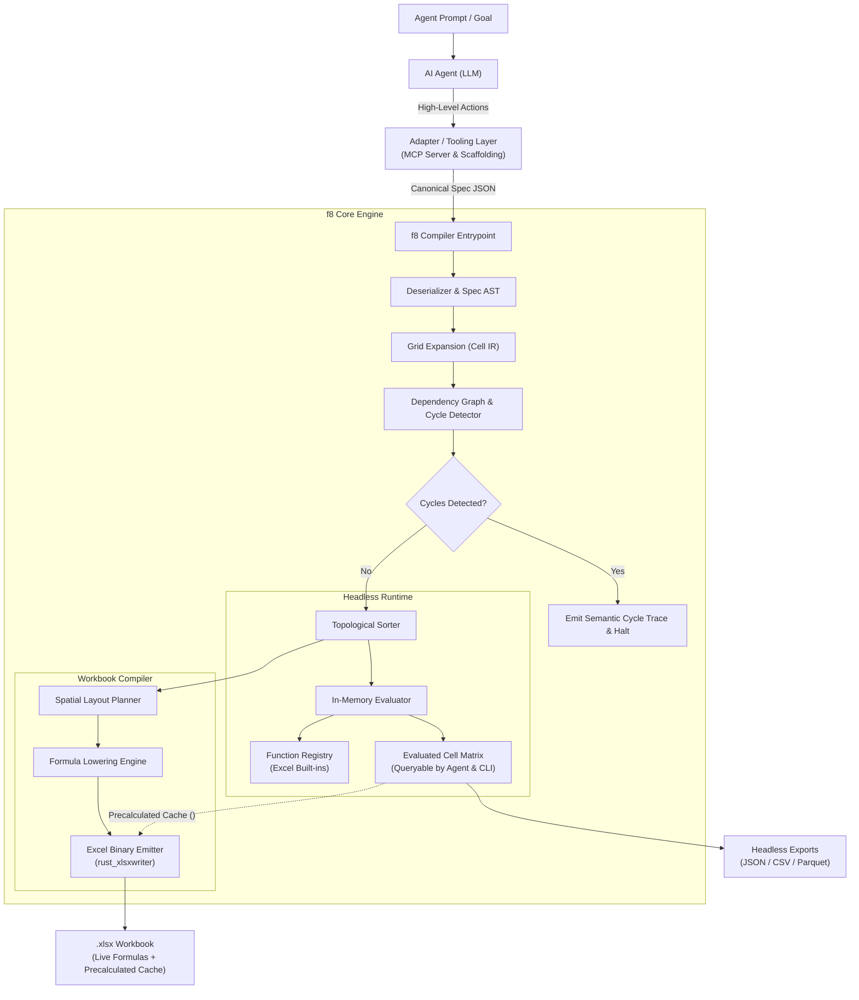
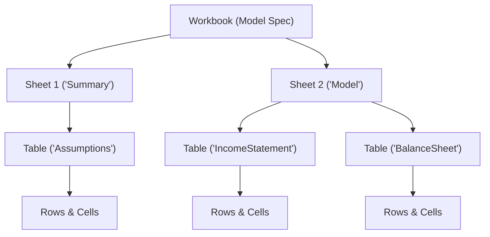

# Architecture Overview

f8 is a deterministic compiler for financial models that treats spreadsheets as compiled artifacts rather than source code.

## 1. Core Philosophy

Traditional financial modeling conflates business logic, multi-dimensional time series, and 2D spatial presentation inside Excel. f8 establishes a **"TypeScript for Spreadsheets"** paradigm:

- **Code is single source of truth**: Models are defined in structured, declarative JSON project specifications (`f8.json` + `tables/*.json`).
- **Explicit, minimal core data structures**: The compiler core enforces strict predictability with only one canonical way to represent any concept. Core data structures contain zero implicit behavior, hidden defaults, or magic inferences. Authoring ergonomics and conveniences are strictly deferred to outer adapters and tooling layers.
- **Agent-first intermediate representation (IR)**: The specification schema is an explicit, orthogonal 2D matrix IR optimized for AI agent synthesis and deterministic compiler verification rather than human typing brevity. Ergonomics, domain scaffolding, and high-level abstractions reside in the **Adapter / Tooling Layer (CLI, MCP server, and Web/WASM adapters)**, keeping the core data model strictly orthogonal, uniform, and free of special-case syntactic magic.
- **Universal, WASM-ready engine**: The calculation core (`f8-core`) is strictly decoupled from operating system I/O. It compiles to both native targets and WebAssembly (`wasm32-unknown-unknown`), powering local CLI terminal workflows, stdio/HTTP MCP agent servers, and client-side web applications with in-memory `.xlsx` generation. All filesystem I/O (manifest/theme disk loading and file writes) is strictly confined to outer adapter crates (`f8-cli`), keeping the core 100% in-memory.
- **Orthogonal 2D matrix paradigm**: A table is a general $R \times C$ matrix. Columns are user-defined and can represent timelines, categories, units, assumptions, or multi-directional metrics (Cap Tables, Comps, Sensitivity matrices, Vertical waterfalls). Every cell $(row, col)$ is a full calculation citizen addressable via `Table[row, col]`.
- **Excel is an uneditable compile artifact**: Emitted `.xlsx` workbooks contain live, auditable formulas and formatting, functioning like compiled binaries or PDF reports.
- **Deterministic compilation**: A Rust engine validates schemas, constructs cell-level dependency graphs, proves acyclicity, plans 2D layouts, and lowers semantic formulas to concrete Excel grid coordinates.

---

## 2. Compilation & Evaluation Pipeline

The pipeline operates across six primary passes:

1. **Ingest & Parse**: Deserializes specifications and validates sheet/table invariants. Fails fast on duplicate sheet/table/axis names, invalid format options, or malformed themes.
2. **Grid Expansion & Formula Parsing**: Expands table rows across defined columns into discrete cell intermediate representations (`CellId`) and parses formula expressions into AST nodes. Validates specificity lattice conflicts and verifies required cell inputs.
3. **Dependency Graph & SCC**: Resolves semantic table/row/col references across all formula ASTs, constructs a directed dependency graph, and executes Tarjan's Strongly Connected Components (SCC) algorithm to enforce a pure Directed Acyclic Graph (DAG).
4. **Topological Evaluation**: Executes the DAG in topological order using the `FunctionRegistry`, computing in-memory cell values with exact Excel parity (`CellValue::Error` on Excel formula errors).
5. **Spatial Layout Planning**: Arranges tables onto sheets with margins, inter-table gutters, section headers, and freeze panes. Computes physical grid coordinates, arbitrates sheet-wide column widths and row heights using theme metrics, and generates a deterministic `LayoutMap` with semantic style roles.
6. **Formula Lowering & Emission**: Resolves semantic labels to concrete cell coordinates (`$A$1` / `A1`), translates theme styles, and writes standard `.xlsx` files via `rust_xlsxwriter`. Formulas are emitted alongside precalculated in-memory results in the cell cache, enabling instant viewing in third-party tools (Apple Numbers, Quick Look, Google Drive, pandas) without waiting for Excel recalculation, with optional values-only freezing.

### Unified Inspection Facade (`CompiledModel`)

To power fast headless introspection across outer interfaces (`f8-cli`, `f8-mcp`) without re-running compiler passes, `f8-core` exposes a unified `CompiledModel` artifact. It consolidates all compilation pass artifacts into a single in-memory structure:
- **Project & Theme**: The parsed `ProjectManifest`, `Vec<TableSpec>`, and resolved `Theme`.
- **Symbols & Cells**: The expanded `SymbolTable` and `CellGrid` (retaining full cell metadata, formats, and ASTs).
- **Graph & Values**: The validated `DependencyGraph` (providing topological order, incoming dependencies, and outgoing blast-radius dependents) and calculated `EvaluatedModel`.
- **Layout & Formulas**: The physical 2D `LayoutMap` (sheet coordinates and column width metrics) and `LoweredFormulaMap` (Excel A1 formulas).

`CompiledModel` exposes pure in-memory inspection and emission methods:
- `emit_workbook(options)`: Directly generates standard `.xlsx` byte buffers (`Vec<u8>`).
- `inspect_cell(table, row, col)`: Returns cell values, formats, formula ASTs, lowered Excel formulas, physical addresses, and direct/transitive edges.
- `table_matrix(table)`: Emits 2D grids of evaluated values, formula expressions, or stacked auditing pairs.
- `precedents_of(cell, recursive)` / `dependents_of(cell, recursive)`: Queries upstream dependencies and downstream blast radius.

---

## 3. Structural Hierarchy

Models follow a four-tier container model mirroring Excel:

- **Workbook**: Root container defining global metadata, themes, and sheet ordering.
- **Sheets**: Visual tab containers managing freeze panes, gridline visibility, and vertical table placement.
- **Tables**: Two-dimensional named matrices indexed by `[RowKey, ColKey]`. Table names must be globally unique across the workbook.
- **Cells**: Individual addressable calculation nodes uniquely identified by `(TableId, RowId, ColId)`.

---

## 4. 3-Tier Separation of Concerns

The architecture strictly decouples semantic identity, visual presentation, and physical grid location:

| Tier                          | Table Axis                  | Row Axis                                            | Column Axis                | Responsibility                               | Mutability                                 |
| :---------------------------- | :-------------------------- | :-------------------------------------------------- | :------------------------- | :------------------------------------------- | :----------------------------------------- |
| **1. Identity (`id`)**        | `id: "IncomeStatement"`     | `id: "revenue"`                                     | `id: "2024E"`              | Logic, formulas, AST nodes, dependency graph | Immutable programmatic identifier          |
| **2. Presentation**           | `title: "Income Statement"` | Descriptor cell (`line_item: "Total Net Revenue"`) | `headers: ["2024 (Forecast)"]` | Display labels in headers and stubs          | Editable anytime without breaking formulas |
| **3. Physical Grid**          | Sheet assignment            | Row offset                                          | Column offset              | Concrete Excel coordinates (`C10`, `$B$4`)   | Automatically assigned by layout engine    |

Modifying presentation labels, formatting rules, or table placement never invalidates logic or dependencies.

### Core Compiler vs. Adapter / Tooling Layer

To preserve both mathematical purity in the compiler and high authoring speed for AI agents, f8 strictly partitions responsibilities:

- **Core Compiler (Intermediate Representation)**:
  - Operates purely in-memory with zero filesystem access; emits byte buffers directly via `Compiler::emit_workbook`.
  - Treats tables strictly as orthogonal 2D matrices ($R \times C$) of addressable cells `Table[row, col]`.
  - Enforces explicit, unambiguous JSON schemas without implicit broadcasting or hidden layout side effects.
  - Validates driver inputs during IR expansion, pinpointing any unassigned coordinates.
  - Exposes a unified inspection facade (`CompiledModel`) containing evaluated values, DAG dependencies, layout mappings, and lowered formulas.
  - Remains completely agnostic to table shapes (3-statement models, Cap Tables, Comps, Sensitivity matrices, and Vertical waterfalls share the exact same primitive data structures).
- **Adapter / Tooling Layer (CLI & MCP Server)**:
  - Acts as the ergonomic bridge between humans, AI agents, and the core compiler.
  - Handles all operating system and filesystem I/O (manifest/theme loading from disk, `.xlsx` file persistence).
  - Exposes high-level commands and tools (e.g. project initialization, fast verification, cell/table inspection, blast-radius queries).
  - Absorbs repetitive templates (such as statement line-item structures and timeline columns) without complicating compiler invariants.

---

## 5. Architectural Invariants

- **Pure DAG compliance**: Circular references are strictly prohibited in V1, complying with the FAST Standard (Section 2.01).
- **Tarjan SCC firewall**: Any detected cyclic dependency immediately halts compilation with an exact semantic trace (`CellA -> CellB -> CellA`).
- **Closed-form financial modeling**: Simultaneous equations (such as revolver interest sweeps) use exact algebraic closed forms rather than iterative Excel calculations.
- **Zero magic in core representations**: Core AST and IR structures never perform implicit type coercion, implicit broadcasting, or dynamic fallback heuristics. Every transformation and calculation path is explicit and singular.
- **Deterministic output**: Identical input specifications produce bit-for-bit reproducible formula layouts.

---

## 6. Technology Stack

| Component                | Technology                          | Purpose                                                               |
| :----------------------- | :---------------------------------- | :-------------------------------------------------------------------- |
| **Data deserialization** | `serde`, `serde_json`               | Type-safe schema validation and project ingestion                     |
| **Formula parser**       | Native Lexer & Pratt parser         | Parsing formula expressions into AST representations                  |
| **Graph engine**         | `petgraph`                          | Directed dependency graph, topological sort, cycle isolation          |
| **In-memory evaluator**  | Native Rust engine                  | Topological DAG execution with 100% Excel calculation parity          |
| **Function catalog**     | Extensible registry pattern         | Single source of truth for Excel built-in functions                   |
| **Workbook emitter**     | `rust_xlsxwriter`                   | Fast generation of native `.xlsx` files with live formulas and styles |
| **CLI framework**        | `clap`                              | Command-line interface for human developers                           |
| **Agent protocol**       | Stdio JSON-RPC (`rmcp`) (Planned)   | Model Context Protocol server for AI agents                           |

---

## 7. Subsystem Documentation

Detailed specifications and engine designs are organized into dedicated topics:

- **End-to-end workflow**:
  - [Model Authoring Guide](./authoring-guide.md): Practical walkthrough for authoring financial models from scratch.
- **System and codebase**:
  - [Codebase Structure](./codebase-structure.md): Directory layout, module boundaries, architectural layers, and dependency rules.
- **DSL and specifications**:
  - [Specification Format & 2D Grid](./dsl/spec-format.md): Multi-file JSON schemas, table structure, gutters, and multi-tier headers.
  - [Addressing Syntax](./dsl/addressing.md): Reference syntax, active coordinates (`@col`, `@row`), temporal offsets, and slicing.
  - [Formula Grammar](./dsl/grammar.md): Formal EBNF grammar and operator precedence.
  - [Semantic Formatting & Themes](./dsl/formatting.md): Semantic format presets, conflict resolution, and pluggable themes.
  - [Modeling Patterns & Archetypes](./dsl/patterns.md): Canonical 2D patterns (horizontal statements, cap tables, comps, debt schedules).
- **Compiler internals**:
  - [Intermediate Representation (IR)](./compiler/ir.md): Cell-level IR, 2D Specificity Resolution Lattice, and grid expansion.
  - [Dependency Graph](./compiler/dependency-graph.md): Tarjan SCC analysis, cycle prevention, and FAST standard rules.
  - [In-Memory Evaluator](./compiler/evaluator.md): Topological DAG evaluation, `CellValue` model, and runtime execution loop.
  - [Excel Parity & Semantics](./compiler/parity.md): Precision, coercion asymmetry, date day counts, and vectorization.
  - [Spatial Layout Planning](./compiler/spatial-layout.md): 2D table stacking, headers, gutters, and freeze panes.
  - [Formula Lowering & Emission](./compiler/lowering-and-emission.md): Coordinate lowering, `.xlsx` binary emission, and headless exports.
- **Function subsystem**:
  - [Function Registry Architecture](./functions/registry.md): `ExcelFunction` trait, parameter contracts, and compiler lifecycle.
  - [Standard Function Catalog](./functions/catalog.md): Supported V1 Excel built-ins, signatures, and calculation behaviors.
- **Interfaces & Scaffolding**:
  - [Command-Line Interface (CLI)](./interfaces/cli.md): Terminal tool for human modeling, verification, and agent scripting.
  - [Software Development Kits (SDK)](./interfaces/sdk.md): Native Python and TypeScript SDKs for programmatic modeling, data science interop, and agent automation.
