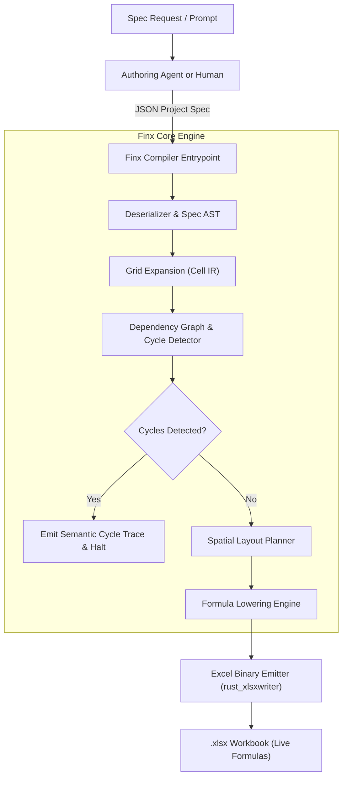
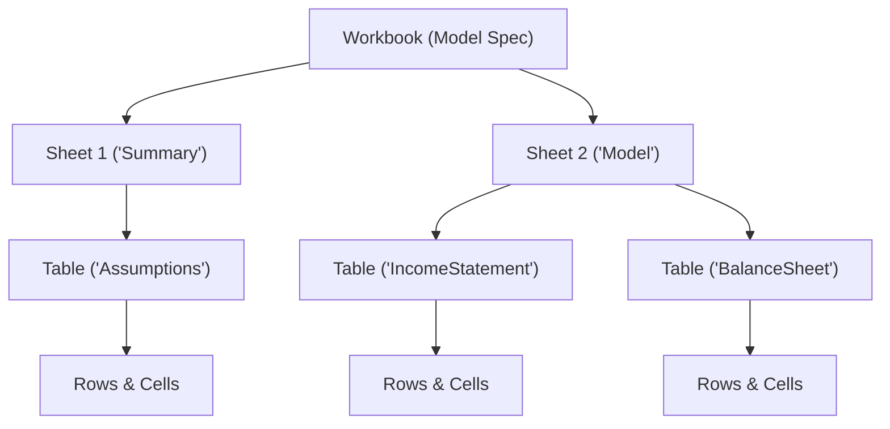

# Architecture Overview

Finx is a deterministic compiler for financial models that treats spreadsheets as compiled artifacts rather than source code.

## 1. Core Philosophy

Traditional financial modeling conflates business logic, multi-dimensional time series, and 2D spatial presentation inside Excel. Finx establishes a **"TypeScript for Spreadsheets"** paradigm:

- **Code is single source of truth**: Models are defined in structured, declarative JSON project specifications (`finx.json` + `tables/*.json`).
- **Excel is an uneditable compile artifact**: Emitted `.xlsx` workbooks contain live, auditable formulas and formatting, functioning like compiled binaries or PDF reports.
- **Deterministic compilation**: A Rust engine validates schemas, constructs cell-level dependency graphs, proves acyclicity, plans 2D layouts, and lowers semantic formulas to concrete Excel grid coordinates.

---

## 2. Compilation Pipeline

The pipeline operates across five primary passes:

1. **Ingest & Parse**: Deserializes specifications and parses formula expressions into AST nodes.
2. **Grid Expansion**: Expands table rows across defined columns into discrete cell-level intermediate representation (`CellId`).
3. **Dependency Graph & SCC**: Constructs a directed dependency graph and executes Tarjan's Strongly Connected Components (SCC) algorithm to enforce a pure Directed Acyclic Graph (DAG).
4. **Spatial Layout Planning**: Arranges tables onto sheets with automated spacing, gutter planning, and freeze panes.
5. **Formula Lowering & Emission**: Resolves semantic labels to concrete cell coordinates (`$A$1` / `A1`) and writes standard `.xlsx` files.

---

## 3. Structural Hierarchy

Models follow a four-tier container model mirroring Excel:

- **Workbook**: Root container defining global metadata, themes, and sheet ordering.
- **Sheets**: Visual tab containers managing freeze panes, gridline visibility, and vertical table placement.
- **Tables**: Two-dimensional named matrices indexed by `[RowKey, ColKey]`. Table names must be globally unique across the workbook.
- **Cells**: Individual addressable calculation nodes uniquely identified by `(TableId, RowId, ColId)`.

---

## 4. 3-Tier Separation of Concerns

The architecture strictly decouples semantic identity, visual presentation, and physical grid location:

| Tier                          | Table Axis                  | Row Axis                          | Column Axis                | Responsibility                               | Mutability                                 |
| :---------------------------- | :-------------------------- | :-------------------------------- | :------------------------- | :------------------------------------------- | :----------------------------------------- |
| **1. Identity (`id`)**        | `id: "IncomeStatement"`     | `id: "revenue"`                   | `id: "2024E"`              | Logic, formulas, AST nodes, dependency graph | Immutable programmatic identifier          |
| **2. Presentation (`label`)** | `title: "Income Statement"` | `label: "Total Net Revenue ($M)"` | `label: "2024 (Forecast)"` | Display labels in headers and stubs          | Editable anytime without breaking formulas |
| **3. Physical Grid**          | Sheet assignment            | Row offset                        | Column offset              | Concrete Excel coordinates (`C10`, `$B$4`)   | Automatically assigned by layout engine    |

Modifying presentation labels, formatting rules, or table placement never invalidates logic or dependencies.

---

## 5. Architectural Invariants

- **Pure DAG compliance**: Circular references are strictly prohibited in V1, complying with the FAST Standard (Section 2.01).
- **Tarjan SCC firewall**: Any detected cyclic dependency immediately halts compilation with an exact semantic trace (`CellA -> CellB -> CellA`).
- **Closed-form financial modeling**: Simultaneous equations (such as revolver interest sweeps) use exact algebraic closed forms rather than iterative Excel calculations.
- **Deterministic output**: Identical input specifications produce bit-for-bit reproducible formula layouts.

---

## 6. Technology Stack

| Component                | Technology                          | Purpose                                                               |
| :----------------------- | :---------------------------------- | :-------------------------------------------------------------------- |
| **Data deserialization** | `serde`, `serde_json`               | Type-safe schema validation and project ingestion                     |
| **Formula parser**       | `winnow`                            | Pratt-parsing formula expressions into AST representations            |
| **Graph engine**         | `petgraph`                          | Directed dependency graph, topological sort, cycle isolation          |
| **Workbook emitter**     | `rust_xlsxwriter`                   | Fast generation of native `.xlsx` files with live formulas and styles |
| **CLI framework**        | `clap`                              | Command-line interface for human developers                           |
| **Agent protocol**       | Stdio JSON-RPC (`rmcp`)             | Model Context Protocol server for AI agents                           |

---

## 7. Subsystem Documentation

Detailed specifications and engine designs are organized into dedicated topics:

- **DSL & Authoring**:
  - [Addressing Syntax](dsl/addressing.md): Reference syntax, active period (`[@]`), temporal offsets, and slicing.
  - [Formula Grammar](dsl/grammar.md): Formal EBNF grammar and operator precedence.
  - [Specification Format](dsl/spec-format.md): Multi-file JSON schema, table modularity, match partitioning, and project examples.
- **Compiler Internals**:
  - [Intermediate Representation (IR)](compiler/ir.md): Cell-level IR, `CellId` structure, and grid expansion.
  - [Dependency Graph](compiler/dependency-graph.md): Tarjan SCC analysis, cycle prevention, and FAST standard rules.
  - [Layout & Lowering](compiler/layout-and-lowering.md): Spatial table stacking, coordinate translation, and formula lowering.
- **Interfaces**:
  - [CLI](interfaces/cli.md): Command-line interface (in design).
  - [Model Context Protocol (MCP)](interfaces/mcp.md): Agent interface via Model Context Protocol (in design).
