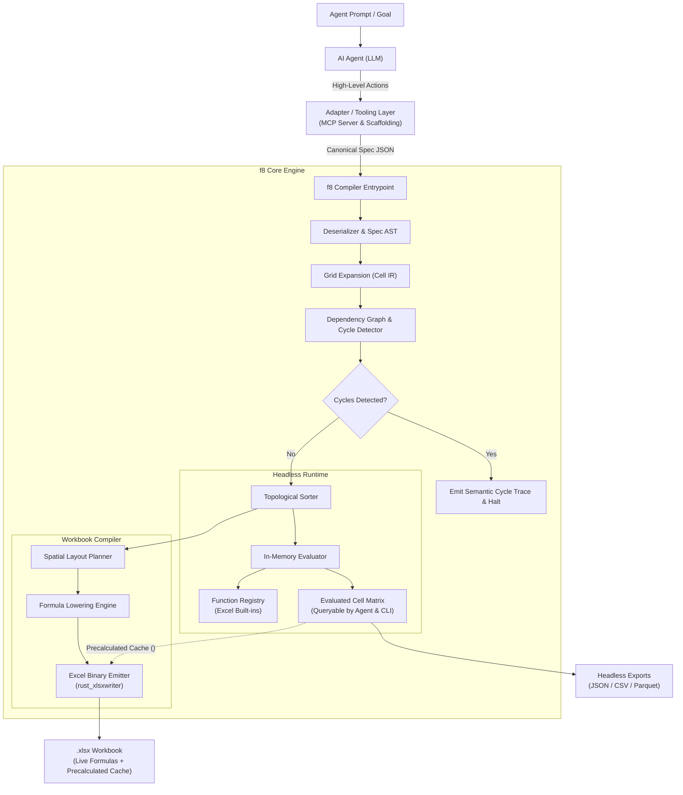
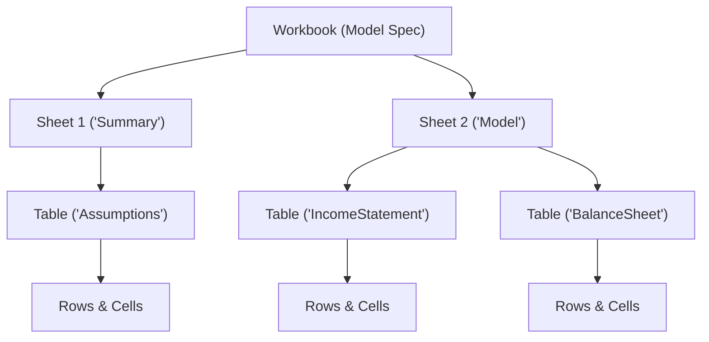
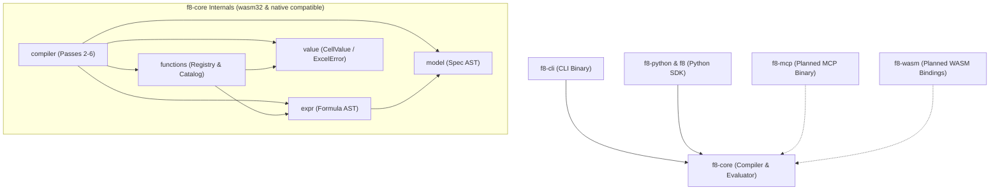

# Architecture Overview

f8 is a deterministic compiler for financial models that treats spreadsheets as compiled artifacts rather than source code.

## 1. Core Philosophy

Traditional financial modeling conflates business logic, multi-dimensional time series, and 2D spatial presentation inside Excel. f8 establishes a **"TypeScript for Spreadsheets"** paradigm:

- **Code is single source of truth**: Models are defined in structured, declarative JSON project specifications (`f8.json` + `tables/*.json`).
- **Explicit, minimal core data structures**: The compiler core enforces strict predictability with only one canonical way to represent any concept. Core data structures contain zero implicit behavior, hidden defaults, or magic inferences. Authoring ergonomics and conveniences are strictly deferred to outer adapters and tooling layers.
- **Agent-first intermediate representation (IR)**: The specification schema is an explicit, orthogonal 2D matrix IR optimized for AI agent synthesis and deterministic compiler verification rather than human typing brevity. Ergonomics, domain scaffolding, and high-level abstractions reside in the **Adapter / Tooling Layer (CLI, Python SDK, MCP server, and Web/WASM adapters)**, keeping the core data model strictly orthogonal, uniform, and free of special-case syntactic magic.
- **Universal, WASM-ready engine**: The calculation core (`f8-core`) is strictly decoupled from operating system I/O. It compiles to both native targets and WebAssembly (`wasm32-unknown-unknown`), powering local CLI terminal workflows, the Python SDK, stdio/HTTP MCP agent servers, and client-side web applications with in-memory `.xlsx` generation. All filesystem I/O (manifest/theme disk loading and file writes) is strictly confined to outer adapters (`f8-cli`, `f8` Python package), keeping the core 100% in-memory.
- **Orthogonal 2D matrix paradigm**: A table is a general $R \times C$ matrix. Columns are user-defined and can represent timelines, categories, units, assumptions, or multi-directional metrics (Cap Tables, Comps, Sensitivity matrices, Vertical waterfalls). Every cell $(row, col)$ is a full calculation citizen addressable via `Table[row, col]`.
- **Excel is an uneditable compile artifact**: Emitted `.xlsx` workbooks contain live, auditable formulas and formatting, functioning like compiled binaries or PDF reports.
- **Deterministic compilation**: A Rust engine validates schemas, constructs cell-level dependency graphs, proves acyclicity, plans 2D layouts, and lowers semantic formulas to concrete Excel grid coordinates.

---

## 2. Compilation & Evaluation Pipeline



The pipeline operates across six primary passes:

1. **Ingest & Parse**: Deserializes specifications and validates sheet/table invariants. Fails fast on duplicate sheet/table/axis names, invalid format options, or malformed themes.
2. **Grid Expansion & Formula Parsing**: Expands table rows across defined columns into discrete cell intermediate representations (`CellId`) and parses formula expressions into AST nodes. Validates specificity lattice conflicts and verifies required cell inputs.
3. **Dependency Graph & SCC**: Resolves semantic table/row/col references across all formula ASTs, constructs a directed dependency graph, and executes Tarjan's Strongly Connected Components (SCC) algorithm to enforce a pure Directed Acyclic Graph (DAG).
4. **Topological Evaluation**: Executes the DAG in topological order using the `FunctionRegistry`, computing in-memory cell values with exact Excel parity (`CellValue::Error` on Excel formula errors).
5. **Spatial Layout Planning**: Arranges tables onto sheets with margins, inter-table gutters, section headers, and freeze panes. Computes physical grid coordinates, arbitrates sheet-wide column widths and row heights using theme metrics, and generates a deterministic `LayoutMap` with semantic style roles.
6. **Formula Lowering & Emission**: Resolves semantic labels to concrete cell coordinates (`$A$1` / `A1`), translates theme styles, and writes standard `.xlsx` files via `rust_xlsxwriter`. Formulas are emitted alongside precalculated in-memory results in the cell cache, enabling instant viewing in third-party tools (Apple Numbers, Quick Look, Google Drive, pandas) without waiting for Excel recalculation, with optional values-only freezing.

### Unified Inspection Facade (`CompiledModel`)

To power fast headless introspection across outer interfaces (`f8-cli`, `f8-mcp`) without re-running compiler passes, `f8-core` exposes a unified `CompiledModel` artifact. It consolidates all compilation pass artifacts into a single in-memory structure:
- **Project & Theme**: The parsed `ProjectManifest`, `Vec<TableSpec>`, and resolved `Theme`.
- **Symbols & Cells**: The expanded `SymbolTable` and `CellGrid` (retaining full cell metadata, formats, and ASTs).
- **Graph & Values**: The validated `DependencyGraph` (providing topological order, incoming dependencies, and outgoing blast-radius dependents) and calculated `EvaluatedModel`.
- **Layout & Formulas**: The physical 2D `LayoutMap` (sheet coordinates and column width metrics) and `LoweredFormulaMap` (Excel A1 formulas).

`CompiledModel` exposes pure in-memory inspection and emission methods:
- `emit_workbook(options)`: Directly generates standard `.xlsx` byte buffers (`Vec<u8>`).
- `inspect_cell(table, row, col)`: Returns cell values, formats, formula ASTs, lowered Excel formulas, physical addresses, and direct/transitive edges.
- `table_matrix(table)`: Emits 2D grids of evaluated values, formula expressions, or stacked auditing pairs.
- `precedents_of(cell, recursive)` / `dependents_of(cell, recursive)`: Queries upstream dependencies and downstream blast radius.

---

## 3. Structural Hierarchy

Models follow a four-tier container model mirroring Excel:



- **Workbook**: Root container defining global metadata, themes, and sheet ordering.
- **Sheets**: Visual tab containers managing freeze panes, gridline visibility, and vertical table placement.
- **Tables**: Two-dimensional named matrices indexed by `[RowKey, ColKey]`. Table names must be globally unique across the workbook.
- **Cells**: Individual addressable calculation nodes uniquely identified by `(TableId, RowId, ColId)`.

---

## 4. 3-Tier Separation of Concerns

The architecture strictly decouples semantic identity, visual presentation, and physical grid location:

| Tier                          | Table Axis                  | Row Axis                                            | Column Axis                | Responsibility                               | Mutability                                 |
| :---------------------------- | :-------------------------- | :-------------------------------------------------- | :------------------------- | :------------------------------------------- | :----------------------------------------- |
| **1. Identity (`id`)**        | `id: "IncomeStatement"`     | `id: "revenue"`                                     | `id: "2024E"`              | Logic, formulas, AST nodes, dependency graph | Immutable programmatic identifier          |
| **2. Presentation**           | `title: "Income Statement"` | Descriptor cell (`line_item: "Total Net Revenue"`) | `headers: ["2024 (Forecast)"]` | Display labels in headers and stubs          | Editable anytime without breaking formulas |
| **3. Physical Grid**          | Sheet assignment            | Row offset                                          | Column offset              | Concrete Excel coordinates (`C10`, `$B$4`)   | Automatically assigned by layout engine    |

Modifying presentation labels, formatting rules, or table placement never invalidates logic or dependencies.

### Core Compiler vs. Adapter / Tooling Layer

To preserve both mathematical purity in the compiler and high authoring speed for AI agents, f8 strictly partitions responsibilities:

- **Core Compiler (Intermediate Representation)**:
  - Operates purely in-memory with zero filesystem access; emits byte buffers directly via `Compiler::emit_workbook`.
  - Treats tables strictly as orthogonal 2D matrices ($R \times C$) of addressable cells `Table[row, col]`.
  - Enforces explicit, unambiguous JSON schemas without implicit broadcasting or hidden layout side effects.
  - Validates driver inputs during IR expansion, pinpointing any unassigned coordinates.
  - Exposes a unified inspection facade (`CompiledModel`) containing evaluated values, DAG dependencies, layout mappings, and lowered formulas.
  - Remains completely agnostic to table shapes (3-statement models, Cap Tables, Comps, Sensitivity matrices, and Vertical waterfalls share the exact same primitive data structures).
- **Adapter / Tooling Layer (CLI, Python SDK & MCP Server)**:
  - Acts as the ergonomic bridge between humans, AI agents, and the core compiler.
  - Handles all operating system and filesystem I/O (manifest/theme loading from disk, `.xlsx` file persistence, multi-file export).
  - Exposes high-level commands, Python modeling DSL, and inspection tools (e.g. project initialization, fast verification, cell/table inspection, blast-radius queries).
  - Absorbs repetitive templates (such as statement line-item structures and timeline columns) without complicating compiler invariants.

---

## 5. Architectural Invariants

- **Pure DAG compliance**: Circular references are strictly prohibited in V1, complying with the FAST Standard (Section 2.01).
- **Tarjan SCC firewall**: Any detected cyclic dependency immediately halts compilation with an exact semantic trace (`CellA -> CellB -> CellA`).
- **Closed-form financial modeling**: Simultaneous equations (such as revolver interest sweeps) use exact algebraic closed forms rather than iterative Excel calculations.
- **Zero magic in core representations**: Core AST and IR structures never perform implicit type coercion, implicit broadcasting, or dynamic fallback heuristics. Every transformation and calculation path is explicit and singular.
- **Deterministic output**: Identical input specifications produce bit-for-bit reproducible formula layouts.

---

## 6. Technology Stack

| Component                | Technology                          | Purpose                                                               |
| :----------------------- | :---------------------------------- | :-------------------------------------------------------------------- |
| **Data deserialization** | `serde`, `serde_json`               | Type-safe schema validation and project ingestion                     |
| **Formula parser**       | Native Lexer & Pratt parser         | Parsing formula expressions into AST representations                  |
| **Graph engine**         | `petgraph`                          | Directed dependency graph, topological sort, cycle isolation          |
| **In-memory evaluator**  | Native Rust engine                  | Topological DAG execution with 100% Excel calculation parity          |
| **Function catalog**     | Extensible registry pattern         | Single source of truth for Excel built-in functions                   |
| **Workbook emitter**     | `rust_xlsxwriter`                   | Fast generation of native `.xlsx` files with live formulas and styles |
| **CLI framework**        | `clap`                              | Command-line interface for human developers and shell agents          |
| **Python SDK & bridge**  | `pyo3`, `maturin`, `pythonize`      | Native C-extension, fluent modeling DSL, and in-process execution     |
| **Agent protocol**       | Stdio JSON-RPC (`rmcp`) (Planned)   | Model Context Protocol server for AI agents                           |

---

## 7. Workspace & Crate Architecture

The codebase is organized as a Cargo Workspace separating the mathematical compiler core from outer interface binaries and distribution packages:

```text
f8/
├── Cargo.toml                  # Workspace root: shared dependencies and lints
├── crates/
│   ├── f8-core/                # Pure calculation compiler & Intermediate Representation (IR)
│   │   └── src/
│   │       ├── model/          # Specification AST, manifest I/O, & schema validation
│   │       ├── expr/           # Formula expression AST & Pratt parser
│   │       ├── value/          # Runtime values (CellValue, ExcelError) & parity rules
│   │       ├── functions/      # Excel function registry, trait, & catalog
│   │       └── compiler/       # Core 6 passes (IR -> Graph -> Eval -> Layout -> Lowering -> Emission)
│   │
│   ├── f8-cli/                 # Command-line interface binary (clap)
│   │   └── src/                # CLI subcommands (init, check, compile, inspect)
│   │
│   └── f8-python/              # Native C-extension PyO3 bindings (abi3-py312)
│       └── src/                # In-process compiler bridge, Serde marshaling, & error mapping
│
├── python/                     # Python package (uv / maturin)
│   └── f8/                     # Fluent modeling DSL, loader, inspection protocols, & bundled agent skills
│
├── docs/                       # High-level architecture, 2D matrix DSL reference, & CLI guide
└── specs/                      # Spec-driven development (living specs, drafts, & history)
```

### Dependency Rules

To prevent circular dependencies and maintain clean boundaries across workspace crates:



- **Acyclic hierarchy**: `f8-core` is strictly leaf-level. It never depends on outer interface crates (`f8-cli`, `f8-python`, `f8-mcp`, `f8-wasm`).
- **I/O-agnostic pure core**: `f8-core` performs pure in-memory computations with zero direct filesystem I/O (`std::fs`). Manifest and theme loading from disk, directory discovery, and workbook file saving are strictly performed by outer adapters (`f8-cli`, `f8` Python package loader/exporter).
- **Embedded archetype assets**: Built-in institutional templates are compiled directly into outer interface binaries as static assets (`include_str!`), ensuring single-binary portability and eliminating runtime path-discovery failures.

---

## 8. Multi-Target Distribution & Phased Roadmap

### WASM-Ready Core Architecture

The compiler core is designed from day one to support both native operating systems and `wasm32-unknown-unknown`:
- **Zero OS dependencies**: Core dependencies (`indexmap`, `petgraph`, `serde`, `serde_json`, `thiserror`) compile cleanly to WebAssembly.
- **In-memory workbook emission**: `rust_xlsxwriter` natively supports in-memory byte buffer generation via `save_to_buffer()`, enabling `.xlsx` exports in browser environments without disk access.
- **Predictable execution**: Headless in-memory evaluation runs synchronously at 60 FPS in interactive frontends.

### Delivery Roadmap

1. **Phase 1: Unified Inspection Facade (`CompiledModel` in `f8-core`)** [Delivered]:
   - Consolidate all compilation pass artifacts into the unified `CompiledModel` facade (`SymbolTable`, `CellGrid`, `DependencyGraph`, `EvaluatedModel`, `LayoutMap`, `LoweredFormulaMap`).
   - Pure in-memory query APIs (`inspect_cell`, `table_matrix`, `precedents_of`, `dependents_of`).
2. **Phase 2: Local Command-Line Interface (`f8-cli`)** [Delivered]:
   - Built `f8 init`, `f8 check`, `f8 compile` (`-o`, `--values-only`), and `f8 inspect` (`summary`, `sheet`, `table`, `cell`, `precedents`, `dependents`) on top of `CompiledModel`.
3. **Phase 3: Python SDK & Native Extension (`f8-python` / `f8`)** [Delivered]:
   - PyO3 native extension bridge (`crates/f8-python`) with stable ABI (`abi3-py312`).
   - Fluent modeling DSL (`f8.Model`, `Sheet`, `Table`, `Cell`) with PEP 561 static typing and bundled agent modeling skill (`f8.skills.f8-modeling`).
   - In-memory compilation, inspection facade (`TableAuditor`), and bidirectional project serialization (`export_project`, `compile_project`).
4. **Phase 4: Model Context Protocol Server (`f8-mcp`, Planned)**:
   - Introduce `crates/f8-mcp` using JSON-RPC stdio / streamable HTTP.
   - Wrap core inspection, scaffolding, and validation routines as typed MCP tools for chat-only AI agents.
5. **Phase 5: WebAssembly & Web Application (`f8-wasm`, Planned)**:
   - Expose `f8-core` via `wasm-bindgen` for client-side evaluation in browser environments.

---

## 9. Documentation Map

Documentation is strictly organized into distinct, non-overlapping categories:

- **Product Philosophy & DSL Reference (`docs/`)**:
  - [Architecture Overview](./architecture.md): High-level mental model, pipeline passes, and crate topology.
  - [CLI & JSON Authoring Guide](./cli-authoring-guide.md): Walkthrough for authoring models via direct JSON and terminal CLI workflows.
  - [Specification Format & 2D Grid](./dsl/spec-format.md): Declarative multi-file JSON schemas, table structure, gutters, and multi-tier headers.
  - [Addressing Syntax](./dsl/addressing.md): Reference syntax, active coordinates (`@col`, `@row`), temporal offsets (`col.prev`), and slicing.
  - [Formula Grammar](./dsl/grammar.md): Formal EBNF grammar and operator precedence.
  - [Semantic Formatting & Themes](./dsl/formatting.md): Semantic format presets, conflict resolution, and pluggable themes.
  - [Modeling Patterns & Archetypes](./dsl/patterns.md): Canonical 2D patterns (horizontal statements, cap tables, comps, debt schedules).
  - [Standard Function Catalog](./functions/catalog.md): Supported V1 Excel built-ins, signatures, and calculation behaviors.
- **Python Modeling Reference (`python/f8/skills/f8-modeling/`)**:
  - Bundled directly inside the `f8` package wheel for AI agents and human modelers.
  - [`SKILL.md`](../python/f8/skills/f8-modeling/SKILL.md): Comprehensive financial modeling agent instructions.
  - [`syntax-and-grid.md`](../python/f8/skills/f8-modeling/references/syntax-and-grid.md): Python DSL methods, column roles, and visual styling.
  - [`functions.md`](../python/f8/skills/f8-modeling/references/functions.md): Built-in function reference and formula conventions in Python.
  - [`auditing-and-repair.md`](../python/f8/skills/f8-modeling/references/auditing-and-repair.md): Model auditing, defect diagnosis, and fix workflows.
- **Compiler Subsystem Specifications (`specs/living-specs/`)**:
  - The permanent single source of truth for compiler passes, data contracts, and engine invariants:
    - [Cell IR & Expansion](../specs/living-specs/compiler/cell-ir.md)
    - [Dependency Graph & Cycle Analysis](../specs/living-specs/compiler/dependency-graph.md)
    - [In-Memory Evaluator & Parity](../specs/living-specs/compiler/evaluator.md)
    - [Spatial Layout Planning](../specs/living-specs/compiler/spatial-layout.md)
    - [Formula Lowering](../specs/living-specs/compiler/formula-lowering.md)
    - [Workbook Emission](../specs/living-specs/compiler/workbook-emission.md)
    - [Compiled Model Facade](../specs/living-specs/compiler/compiled-model.md)
    - [Function Registry Architecture](../specs/living-specs/functions/registry.md)
    - [CLI Architecture](../specs/living-specs/interfaces/cli.md)
    - [Python SDK Native Extension](../specs/living-specs/interfaces/python-sdk.md)

