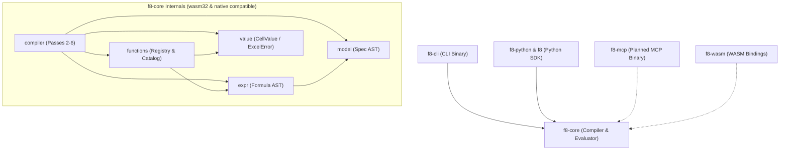

# Codebase Structure

This document outlines the directory layout, module boundaries, and dependency hierarchy of the f8 codebase.

---

## 1. Directory Layout

The codebase is organized as a Cargo Workspace separating the mathematical compiler core from outer interface binaries and embedded institutional templates:

```text
f8/
├── Cargo.toml                  # Workspace root: shared dependencies and lints
├── Cargo.lock
│
├── crates/
│   ├── f8-core/              # Pure calculation compiler & Intermediate Representation (IR)
│   │   ├── src/
│   │   │   ├── lib.rs          # Core library entrypoint and exports
│   │   │   ├── model/          # Specification AST, manifest I/O, & schema validation
│   │   │   ├── expr/           # Formula expression AST & Pratt parser
│   │   │   ├── value/          # Runtime values (CellValue, ExcelError) & parity rules
│   │   │   ├── functions/      # Excel function registry, trait, & catalog
│   │   │   └── compiler/       # Core 6 passes (IR -> Graph -> Eval -> Layout -> Lowering -> Emission)
│   │   └── tests/              # Core compiler pass tests, calculation parity, & model archetypes
│   │
│   ├── f8-cli/               # Command-line interface binary (clap)
│   │   ├── src/                # CLI subcommands (init, check, compile, inspect)
│   │   ├── templates/          # Institutional model archetypes (embedded via include_str!)
│   │   │   ├── three-statement/# Linked IS, BS, CF, and driver assumptions
│   │   │   ├── lbo/            # Transaction assumptions, debt schedules, returns
│   │   │   ├── trading-comps/  # Public SaaS trading comps and valuation multiples
│   │   │   └── cap-table/      # Pre-/post-money ownership and dilution schedule
│   │   └── tests/              # CLI integration tests, argument parsing, & exit code assertions
│   │
│   └── f8-python/            # Native C-extension PyO3 bindings (abi3-py312)
│       └── src/                # In-process compiler bridge, Serde marshaling, & error mapping
│
├── python/                     # Python package (uv / maturin)
│   ├── f8/                   # Fluent modeling DSL, loader, & inspection protocols
│   └── tests/                # Python unit tests & integration fixtures
│
├── docs/                       # High-level strategic architecture & subsystem documentation
└── specs/                      # Spec-driven development (living specs & draft specs)
```

---

## 2. Architectural Layers

### 2.1. Layer 1: Foundational Domain Types & ASTs (`f8-core::model`, `value`, `expr`)

- **`model`**: Declarative project specifications (`f8.json` manifests and `tables/*.json` specs). Performs two-stage validation before compilation. Zero internal dependencies.
- **`expr`**: Pratt parser and AST nodes (`Expr`, `BinaryOp`, `Reference`) implementing [Formula Grammar](./dsl/grammar.md).
- **`value`**: Runtime cell value enum (`CellValue`), Excel domain errors (`ExcelError`), and arithmetic parity rules as defined in [Excel Parity](./compiler/parity.md).

### 2.2. Layer 2: Cross-Cutting Function Subsystem (`f8-core::functions`)

- **`functions`**: Decouples Excel built-in functions from compiler internals:
  - Exposes parameter metadata (`ParameterDef`, arity, variadic rules) for parser validation.
  - Implements runtime calculation (`ExcelFunction::evaluate`) for in-memory evaluation.
  - Implements canonical Excel naming for formula lowering.
  - Re-exports standard catalog categories (math, logical, financial, lookup, datetime).

### 2.3. Core Compiler Passes (`f8-core::compiler`)

Sequential pipeline transforming validated input specs into evaluated matrices and `.xlsx` binaries (following Pass 1 ingest and parse):

- **Pass 2 (`compiler::ir`)**: Expands table rows across declared columns into discrete `CellId` nodes, resolving 2D specificity conflicts and verifying driver coordinates.
- **Pass 3 (`compiler::graph`)**: Builds a directed dependency graph with `petgraph`, verifies zero circularity via Tarjan's SCC, and generates topological ordering. Retains incoming (`dependencies_of`) and outgoing (`dependents_of`) edge indexes for introspection.
- **Pass 4 (`compiler::eval`)**: Traverses the DAG in topological order, executing cells via `functions` to produce an in-memory `EvaluatedModel`.
- **Pass 5 (`compiler::layout`)**: Plans physical 2D grid coordinates, table stacking, headers, gutters, and freeze panes into a `LayoutMap`.
- **Pass 6a (`compiler::lowering`)**: Rewrites semantic AST references into concrete Excel formulas (`=C10-C11` or `='Summary'!$B$4`).
- **Pass 6b (`compiler::emission`)**: Streams spatial layouts, styles, precalculated cell caches, and formulas into in-memory `.xlsx` byte buffers via `rust_xlsxwriter::Workbook::save_to_buffer()`, or serializes headless outputs (JSON/CSV).
- **Inspection Facade (`compiler::CompiledModel`)**: Unified compiler artifact combining `SymbolTable`, `CellGrid`, `DependencyGraph`, `EvaluatedModel`, `LayoutMap`, and `LoweredFormulaMap` to answer `inspect cell`, `inspect precedents`, `inspect dependents`, and `inspect table` queries without re-running passes.

### 2.4. Layer 4: Institutional Templates & Scaffolding (Embedded Assets)

Curated canonical JSON skeletons demonstrating institutional financial modeling best practices, embedded directly into binary artifacts (via `include_str!`):

- **Embedded factory archetypes**: Bundled directly into outer interface binaries (`f8-cli`, `f8-mcp`) to eliminate external directory dependencies, runtime path-lookup failures, and installation asset fragmentation.
- **Institutional layout & formula wiring**: Pre-configured with exact typographic indentation, section groupings, subtotal formatting, and inter-statement formula linkages (e.g. Net Income flowing to Retained Earnings and Cash Flow).
- **"Scaffold-and-Fill" workflow**: Driver cells and historical actuals are omitted or marked as required inputs. The compiler fails fast on unassigned driver cells with exact coordinates (`UnassignedCell`), providing deterministic feedback for agents and analysts to populate.

### 2.5. Layer 5: Interfaces & Distribution Adapters

Outer adapters providing access across diverse execution environments:

- **`f8-cli` (Phase 2)**: Command-line interface powered by `clap` (`init`, `check`, `compile`, `inspect`). Provides direct terminal execution for financial analyst modeling (CFA personal workflow) and autonomous shell-enabled agents (Antigravity, Claude Code, Cursor) with zero protocol friction.
- **`f8-python` & `f8` (Phase 3)**: Native Python C-extension (`crates/f8-python`) and fluent modeling package (`python/f8`). Enables programmatic model building (`Model`, `Sheet`, `Table`, `Cell`), in-process compilation (`CompiledModel`), table inspection (`TableAuditor`), and direct multi-file export/loading (`export_project`, `compile_project`) as documented in [SDK Architecture & Design](./interfaces/sdk.md).
- **`f8-mcp` (Phase 4 Planned)**: Model Context Protocol JSON-RPC server (stdio and streamable HTTP) providing headless compilation, cell/table inspection, blast-radius analysis, and canonical table I/O for chat-only agents (Claude Desktop).
- **`f8-wasm` (Phase 5 Planned)**: WebAssembly bindings via `wasm-bindgen` exposing in-memory compilation and evaluation to browser web apps and TypeScript environments.

---

## 3. Dependency Rules

To prevent circular dependencies and maintain clean boundaries across workspace crates:



- **Acyclic hierarchy**: `f8-core` is strictly leaf-level. It never depends on outer interface crates (`f8-cli`, `f8-python`, `f8-mcp`, `f8-wasm`).
- **I/O-agnostic pure core**: `f8-core` performs pure in-memory computations with zero direct filesystem I/O (`std::fs`). Manifest and theme loading from disk, directory discovery, and workbook file saving are strictly performed by outer adapters (`f8-cli`, `f8` Python package loader/exporter).
- **Embedded archetype assets**: Built-in institutional templates are compiled directly into outer interface binaries as static assets (`include_str!`), ensuring single-binary portability and eliminating runtime path-discovery failures.
- **Pass isolation**: Core compiler passes depend on shared domain types (`model`, `expr`, `value`, `functions`), but do not depend backwards on each other.
- **Direct interface integration**: Outer interfaces (`f8-cli`, `f8-python`, `f8-mcp`, `f8-wasm`) depend directly on `f8-core` for validation, topological evaluation, and compilation.
- **Linear data flow**: Each compiler pass consumes the output of the prior pass as pure, explicit data structures.

---

## 4. Multi-Target Distribution & Phased Roadmap

### 4.1. WASM-Ready Core Architecture

The compiler core is designed from day one to support both native operating systems and `wasm32-unknown-unknown`:
- **Zero OS dependencies**: Core dependencies (`indexmap`, `petgraph`, `serde`, `serde_json`, `thiserror`) compile cleanly to WebAssembly.
- **In-memory workbook emission**: `rust_xlsxwriter` natively supports in-memory byte buffer generation via `save_to_buffer()`, enabling `.xlsx` exports in browser environments without disk access.
- **Predictable execution**: Headless in-memory evaluation runs synchronously at 60 FPS in interactive frontends.

### 4.2. Delivery Roadmap

1. **Phase 1: Unified Inspection Facade (`CompiledModel` in `f8-core`)**:
   - Consolidate all compilation pass artifacts into the unified `CompiledModel` facade (`SymbolTable`, `CellGrid`, `DependencyGraph`, `EvaluatedModel`, `LayoutMap`, `LoweredFormulaMap`).
   - Implement pure in-memory query APIs (`inspect_cell`, `table_matrix`, `precedents_of`, `dependents_of`).
   - Maintain fail-fast, coordinate-rich compiler error reporting with `thiserror`.
2. **Phase 2: Local Command-Line Interface (`f8-cli`)**:
   - Build `f8 init`, `f8 check`, `f8 compile` (`-o`, `--values-only`), and `f8 inspect` (`summary`, `sheet`, `table`, `cell`, `precedents`, `dependents`) on top of `CompiledModel`.
   - Dogfood on personal and institutional financial models (3-statement, LBO, comps) to refine authoring ergonomics.
3. **Phase 3: Python SDK & Native Extension (`f8-python` / `f8`)**:
   - PyO3 native extension bridge (`crates/f8-python`) with stable ABI (`abi3-py312`).
   - Fluent modeling DSL (`f8.Model`, `Sheet`, `Table`, `Cell`) with PEP 561 static typing.
   - In-memory compilation, inspection facade (`TableAuditor`), and bidirectional project serialization (`export_project`, `compile_project`).
4. **Phase 4: Model Context Protocol Server (`f8-mcp`, Planned)**:
   - Introduce `crates/f8-mcp` using JSON-RPC stdio / streamable HTTP.
   - Wrap core inspection, scaffolding, and validation routines as typed MCP tools for chat-only AI agents.
5. **Phase 5: WebAssembly & Web Application (`f8-wasm`, Planned)**:
   - Expose `f8-core` via `wasm-bindgen` for client-side evaluation.
   - Build interactive web spreadsheet visualizers or SaaS integrations.
