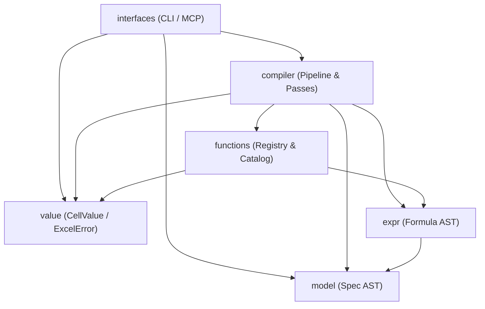

# Codebase Structure

This document outlines the directory layout, module boundaries, and dependency hierarchy of the Finx codebase.

---

## 1. Directory Layout

The codebase is organized into four distinct architectural layers:

```text
src/
├── lib.rs                     # Library entrypoint and module re-exports
├── main.rs                    # Binary entrypoint
│
├── model/                     # Specification AST & schema validation
│   ├── id.rs                  # Programmatic identifier newtypes (TableId, RowId, ColId)
│   ├── format.rs              # Semantic formatting presets (FormatPreset)
│   ├── manifest.rs            # Project manifest schema (ProjectManifest, SheetSpec)
│   ├── table.rs               # Table calculation specification (TableSpec, RowSpec)
│   └── error.rs               # Ingestion diagnostics (ModelError)
│
├── expr/                      # Formula expression AST & parser
│   └── mod.rs                 # Pratt parser implementing formula grammar
│
├── value/                     # Runtime value system & parity semantics
│   └── mod.rs                 # CellValue, ExcelError, and coercion rules
│
├── functions/                 # Cross-cutting Excel function subsystem
│   └── mod.rs                 # ExcelFunction trait, ParameterDef, FunctionRegistry, and catalog
│
├── compiler/                  # Sequential compiler passes
│   ├── mod.rs                 # Pipeline driver orchestrating passes
│   ├── ir/                    # Pass 2: Grid expansion & CellId allocation
│   ├── graph/                 # Pass 3: Dependency DAG & Tarjan SCC cycle detector
│   ├── eval/                  # Pass 4: In-memory topological evaluator & EvaluatedModel
│   ├── layout/                # Pass 5: Spatial 2D table layout planner & LayoutMap
│   ├── lowering/              # Pass 6a: Semantic reference lowering to Excel coordinates
│   └── emission/              # Pass 6b: rust_xlsxwriter binary writer & headless export
│
└── interfaces/                # User and agent interfaces
    └── mod.rs                 # CLI commands and Model Context Protocol (MCP) server
```

---

## 2. Architectural Layers

### 2.1. Layer 1: Foundational Domain Types & ASTs

- **`model`**: Declarative project specifications (`finx.json` manifests and `tables/*.json` specs). Performs two-stage validation before compilation. Zero internal dependencies.
- **`expr`**: Pratt parser and AST nodes (`Expr`, `BinaryOp`, `Reference`) implementing [Formula Grammar](dsl/grammar.md).
- **`value`**: Runtime cell value enum (`CellValue`), Excel domain errors (`ExcelError`), and arithmetic parity rules as defined in [Excel Parity](compiler/parity.md).

### 2.2. Layer 2: Cross-Cutting Function Subsystem

- **`functions`**: Decouples Excel built-in functions from compiler internals:
  - Exposes parameter metadata (`ParameterDef`, arity, variadic rules) for parser validation.
  - Implements runtime calculation (`ExcelFunction::evaluate`) for in-memory evaluation.
  - Implements canonical Excel naming for formula lowering.
  - Re-exports standard catalog categories (math, logical, financial, lookup, datetime).

### 2.3. Layer 3: Compiler Passes (`compiler::*`)

Sequential pipeline transforming validated input specs into evaluated matrices and `.xlsx` binaries (following Pass 1 ingest and parse):

- **Pass 2 (`compiler::ir`)**: Expands table rows across declared columns into discrete `CellId` nodes.
- **Pass 3 (`compiler::graph`)**: Builds a directed dependency graph with `petgraph`, verifies zero circularity via Tarjan's SCC, and generates topological ordering.
- **Pass 4 (`compiler::eval`)**: Traverses the DAG in topological order, executing cells via `functions` to produce an in-memory `EvaluatedModel`.
- **Pass 5 (`compiler::layout`)**: Plans physical 2D grid coordinates, table stacking, headers, gutters, and freeze panes into a `LayoutMap`.
- **Pass 6a (`compiler::lowering`)**: Rewrites semantic AST references into concrete Excel formulas (`=C10-C11` or `='Summary'!$B$4`).
- **Pass 6b (`compiler::emission`)**: Streams spatial layouts, styles, precalculated cell caches, and formulas into `.xlsx` packages via `rust_xlsxwriter`, or serializes headless outputs (JSON/CSV).

### 2.4. Layer 4: Interfaces

- **`interfaces`**: User-facing entrypoints:
  - Command-line interface (`clap`).
  - Model Context Protocol (`rmcp`) server for AI agents.

---

## 3. Dependency Rules

To prevent circular dependencies and maintain clean boundaries:



- **Acyclic hierarchy**: Foundational models (`model`, `value`) never depend on compiler passes.
- **Pass isolation**: Compiler passes depend on shared domain types (`model`, `expr`, `value`, `functions`), but do not depend backwards on each other.
- **Linear data flow**: Each compiler pass consumes the output of the prior pass as pure, explicit data structures.
