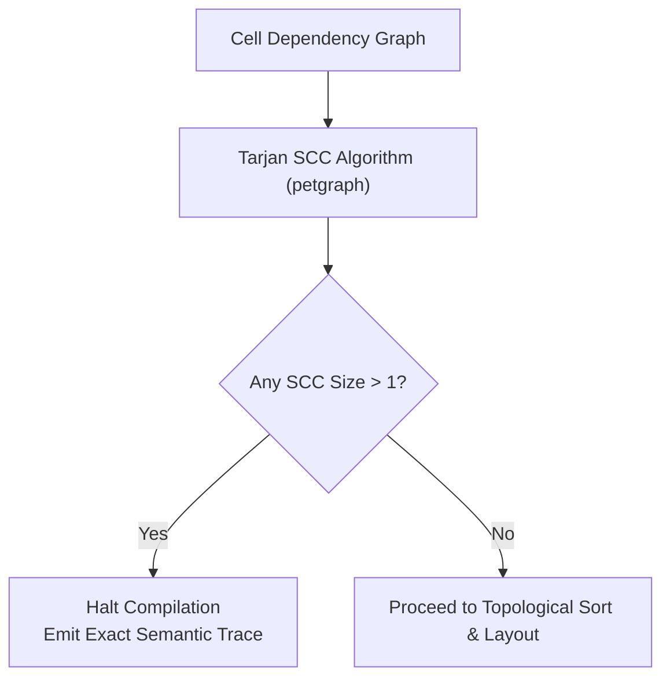

# Dependency Graph & Cycle Detection

This document specifies f8's dependency analysis, cycle detection mechanisms, and FAST Standard compliance.

## 1. Graph Construction

Once grid expansion completes, the compiler constructs a directed graph of cell dependencies using `petgraph`:

- **Nodes**: Each discrete `CellId` (`TableId`, `RowId`, `ColId`).
- **Edges**: A directed edge `A -> B` signifies that cell $B$ references and depends on cell $A$.
- **Slice expansion**: Range references (e.g. `Table["row", "2024E".."2028E"]`) expand into individual incoming dependency edges for every cell within the range.

---

## 2. FAST Standard Compliance (Zero Circularity)

f8 strictly complies with the **FAST Standard (Section 2.01)**:

- **No circular references**: Models must compile to a pure Directed Acyclic Graph (DAG).
- **Disabled iterative calculation**: Emitted `.xlsx` files explicitly set `calcPr.iterate = false`, preventing Excel circular calculation warnings, sluggish recalculation, and `#DIV/0!` locking.
- **Topological sort**: Execution order is derived from topological sorting of the cell DAG.

---

## 3. Tarjan SCC Diagnostic Firewall

To isolate circular logic, the compiler executes Tarjan's Strongly Connected Components (SCC) algorithm over the cell graph:



### 3.1. Diagnostic Error Output

When a cycle is detected, compilation immediately halts with an actionable semantic trace:

```text
Error: Circular dependency detected in model.
Cycle trace:
  1. BalanceSheet["cash", "2025E"]
  2. InterestIncome["interest", "2025E"]
  3. NetIncome["net_income", "2025E"]
  4. BalanceSheet["cash", "2025E"]
```

---

## 4. Closed-Form Algebraic Solutions

Financial models historically introduced circular references for simultaneous equations (e.g. interest calculated on average debt balances, or circular tax calculations).

f8 requires exact closed-form algebraic formulations. For example, a revolver cash sweep with average-balance interest:

$$\text{RevolverDraw} = \max\left(0, \frac{\text{Deficit}}{1 - \frac{\text{Rate}}{2}}\right)$$

This preserves mathematical correctness while maintaining strict DAG compliance.

---

## 5. Pluggable `CycleHandler`

Cycle handling is encapsulated behind a Rust trait:

```rust
pub trait CycleHandler {
    fn handle_cycles(&self, cycle: &[CellId]) -> Result<(), GraphError>;
}
```

In V1, the default implementation is `StrictDagHandler`, which errors on any cycle. Future versions can introduce optional iterative solver plugins without modifying the core compiler pipeline.

See [Intermediate Representation (IR)](./ir.md) for node definitions, [In-Memory Evaluator](./evaluator.md) for DAG execution, and [Formula Lowering & Emission](./lowering-and-emission.md) for Excel coordinate emission.
