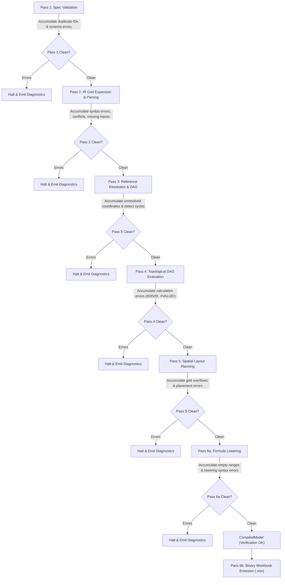

# Compiler Diagnostics & Error Accumulation

This document specifies f8's compiler diagnostic subsystem, defining the phase-level diagnostic accumulation architecture, error taxonomy, and structured JSON presentation model for autonomous AI agents and developer tooling.

---

## 1. Overview & Philosophy

Traditional compilers for declarative languages often default to fail-fast error reporting—terminating execution upon encountering the very first error. In financial modeling workflows, fail-fast behavior introduces significant friction:
- **Scaffold-and-Fill loop**: Initializing an institutional template with $N$ unpopulated driver cells forces $N$ sequential compilation attempts if errors are reported one by one.
- **Bulk refactoring**: Renaming a statement line item or driver row breaks multiple downstream formulas across sheets. Reporting one broken formula at a time results in a slow, iterative "whack-a-mole" cycle.

To eliminate this friction, f8 implements **Phase-Level Diagnostic Accumulation**:
- Within each compiler pass, the engine processes all available entities, accumulating all independent errors into a unified `DiagnosticBag`.
- Pass gates determine whether the compiler can safely proceed to the next pass or must halt and emit accumulated diagnostics.
- All diagnostics are treated uniformly as errors; there are no non-fatal warnings or ambiguous severities. Any compilation or evaluation anomaly halts compilation at its pass gate.
- Diagnostics emit a single, predictable, structured machine-readable JSON schema, removing terminal code frame rendering overhead.



---

## 2. Phase-Gated Diagnostic Accumulation

The compiler pipeline evaluates diagnostics against clear pass-boundary gates, distinguishing between **operational I/O errors** (handled by the CLI/loader layer) and **in-memory compiler errors** (accumulated within `f8-core`):

### Pass 1 Gate: Specification Ingestion & Validation
- **Scope**: In-memory validation of deserialized `ProjectManifest` and `TableSpec` slice. (Filesystem I/O and raw JSON syntax errors are handled prior to compilation by the CLI/adapter loader, returning operational exit code `1`).
- **Accumulable errors**: Iterates through all sheets and all table specifications. Collects all duplicate sheet names, duplicate table IDs, duplicate row/column keys, empty tables, and invalid format preset combinations into `DiagnosticBag`.
- **Gate**: If any Pass 1 errors exist in the bag, compilation halts before IR expansion.

### Pass 2 Gate: IR Grid Expansion & Formula Parsing
- **Scope**: Cell grid expansion, formula Pratt parsing, specificity lattice resolution, and property inheritance.
- **Accumulable errors**:
  - **Formula syntax errors**: Parses every row, column, and cell formula. On parse failure, records a diagnostic and isolates the cell with a poisoned payload (`CellPayload::ParseError(raw_expr)`), allowing all sibling formulas to continue parsing.
  - **Property conflicts**: Resolves formatting, decimals, and currency properties across all coordinates, recording all specificity lattice conflicts.
  - **Missing driver inputs**: Identifies all unassigned data coordinates lacking formula or literal definitions, aggregating them into a single structured `MissingRequiredInputs` diagnostic checklist (`missing_inputs: Vec<MissingInput>`). Cells explicitly assigned `null` (`ValueLiteral::Null`) in the cell map represent intentional blank/spacer cells and are exempted from missing input collection.
  - **Raw formula preservation**: `CellPayload::Formula` retains the exact author-provided raw formula string alongside the parsed `Expr` AST, allowing downstream diagnostics to output the original expression without re-synthesizing text.
- **Gate**: If any formula syntax errors, vector conflicts, or missing inputs exist in the bag, compilation halts before reference resolution. Incomplete or malformed ASTs must never reach Pass 3 to avoid spurious cascading reference errors.

### Pass 3 Gate: Reference Resolution & DAG Acyclicity
- **Scope**: Coordinate resolution (`Table[Row, Col]`), relative temporal offsets (`col.prev`), range slicing, and cycle detection.
- **Accumulable errors**:
  - Validates every coordinate reference in every parsed formula AST across the entire workbook. Collects all unknown table references, unknown row identifiers, unknown column identifiers, out-of-bounds temporal offsets, and cross-table `@col` active coordinate mismatches.
  - Computes Levenshtein distance against registered symbol names to generate automated remediation hints (`"Did you mean 'ebitda'?"`).
  - Tarjan's Strongly Connected Components (SCC) algorithm identifies all circular dependency loops simultaneously in a single graph traversal.
- **Gate**: If broken references or cycles exist in the bag, compilation halts before topological evaluation.

### Pass 4 Gate: Topological DAG Evaluation
- **Scope**: In-memory calculation of cell values across the DAG.
- **Accumulable errors**: Mathematical runtime errors (`#DIV/0!`, `#VALUE!`, `#NUM!`, `#N/A`) do not panic. The evaluator populates target cells with `CellValue::Error(ExcelError)` and records diagnostic errors (`E0401`–`E0403`) in `DiagnosticBag`, allowing downstream independent formulas to continue evaluation. When diagnostics are sorted, upstream root-cause cells appear first, allowing agents and analysts to trace calculations upstream via standard dependency inspection (`f8 inspect precedents`).
- **Gate**: If any mathematical evaluation errors exist in the bag, compilation halts before spatial layout planning.

### Pass 5 Gate: Spatial Layout Planning
- **Scope**: 2D table placement, sheet assignment, gutters, margins, headers, and freeze pane offsets.
- **Accumulable errors**:
  - Validates table placements against Excel physical limits (max 1,048,576 rows and 16,384 columns per sheet). Collects all boundary overflows (`GridLimitExceeded`).
  - Identifies tables defined in the project but unassigned to any worksheet (`UnassignedTable`), or worksheets referencing non-existent tables (`UnknownTable`).
  - Detects overlapping table placements when manual coordinates conflict.
- **Gate**: If spatial layout errors exist in the bag, compilation halts before formula lowering. Concrete Excel coordinate mapping requires a valid physical layout.

### Pass 6a Gate: Formula Lowering
- **Scope**: Translation of semantic AST expressions into concrete Excel formulas (`=C10-C11` or `='Summary'!$B$4`).
- **Accumulable errors**:
  - Lowers all formula expressions across the entire workbook grid. Collects all empty range slices (`EmptyRange`), missing physical cell mappings (`MissingCellCoordinate`), and Excel syntax lowering limitations.
- **Gate**: If formula lowering errors exist in the bag, compilation halts before binary workbook emission.

### Pass 6b: Binary Workbook Emission (`.xlsx`)
- **Scope**: OpenXML package synthesis, style catalog generation, and `.xlsx` byte buffer compression.
- **Behavior**: At this stage, all models, formulas, values, and layouts have been verified clean. Emission failures are physical or I/O constraints (e.g. invalid theme color hex strings or memory/buffer write limits). Theme color errors are recorded as `E0610` diagnostics; catastrophic zip/stream failures return an operational `EmissionError`.

---

## 3. Data Structures

Diagnostic data types are centralized in `f8-core::compiler::diagnostic`:

```rust
use serde::{Deserialize, Serialize};
use crate::model::format::{CurrencyCode, FormatPreset};
use crate::model::id::{ColId, RowId, SheetId, TableId};

/// Diagnostic severity level (all compiler diagnostics are errors).
#[derive(Debug, Clone, Copy, PartialEq, Eq, PartialOrd, Ord, Serialize, Deserialize, Default)]
#[serde(rename_all = "snake_case")]
pub enum DiagnosticLevel {
    #[default]
    Error,
}

/// Precise cell coordinate origin of a diagnostic.
#[derive(Debug, Clone, PartialEq, Eq, Hash, Serialize, Deserialize)]
pub struct CellOrigin {
    pub sheet: Option<SheetId>,
    pub table: TableId,
    pub row: RowId,
    pub col: ColId,
}

/// Unassigned driver input cell required for model calculation.
#[derive(Debug, Clone, PartialEq, Eq, Serialize, Deserialize)]
pub struct MissingInput {
    pub table: TableId,
    pub row: RowId,
    pub col: ColId,
    pub line_item: Option<String>,
    pub col_header: Option<String>,
    pub format: Option<FormatPreset>,
    pub decimals: Option<u32>,
    pub currency: Option<CurrencyCode>,
    pub note: Option<String>,
}

/// Unified diagnostic record.
#[derive(Debug, Clone, PartialEq, Eq, Serialize, Deserialize)]
pub struct Diagnostic {
    pub level: DiagnosticLevel,
    pub code: &'static str,
    pub kind: &'static str,
    pub message: String,
    #[serde(skip_serializing_if = "Option::is_none")]
    pub origin: Option<CellOrigin>,
    #[serde(skip_serializing_if = "Option::is_none")]
    pub expression: Option<String>,
    #[serde(skip_serializing_if = "Option::is_none")]
    pub help: Option<String>,
    #[serde(skip_serializing_if = "Vec::is_empty", default)]
    pub missing_inputs: Vec<MissingInput>,
    #[serde(skip_serializing_if = "Vec::is_empty", default)]
    pub cycle_path: Vec<CellOrigin>,
}

/// Sequential accumulation container for compiler diagnostics.
#[derive(Debug, Default, Clone, PartialEq, Eq, Serialize, Deserialize)]
pub struct DiagnosticBag {
    diagnostics: Vec<Diagnostic>,
}

impl DiagnosticBag {
    pub fn new() -> Self {
        Self::default()
    }

    pub fn add(&mut self, diagnostic: Diagnostic) {
        self.diagnostics.push(diagnostic);
    }

    pub fn merge(&mut self, other: DiagnosticBag) {
        self.diagnostics.extend(other.diagnostics);
    }

    pub fn has_errors(&self) -> bool {
        !self.diagnostics.is_empty()
    }

    pub fn error_count(&self) -> usize {
        self.diagnostics.len()
    }

    pub fn as_slice(&self) -> &[Diagnostic] {
        &self.diagnostics
    }

    pub fn into_vec(self) -> Vec<Diagnostic> {
        self.diagnostics
    }

    /// Sorts diagnostics deterministically by sheet, table, row, column, and code.
    pub fn sort_deterministic(&mut self) {
        self.diagnostics.sort_by(|a, b| {
            let key_a = (
                a.origin.as_ref().and_then(|o| o.sheet.as_ref().map(|s| s.as_str())),
                a.origin.as_ref().map(|o| o.table.as_str()),
                a.origin.as_ref().map(|o| o.row.as_str()),
                a.origin.as_ref().map(|o| o.col.as_str()),
                a.code,
            );
            let key_b = (
                b.origin.as_ref().and_then(|o| o.sheet.as_ref().map(|s| s.as_str())),
                b.origin.as_ref().map(|o| o.table.as_str()),
                b.origin.as_ref().map(|o| o.row.as_str()),
                b.origin.as_ref().map(|o| o.col.as_str()),
                b.code,
            );
            key_a.cmp(&key_b)
        });
    }
}

impl IntoIterator for DiagnosticBag {
    type Item = Diagnostic;
    type IntoIter = std::vec::IntoIter<Diagnostic>;

    fn into_iter(self) -> Self::IntoIter {
        self.diagnostics.into_iter()
    }
}

impl Extend<Diagnostic> for DiagnosticBag {
    fn extend<T: IntoIterator<Item = Diagnostic>>(&mut self, iter: T) {
        self.diagnostics.extend(iter);
    }
}
```

### 3.1. Cell Payload Error Isolation & Raw Formula Retention
To support Pass 2 accumulation without aborting at the first invalid formula expression, `CellPayload` in `f8-core::compiler::ir::cell` isolates errors while preserving raw author text:

```rust
pub enum CellPayload {
    Literal(ValueLiteral),
    Formula {
        expr: Expr,
        raw: String,
    },
    ParseError(String), // Stores raw unparseable string; isolates failure to this cell node
}
```
1. **Error isolation**: On parse failure, an `E0201` (`FormulaParseError`) diagnostic is added to the `DiagnosticBag`, and the cell is populated with `CellPayload::ParseError(raw_expr)`. Subsequent cells and tables continue expanding.
2. **Raw formula preservation**: Storing `raw: String` alongside `Expr` allows downstream passes (reference resolution, DAG cycle detection, and evaluation error reporting) to directly embed the exact original formula string into `Diagnostic.expression` without needing reverse AST serialization.
3. **Pass 2 gate**: Halts before Pass 3 if any errors exist in the bag, ensuring unparseable expressions never reach reference resolution.

### 3.2. Compiler Pipeline Execution Contract
Compiler passes pass `&mut DiagnosticBag` across phase boundaries:

```rust
impl Compiler {
    /// Verifies the workbook across Passes 1–6a, accumulating all diagnostics.
    ///
    /// Returns `Ok(CompiledModel)` if zero errors exist.
    /// Returns `Err(DiagnosticBag)` if any errors were encountered.
    pub fn check(
        manifest: &ProjectManifest,
        tables: &[TableSpec],
    ) -> Result<CompiledModel, DiagnosticBag> {
        let mut bag = DiagnosticBag::new();
        let model = Self::compile_with_diagnostics(manifest, tables, &mut bag)?;
        Ok(model)
    }
}
```

### 3.3. Diagnostic Grouping Rationale (`MissingRequiredInputs`)
Unlike formula errors (`E0302`, `E0201`) where each error corresponds to a distinct formula expression, `E0206` (`MissingRequiredInputs`) aggregates all unassigned driver cells across the workbook into a single diagnostic record with a nested `missing_inputs: Vec<MissingInput>` array:
- **Noise reduction**: Unpopulated financial templates frequently have dozens or hundreds of empty driver cells. Emitting 50 top-level diagnostics obscures other critical errors.
- **Agent checklist ergonomics**: Autonomous AI agents receive the complete, structured inventory of missing values in a single JSON array, allowing batch assignment in a single prompt loop.

### 3.4. Structured Cycle Path (`CyclicDependency`)
When Tarjan's SCC pass detects a circular reference loop, the `E0307` diagnostic records the complete directed loop in `cycle_path: Vec<CellOrigin>`:
- **Agent remediation**: Autonomous agents consume the exact sequence of `CellOrigin` coordinates directly to locate and break the circular equation without regex-parsing text.
- **Deterministic ordering**: The cycle path begins and ends at the root pivot coordinate detected by the strongly connected component traversal.

---

## 4. Diagnostic Code Taxonomy

All diagnostic codes represent fatal compiler errors (`E`) categorized by pass:

| Code | Severity | Classification | Description |
|---|---|---|---|
| **E0101** | Error | DuplicateSheetName | Multiple sheets declare the same visual name. |
| **E0102** | Error | DuplicateTableId | Table identifier is declared more than once in the workbook. |
| **E0103** | Error | DuplicateRowId | Row identifier is duplicated within a single table. |
| **E0104** | Error | DuplicateColumnId | Column identifier is duplicated within a single table. |
| **E0105** | Error | EmptyTable | Table contains zero rows or zero columns. |
| **E0106** | Error | InvalidFormatOption | Decimals or currency declared on non-numeric format preset. |
| **E0201** | Error | FormulaParseError | Pratt parser encountered unexpected token or unclosed parenthesis. |
| **E0202** | Error | AmbiguousExpression | Both row and column define vector expressions without a point override. |
| **E0203** | Error | FormatConflict | Row format preset is incompatible with column format preset. |
| **E0204** | Error | DecimalsConflict | Row precision conflicts with column precision without cell override. |
| **E0205** | Error | CurrencyConflict | Row currency code conflicts with column currency code. |
| **E0206** | Error | MissingRequiredInputs | One or more data cells have no formula, literal value, or explicit null. |
| **E0301** | Error | UnresolvedTable | Formula references a table identifier not present in symbol table. |
| **E0302** | Error | UnresolvedRow | Formula references a row key that does not exist in target table. |
| **E0303** | Error | UnresolvedColumn | Formula references a column key that does not exist in target table. |
| **E0304** | Error | InvertedRange | Formula range slice specifies start coordinate after end coordinate. |
| **E0305** | Error | TemporalOffsetOutOfBounds | Relative offset (`col.prev` / `col.next`) extends past timeline bounds. |
| **E0306** | Error | ActiveCoordinateMismatch | Formula uses `@col` or `@row` across tables with non-homologous axes. |
| **E0307** | Error | CyclicDependency | Circular calculation reference detected via Tarjan SCC. |
| **E0401** | Error | DivisionByZero | Evaluated formula cell calculated `#DIV/0!`. |
| **E0402** | Error | ValueCalculationError | Evaluated formula cell calculated `#VALUE!`. |
| **E0403** | Error | NumberCalculationError | Evaluated formula cell calculated `#NUM!`. |
| **E0501** | Error | GridLimitExceeded | Table placement exceeds Excel 1M row or 16K column limit. |
| **E0502** | Error | UnassignedTable | Table specification is defined but not mounted on any worksheet. |
| **E0503** | Error | UnknownTable | Worksheet references a table specification not provided. |
| **E0504** | Error | OverlappingTables | Multiple tables occupy overlapping physical coordinates. |
| **E0601** | Error | EmptyRange | Formula range slice resolves to an empty coordinate span. |
| **E0602** | Error | MissingCellCoordinate | Referenced cell coordinate is missing from spatial layout map. |
| **E0603** | Error | LoweringSyntaxError | Formula construct cannot be lowered to valid Excel syntax. |
| **E0610** | Error | InvalidThemeColor | Hex color string in theme cannot be parsed into valid RGB. |

---

## 5. Machine-Readable Diagnostic Schema

All diagnostics emitted by the compiler (via `f8 check --json` or stderr on build failure) follow a single, deterministic JSON schema:

```json
{
  "status": "error",
  "exit_code": 2,
  "summary": {
    "error_count": 4
  },
  "diagnostics": [
    {
      "level": "error",
      "code": "E0302",
      "kind": "UnresolvedRow",
      "message": "Formula references unknown row 'ebitda_adj' in table 'IncomeStatement'",
      "origin": {
        "sheet": "Financials",
        "table": "IncomeStatement",
        "row": "ebit",
        "col": "2024E"
      },
      "expression": "IncomeStatement[\"ebitda_adj\", @col] - IncomeStatement[\"depr\", @col]",
      "help": "Did you mean 'ebitda'?"
    },
    {
      "level": "error",
      "code": "E0307",
      "kind": "CyclicDependency",
      "message": "Circular dependency loop detected across 2 formulas",
      "origin": {
        "sheet": "Financials",
        "table": "IncomeStatement",
        "row": "tax",
        "col": "2024E"
      },
      "help": "Break the circular calculation loop using a closed-form algebraic formula.",
      "cycle_path": [
        {
          "sheet": "Financials",
          "table": "IncomeStatement",
          "row": "tax",
          "col": "2024E"
        },
        {
          "sheet": "Financials",
          "table": "IncomeStatement",
          "row": "ebit",
          "col": "2024E"
        },
        {
          "sheet": "Financials",
          "table": "IncomeStatement",
          "row": "tax",
          "col": "2024E"
        }
      ]
    },
    {
      "level": "error",
      "code": "E0201",
      "kind": "FormulaParseError",
      "message": "Unexpected end of input, expected closing parenthesis ')'",
      "origin": {
        "sheet": "Financials",
        "table": "BalanceSheet",
        "row": "total_assets",
        "col": "2024E"
      },
      "expression": "SUM(BalanceSheet[\"cash\"..\"other_assets\", @col",
      "help": "Ensure all opened parentheses are properly closed."
    },
    {
      "level": "error",
      "code": "E0401",
      "kind": "DivisionByZero",
      "message": "Evaluation resulted in division by zero (#DIV/0!)",
      "origin": {
        "sheet": "Financials",
        "table": "Assumptions",
        "row": "debt_to_ebitda",
        "col": "2023A"
      },
      "expression": "BalanceSheet[\"total_debt\", @col] / IncomeStatement[\"ebitda\", @col]",
      "help": "Target denominator evaluates to zero. Consider wrapping with IFERROR or IF."
    }
  ]
}
```

---

## 6. Integration Rules

1. **Deterministic order**: Diagnostics in `DiagnosticBag` must be sorted via `sort_deterministic()` by `(sheet, table, row, col, code)` prior to serialization, ensuring bit-for-bit identical output across runs.
2. **Zero allocation on success**: When compilation succeeds with zero errors, `DiagnosticBag::new()` performs zero heap allocation (`Vec::new()` does not allocate until pushed).
3. **Structured error propagation**: Core compiler entrypoints return `Result<CompiledModel, DiagnosticBag>`.
4. **Zero production panics**: Diagnostic accumulation must never use `.unwrap()` or `.expect()`. Any parsing, resolution, or evaluation anomalies are caught and converted directly into structured `Diagnostic` records.
