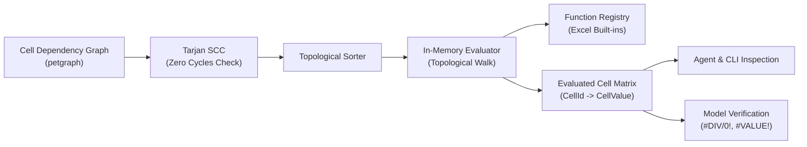

# In-Memory Evaluation Engine

This document specifies f8's in-memory calculation engine, topological execution loop over the cell dependency DAG, and runtime state model.

## 1. Overview

The in-memory evaluation engine executes models directly in Rust without external spreadsheet dependencies.



### 1.1. Key Use Cases

- **Agent and CLI feedback**: Enables AI agents and CLI users to query calculated outputs instantaneously during model generation.
- **Model verification**: Detects formula runtime errors (`#DIV/0!`, `#VALUE!`, `#NUM!`) during compilation before generating workbook binaries.
- **Headless execution**: Recalculates model outputs across scenarios without spawning Excel processes.
- **Precomputed workbook cache**: Emits cached values into `.xlsx` packages so third-party viewers render values immediately without recalculation.

---

## 2. DAG Topological Execution Loop

Because models comply with the FAST Standard (Section 2.01) and pass Tarjan's SCC cycle detector, the dependency graph is guaranteed to be a pure Directed Acyclic Graph (DAG):

1. **Topological sort**: The compiler computes a linear ordering of all `CellId` nodes using `petgraph::algo::toposort`.
2. **Sequential scalar execution**: The engine iterates through cells in topological order. Every cell formula strictly evaluates to a single scalar `CellValue`:
   - **Literal cells**: Assigns `ValueLiteral` directly into the matrix.
   - **Formula cells**: Evaluates the formula AST against resolved dependency cell values.
3. **Memoization**: Computed values are stored in a 1:1 lookup matrix indexed by `CellId`.

Because cells never spill into neighboring coordinates, execution order is completely deterministic and static.

---

## 3. Cell Value & Error Representation

Values are stored using a strongly typed `CellValue` enum:

```rust
#[derive(Debug, Clone, PartialEq)]
pub enum CellValue {
    /// 64-bit IEEE 754 floating point number.
    Number(f64),
    /// Textual string value.
    Text(String),
    /// Logical boolean value.
    Boolean(bool),
    /// Empty cell (distinct from zero, though coercible in arithmetic).
    Empty,
    /// Excel runtime domain error.
    Error(ExcelError),
}
```

### 3.1. Excel Error Values (`ExcelError`)

Undefined mathematical or formula conditions produce structured error values:

| Excel error | Code | Trigger condition |
| :--- | :--- | :--- |
| `#DIV/0!` | `ExcelError::Div0` | Division by zero or an empty denominator cell |
| `#VALUE!` | `ExcelError::Value` | Type mismatch (e.g. attempting arithmetic on text) |
| `#REF!` | `ExcelError::Ref` | Reference to non-existent coordinate or out-of-bounds column |
| `#NUM!` | `ExcelError::Num` | Invalid numeric parameter (e.g. negative root, non-converging IRR, date mismatch) |
| `#N/A` | `ExcelError::Na` | Lookup value not found in target range |
| `#NAME?` | `ExcelError::Name` | Unrecognized function identifier |

### 3.2. Engine Errors (`EvalError`) vs Domain Errors (`ExcelError`)

The pipeline strictly separates compiler execution failures from Excel domain errors:

- **Engine errors (`EvalError`)**: Internal compiler failures (e.g. malformed AST, coordinate missing from symbol table, unresolved cycle). Bubbled immediately via Rust's `?` operator to abort compilation.
- **Domain errors (`CellValue::Error(ExcelError)`)**: Valid Excel formula outcomes. Wrapped in `Ok(CellValue::Error(...))` and stored in the evaluated matrix, allowing downstream formulas to propagate the error and providing diagnostics for tooling.

---

## 4. Parity & Calculation Semantics

Detailed calculation rules, numeric precision, range coercion asymmetry, date day counts, and operator behaviors are defined in [Excel Parity & Evaluation Semantics](parity.md).

---

## 5. Inspection Interface & Unified Facade (`CompiledModel`)

Following DAG execution, the resulting `EvaluatedModel` is consolidated alongside other compiler pass artifacts into `CompiledModel`. Outer tools (`f8-cli`, `f8-mcp`) query evaluation state directly:

- **`inspect_cell(table, row, col)`**: Returns cell evaluation state, raw literal or formula AST, lowered Excel formula, physical coordinates, and dependency edges.
- **`table_matrix(table)`**: Emits a 2D matrix of evaluated values, formula expressions, or stacked audit pairs for tabular display.
- **`find_errors()`**: Sweeps the evaluated matrix, identifying all coordinates that resolved to `CellValue::Error(ExcelError)`.
- **`precedents_of(cell, recursive)` / `dependents_of(cell, recursive)`**: Walks the DAG to report direct or transitive dependencies and blast radius.

See [Dependency Graph](dependency-graph.md) for DAG construction, [Function Registry](../functions/registry.md) for function contracts, and [Excel Parity](parity.md) for calculation parity rules.

