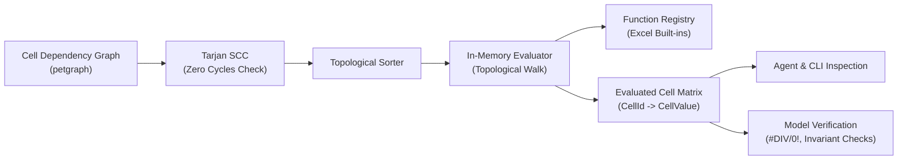

# In-Memory Evaluation Engine

This document specifies Finx's in-memory calculation engine, execution over the cell dependency DAG, and Excel calculation parity.

## 1. Overview

While Finx compiles financial models into native `.xlsx` workbooks with live Excel formulas, the in-memory evaluation engine executes models directly in Rust without external dependencies.



### 1.1. Key Use Cases

- **Agent and CLI feedback**: Enables AI agents and CLI users to query calculated outputs (e.g. `IncomeStatement.revenue["2025E"]` or `BalanceSheet.cash["2024E"]`) instantaneously during model generation.
- **Model verification**: Detects formula runtime errors (such as `#DIV/0!`, `#VALUE!`, or unclosed corkscrews) during compilation rather than when opened by an end user in Excel.
- **Headless scenario analysis**: Recalculates model outputs across varying assumptions without spawning Excel or external python processes.
- **Precomputed workbook cache**: Emits cached calculated values alongside live formulas in `.xlsx` files so spreadsheet viewers render values immediately.

---

## 2. DAG Topological Execution

Because all models must comply with the FAST Standard (Section 2.01) and pass Tarjan's SCC cycle detector, the dependency graph is guaranteed to be a pure Directed Acyclic Graph (DAG):

1. **Topological sort**: The compiler computes a linear ordering of all `CellId` nodes using `petgraph::algo::toposort`.
2. **Sequential execution**: The engine iterates through cells in topological order:
   - **Literal cells**: Direct assignment of `ValueLiteral` into the matrix.
   - **Formula cells**: Evaluates the formula AST against already-calculated dependency cell values.
3. **Memoization**: Computed values are stored in a high-performance indexed matrix indexed by `CellId`.

---

## 3. Cell Value Representation

Values are stored using a strongly typed `CellValue` enum mirroring Excel's value model:

```rust
#[derive(Debug, Clone, PartialEq)]
pub enum CellValue {
    /// 64-bit IEEE 754 floating point number.
    Number(f64),
    /// Textual string value.
    Text(String),
    /// Logical boolean value.
    Boolean(bool),
    /// Empty cell (distinct from zero, though coercible in arithmetic).
    Empty,
    /// Excel runtime error.
    Error(ExcelError),
}
```

### 3.1. Excel Error Values (`ExcelError`)

Calculations encountering undefined mathematical or logical conditions produce structured error values rather than panicking or terminating execution:

| Excel error | Code | Trigger condition |
| :--- | :--- | :--- |
| `#DIV/0!` | `ExcelError::Div0` | Division by zero or an empty denominator cell |
| `#VALUE!` | `ExcelError::Value` | Type mismatch (e.g. attempting arithmetic on text) |
| `#REF!` | `ExcelError::Ref` | Reference to non-existent coordinate or out-of-bounds column |
| `#NUM!` | `ExcelError::Num` | Invalid numeric parameter (e.g. square root of negative, non-converging IRR) |
| `#N/A` | `ExcelError::Na` | Lookup value not found in target range |
| `#NAME?` | `ExcelError::Name` | Unrecognized function identifier |

---

## 4. Excel Parity Rules

To ensure 100% calculation parity between Finx in-memory evaluation and Excel:

### 4.1. Numeric Precision
- Calculations use IEEE 754 standard double-precision floats (`f64`), matching Excel's internal numeric representation and avoiding rounding discrepancies.

### 4.2. Empty Cell Semantics
- **Arithmetic context**: Empty cells are treated as `0.0` in arithmetic operations (`+`, `-`, `*`, `/`). For example, `Empty + 10.0` evaluates to `10.0`.
- **String context**: Empty cells coerce to an empty string `""`.
- **Aggregation functions**: Functions such as `AVERAGE` and `COUNT` ignore empty cells, whereas cells with explicit zero (`0.0`) are included.

### 4.3. Logical & Boolean Coercion
- In arithmetic expressions, `true` coerces to `1.0` and `false` coerces to `0.0`.
- Comparisons (`=`, `<>`, `<`, `<=`, `>`, `>=`) evaluate to `CellValue::Boolean`.

### 4.4. Range Slicing & Propagation
- Range references (e.g. `Table.row["2024E".."2028E"]` or `Table[rows.opex, @]`) resolve to ordered vectors of `CellValue`.
- Aggregations (`SUM`, `MAX`, `MIN`) flatten multi-dimensional slices before calculation.
- Error propagation: Any `#REF!` or `#VALUE!` error encountered within a strict scalar arithmetic expression bubbles up to the dependent cell.

---

## 5. Agent Inspection Interface

The evaluated matrix provides convenient lookup APIs for CLI and MCP agent tools:

```rust
impl EvaluatedModel {
    /// Retrieve evaluated value for a specific cell coordinate.
    pub fn get_value(&self, table: &TableId, row: &RowId, col: &ColId) -> Option<&CellValue>;

    /// Retrieve all evaluated row values across columns as an ordered map.
    pub fn get_row_values(&self, table: &TableId, row: &RowId) -> Result<IndexMap<ColId, CellValue>, ModelError>;

    /// Check if any cell in the model evaluated to an Excel error.
    pub fn find_errors(&self) -> Vec<(CellId, ExcelError)>;
}
```

See [Dependency Graph](dependency-graph.md) for DAG construction and [Function Registry](function-registry.md) for built-in Excel function implementations.
