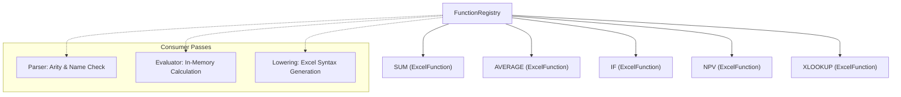

# Function Registry

This document specifies Finx's Excel function registry, function definition contracts, and the standard built-in catalog.

## 1. Overview

The function registry serves as the single source of truth for Excel function definitions in Finx. It decouples function behavior from parser internals and spatial layout, providing unified capabilities across three compiler passes:

- **Static validation**: Verifies function names and arity constraints during AST construction.
- **Formula lowering**: Emits standard uppercase Excel formulas (`SUM(...)`, `IF(...)`).
- **In-memory evaluation**: Dispatches function evaluation to registered Rust implementations during topological execution.

---

## 2. Registry Architecture



### 2.1. The `ExcelFunction` Trait

Every supported Excel function implements the `ExcelFunction` trait:

```rust
pub trait ExcelFunction: Send + Sync {
    /// Canonical uppercase Excel function name (e.g. "SUM").
    fn name(&self) -> &'static str;

    /// Minimum number of required arguments.
    fn min_args(&self) -> usize;

    /// Maximum number of arguments, or None if variadic.
    fn max_args(&self) -> Option<usize>;

    /// Argument classification for signature checking.
    fn arg_kind(&self, index: usize) -> ArgKind;

    /// Evaluates function arguments against cell context.
    fn evaluate(&self, args: &[FunctionArg], ctx: &EvalContext) -> Result<CellValue, EvalError>;
}
```

### 2.2. Argument Kinds

| Arg kind | Semantic behavior | Typical usage |
| :--- | :--- | :--- |
| `Scalar` | Expects a single evaluated cell value | `IF` condition, `ROUND` decimals |
| `Slice` | Accepts 1D ranges, 2D ranges, or scalar values | `SUM` arguments, `AVERAGE` ranges |
| `Any` | Accepts scalar values, arrays, or range expressions | `XLOOKUP` lookup values and return arrays |

---

## 3. Standard Function Catalog (V1)

Finx targets financial modeling workflows and standard financial statement schedules. The V1 built-in catalog covers essential math, logic, and financial functions:

### 3.1. Mathematical & Aggregations

| Function | Min args | Max args | Description |
| :--- | :--- | :--- | :--- |
| `SUM` | 1 | Unlimited | Arithmetic sum of all numeric values across scalars and slices |
| `AVERAGE` | 1 | Unlimited | Arithmetic mean of numeric values, ignoring empty cells |
| `COUNT` | 1 | Unlimited | Count of cells containing numeric values |
| `MAX` | 1 | Unlimited | Maximum numeric value across scalars and slices |
| `MIN` | 1 | Unlimited | Minimum numeric value across scalars and slices |
| `ROUND` | 2 | 2 | Rounds a number to a specified number of digits |
| `ABS` | 1 | 1 | Returns the absolute value of a number |

### 3.2. Logical Operations

| Function | Min args | Max args | Description |
| :--- | :--- | :--- | :--- |
| `IF` | 2 | 3 | Conditional branch with short-circuit evaluation |
| `AND` | 1 | Unlimited | Logical conjunction across arguments |
| `OR` | 1 | Unlimited | Logical disjunction across arguments |
| `NOT` | 1 | 1 | Logical negation |
| `IFS` | 2 | Unlimited | Multi-condition evaluation with paired test-value branches |

### 3.3. Financial Functions

| Function | Min args | Max args | Description |
| :--- | :--- | :--- | :--- |
| `NPV` | 2 | Unlimited | Net present value based on a discount rate and series of cash flows |
| `XNPV` | 3 | 3 | Net present value for cash flows with specific dates |
| `IRR` | 1 | 2 | Internal rate of return for a series of periodic cash flows |
| `XIRR` | 2 | 3 | Internal rate of return for non-periodic cash flows with dates |
| `PMT` | 3 | 5 | Constant periodic payment for an annuity based on constant interest |

### 3.4. Lookup & Reference

| Function | Min args | Max args | Description |
| :--- | :--- | :--- | :--- |
| `XLOOKUP` | 3 | 6 | Modern lookup returning value or array from matching search range |
| `INDEX` | 2 | 3 | Returns cell reference or value at row/col offset in range |
| `MATCH` | 2 | 3 | Returns relative position of lookup item in range |

---

## 4. Compiler Lifecycle Integration

1. **Parser validation**:
   - The parser matches `FunctionName` against registered keys in `FunctionRegistry`.
   - Unknown function names trigger a structured `CompileError::UnknownFunction`.
   - Argument counts are checked against `min_args` and `max_args`.
2. **Formula lowering**:
   - The lowering engine renders function calls using the canonical `name()` string, ensuring identical naming between specification and emitted `.xlsx` formulas.
3. **In-memory evaluation**:
   - When evaluating a `FunctionCall` node, the evaluator retrieves the registered implementation from `FunctionRegistry` and calls `evaluate()`.
   - Short-circuiting functions (such as `IF`) receive unevaluated AST branches through lazy argument evaluation.

See [In-Memory Evaluator](evaluator.md) for execution details and [Formula Grammar](../dsl/grammar.md) for expression syntax.
