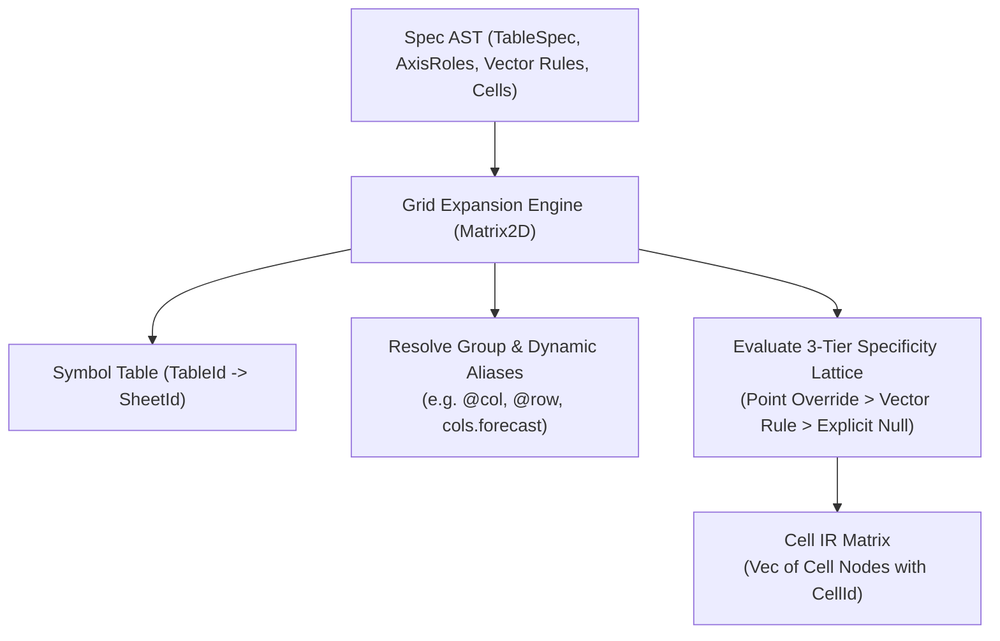

# Intermediate Representation (IR)

This document specifies Finx's intermediate representations, focusing on cell-level granularity and the 2D grid expansion pass.

## 1. Cell-Level IR Granularity

Dependency analysis and calculation ordering operate strictly on **individual cells**, never on whole rows or tables.

### 1.1. Cell Identity (`CellId`)

Every discrete cell in the model is identified by a 3-tuple:

$$\text{CellId} = (\text{TableId}, \text{RowId}, \text{ColId})$$

- `TableId`: Globally unique table identifier across the workbook (e.g. `IncomeStatement`).
- `RowId`: Row identifier within the table (e.g. `revenue`).
- `ColId`: Column identifier within the table (e.g. `2024E`).

The workbook symbol table maintains a 1-to-1 mapping from each `TableId` to its parent `SheetId`.

### 1.2. Why Cell-Level IR is Essential

In financial modeling, roll-forward schedules (corkscrews) link consecutive periods:

$$\text{EndingBalance}_t = \text{BeginningBalance}_t + \Delta_t$$
$$\text{BeginningBalance}_t = \text{EndingBalance}_{t-1}$$

At the row level, `EndingBalance` and `BeginningBalance` appear mutually dependent. At the cell level across time, the graph forms a pure Directed Acyclic Graph (DAG):

$$\text{End}_{t-1} \rightarrow \text{Beg}_t \rightarrow \text{End}_t \rightarrow \text{Beg}_{t+1}$$

Cell-level IR prevents false-positive cyclic dependency errors.

---

## 2. 2D Grid Expansion Pass

The grid expansion pass transforms the high-level specification AST into discrete cell IR nodes using the 3-tier specificity lattice:

### 2.1. Expansion Responsibilities

1. **Axis enumeration**: Iterates over all declared table rows and columns $(r, c)$ in declared order.
2. **First-class cell registration**: Both descriptor coordinates (labels, units, metadata) and measure coordinates are registered as full calculation or literal nodes in the cell grid.
3. **3-tier specificity resolution**:
   - **Tier 1 (Point Override)**: Uses explicit 0D point payload from `row.cells[c]` if present.
   - **Tier 2 (Vector Rules)**: If unassigned and both intersecting axes are `AxisRole::Measure`, evaluates `row.expr` and `col.expr`. If both define an expression without an override, halts with `AmbiguousExpressionConflict`. If only one defines an expression, assigns it.
   - **Tier 3 (Exhaustive Verification)**: If no payload or rule applies and the cell is not an explicit `null`, halts compilation with `UnassignedCellError`.
4. **Group & dynamic alias lowering**: Lowers dynamic coordinate tokens (`@col`, `@row`, `col.prev`, `col.next`, `row.prev`, `row.next`, `cols.<group>`, `rows.<group>`) into concrete coordinates or bounded range boundaries.

---

## 3. Cell IR Node Structure

Each expanded cell node contains:

- **Identity**: `CellId` (`TableId`, `RowId`, `ColId`).
- **Role**: `AxisRole` (`Measure` or `Descriptor`).
- **Sheet**: Target `SheetId` resolved from the parent table.
- **Payload**: Either:
  - `Literal(ValueLiteral)`: Number, string, boolean, or null.
  - `Formula(AstNode)`: Parsed expression AST containing reference targets.
- **Formatting**: Resolved format preset token (e.g. `currency`, `percentage`, `text`).
- **Notes & Provenance**: Inherited or overridden note string and provenance metadata.
- **Spatial Position**: Populated later by the layout engine (`sheet_name`, `col_idx`, `row_idx`).

See [Dependency Graph](dependency-graph.md) for how cell nodes are assembled into a DAG, and [Spatial Layout Planning](spatial-layout.md) for coordinate assignment.
