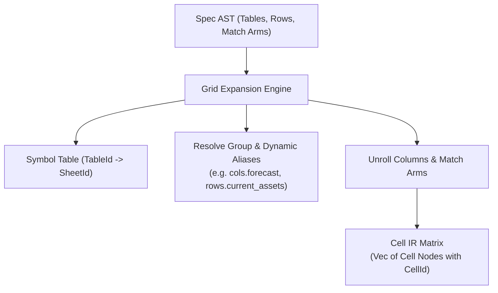

# Intermediate Representation (IR)

This document specifies Finx's intermediate representations, focusing on cell-level granularity and the grid expansion pass.

## 1. Cell-Level IR Granularity

Dependency analysis and calculation ordering operate strictly on **individual cells**, never on whole rows or tables.

### 1.1. Cell Identity (`CellId`)

Every discrete cell in the model is identified by a 3-tuple:

$$\text{CellId} = (\text{TableId}, \text{RowId}, \text{ColId})$$

- `TableId`: Globally unique table identifier across the workbook (e.g. `IncomeStatement`).
- `RowId`: Row identifier within the table (e.g. `revenue`).
- `ColId`: Column identifier within the table (e.g. `2024E`).

The workbook symbol table maintains a 1-to-1 mapping from each `TableId` to its parent `SheetId`.

### 1.2. Why Cell-Level IR is Essential

In financial modeling, roll-forward schedules (corkscrews) link consecutive periods:

$$\text{EndingBalance}_t = \text{BeginningBalance}_t + \Delta_t$$
$$\text{BeginningBalance}_t = \text{EndingBalance}_{t-1}$$

At the row level, `EndingBalance` and `BeginningBalance` appear mutually dependent. At the cell level across time, the graph forms a pure Directed Acyclic Graph (DAG):

$$\text{End}_{t-1} \rightarrow \text{Beg}_t \rightarrow \text{End}_t \rightarrow \text{Beg}_{t+1}$$

Cell-level IR prevents false-positive cyclic dependency errors.

---

## 2. Grid Expansion Pass

The grid expansion pass transforms the high-level specification AST into discrete cell IR nodes:

### 2.1. Expansion Responsibilities

1. **Column enumeration**: Iterates over all declared table columns in order.
2. **Group & dynamic alias resolution**: Resolves dynamic tokens (`col.prev`, `col.next`, `cols.<group>`, `rows.<group>`) into concrete coordinates or bounded range boundaries.
3. **Partition evaluation**: Matches each column against row definitions, selecting the appropriate literal input or parsed formula expression.
4. **Dimension verification**: Verifies that literal array lengths match targeted column counts (`len(value) == len(target_columns)`).

---

## 3. Cell IR Node Structure

Each expanded cell node contains:

- **Identity**: `CellId` (`TableId`, `RowId`, `ColId`).
- **Sheet**: Target `SheetId` resolved from the parent table.
- **Payload**: Either:
  - `Literal(Value)`: Number, string, or null.
  - `Formula(AstNode)`: Parsed expression AST containing reference targets.
- **Formatting**: Optional number format token (e.g. `currency`, `percentage`).
- **Spatial Position**: Populated later by the layout engine (`sheet_name`, `col_idx`, `row_idx`).

See [Dependency Graph](dependency-graph.md) for how cell nodes are assembled into a DAG, and [Spatial Layout Planning](spatial-layout.md) for coordinate assignment.
