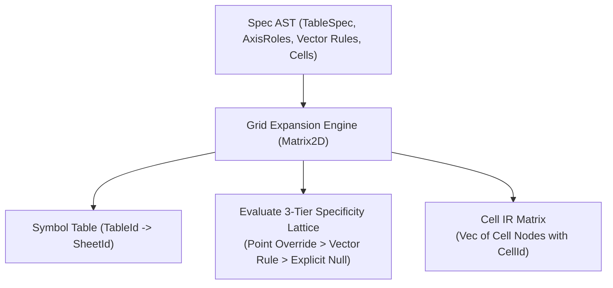
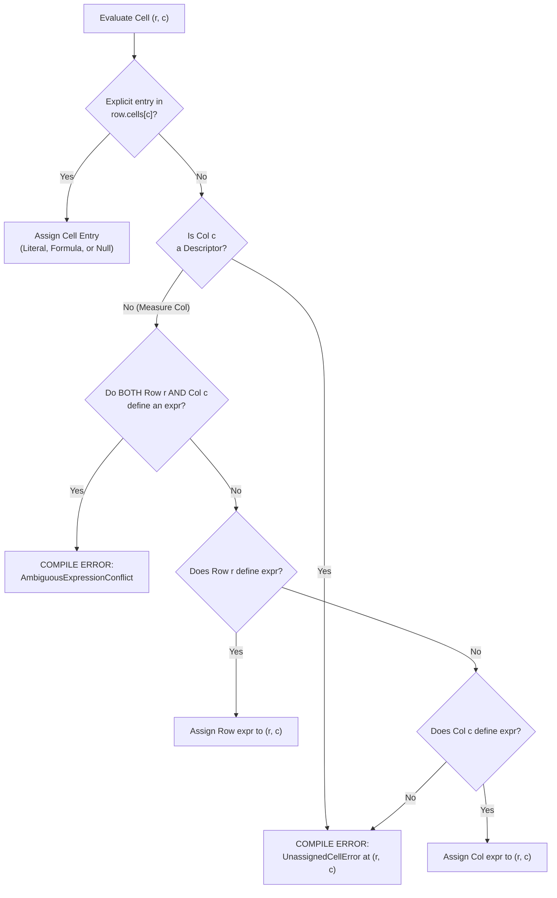

# Intermediate Representation (IR)

This document specifies f8's intermediate representations, focusing on cell-level granularity, the 2D grid expansion pass, and the deterministic property resolution lattice.

## 1. Cell-Level IR Granularity

Dependency analysis and calculation ordering operate strictly on **individual cells**, never on whole rows or tables.

### 1.1. Cell Identity (`CellId`)

Every discrete cell in the model is identified by a 3-tuple:

$$\text{CellId} = (\text{TableId}, \text{RowId}, \text{ColId})$$

- `TableId`: Globally unique table identifier across the workbook (e.g. `IncomeStatement`).
- `RowId`: Row identifier within the table (e.g. `revenue`).
- `ColId`: Column identifier within the table (e.g. `2024E`).

The workbook symbol table maintains a 1-to-1 mapping from each `TableId` to its parent `SheetId`.

### 1.2. Why Cell-Level IR is Essential

In financial modeling, roll-forward schedules (corkscrews) link consecutive periods:

$$\text{EndingBalance}_t = \text{BeginningBalance}_t + \Delta_t$$
$$\text{BeginningBalance}_t = \text{EndingBalance}_{t-1}$$

At the row level, `EndingBalance` and `BeginningBalance` appear mutually dependent. At the cell level across time, the graph forms a pure Directed Acyclic Graph (DAG):

$$\text{End}_{t-1} \rightarrow \text{Beg}_t \rightarrow \text{End}_t \rightarrow \text{Beg}_{t+1}$$

Cell-level IR prevents false-positive cyclic dependency errors.

---

## 2. 2D Grid Expansion Pass

The grid expansion pass transforms the high-level specification AST into discrete cell IR nodes using the 3-tier specificity lattice:

### 2.1. Expansion Pipeline

1. **Data coordinate enumeration**: Iterates over declared data rows and data columns $(r, c)$. Structural elements (`Gutter`, `SectionHeader`) emit zero nodes into `CellGrid`.
2. **First-class cell registration**: Both descriptor coordinates (labels, units, metadata) and measure coordinates are registered as full calculation or literal nodes in the cell grid.
3. **Property lattice evaluation**: Evaluates payload, formatting, and notes through the deterministic resolution rules.

---

## 3. The 2D Specificity Resolution Lattice

Every cell coordinate $(r, c)$ in table $T$ resolves its payload, format, and notes through a deterministic evaluation lattice.

### 3.1. Cell Payload Resolution Algorithm

1. **Step 1 (cell override)**: Check if `row.cells` explicitly defines an entry for column $c$. If present, use this payload (literal, formula, or explicit `null`).
2. **Step 2 (descriptor boundary check)**: If column $c$ is a descriptor (`role: "descriptor"`), vector rules do not broadcast across it. If no explicit entry exists in `row.cells`, halt compilation with `UnassignedCellError`.
3. **Step 3 (ambiguity check)**: For measure columns, check if row $r$ defines `row.expr` **AND** column $c$ defines `col.expr`. If both exist without an explicit cell override, halt compilation with `AmbiguousExpressionConflict`.
4. **Step 4 (row vector rule)**: If only `row.expr` is defined, assign `row.expr` to cell $(r, c)$.
5. **Step 5 (column vector rule)**: If only `col.expr` is defined, assign `col.expr` to cell $(r, c)$.
6. **Step 6 (exhaustive verification)**: If neither defines an expression and no entry was provided in `row.cells`, halt compilation with `UnassignedCellError`.

### 3.2. Format Preset Resolution Algorithm

1. **Cell format override**: An explicit point format declared on the cell always wins.
2. **Descriptor boundary**: A descriptor column specifies text formatting for its labels. Measure formats (`currency`, `number`, `percentage`, etc.) never broadcast to descriptor coordinates.
3. **Measure vector conflict**: If measure column $c$ and row $r$ specify differing format presets (e.g. `row.format: "currency"` and `col.format: "percentage"`), compilation halts with `FormatConflictError` unless resolved by an explicit cell format override.
4. **Single vector format**: If only the row or only the column specifies a format preset, that preset applies.
5. **Default**: Unspecified numbers default to general numeric presentation; unspecified text defaults to standard string alignment.

### 3.3. Precision (Decimals) Resolution Algorithm

1. **Numeric applicability**: `decimals` resolution applies strictly to numeric presets (`currency`, `number`, `percentage`, `multiple`, `basis_points`). Non-numeric presets (`date`, `text`) have no precision concept and always resolve `decimals: None`.
2. **Cell decimals override**: An explicit `decimals` declared on the cell always wins.
3. **Measure vector conflict**: If measure column $c$ and row $r$ specify differing `decimals` without an explicit cell override, compilation halts with `DecimalsConflictError`.
4. **Single vector decimals**: If only the row or only the column specifies `decimals`, that precision applies.
5. **Theme default fallback**: Unspecified decimals fall back to the active theme's configured default for the resolved `FormatPreset` (e.g. 0 for `currency` and `number`, 1 for `percentage` and `multiple`, 0 for `basis_points`).

### 3.4. Semantic Style & Highlight Resolution Algorithm

In a 2D matrix, rows and columns govern orthogonal geometric axes:
- **Rows** govern horizontal summary rules (`top` and `bottom` edges).
- **Columns** govern vertical summary rules (`left` and `right` edges).

1. **Explicit cell reset**: `cell.style == Some(SemanticStyle::Data)` suppresses both horizontal and vertical summary rules (`horizontal = Data, vertical = Data`).
2. **Explicit cell summary rule**: `cell.style == Some(s)` sets `horizontal = s` (applying horizontal accounting rules), preserving `vertical = col.style.unwrap_or(Data)`.
3. **Vector rules (default)**: When `cell.style` is `None`:
   - `horizontal = row.style.unwrap_or(SemanticStyle::Data)`
   - `vertical = col.style.unwrap_or(SemanticStyle::Data)`
4. **Symmetrical border composition**: Intersection cells where both axes are `Total` receive top thin, bottom double, left thin, and right double borders, forming a fully framed accounting box.
5. **Font weight composition**: Bold typography is applied if `horizontal == SemanticStyle::Total || vertical == SemanticStyle::Total`.
6. **Highlight precedence**: `cell.highlight.unwrap_or(row.highlight || col.highlight)`.
   - Point override `highlight: false` explicitly un-highlights a cell even if its row or column is highlighted.

### 3.5. Note & Provenance Resolution

- **Precedence**: `Cell.note > Row.note > Col.note`.
- **Inheritance**: A cell inherits its row or column note/source unless explicitly overridden at the cell level.

---

## 4. Cell IR Node Structure

Each expanded cell node contains:

- **Identity**: `CellId` (`TableId`, `RowId`, `ColId`).
- **Sheet**: Target `SheetId` resolved from the parent table.
- **Payload**: Either:
  - `Literal(ValueLiteral)`: Number, string, boolean, or null.
  - `Formula(AstNode)`: Parsed expression AST containing reference targets.
- **Formatting, Precision & Currency**: Resolved format preset token (`FormatPreset`), optional display precision (`decimals: Option<u32>`), and optional currency denomination code (`currency: Option<CurrencyCode>`).
- **Style**: Resolved structural style pair (`horizontal: SemanticStyle`, `vertical: SemanticStyle`) and visual emphasis flag (`is_highlight: bool`).
- **Notes & Provenance**: Inherited or overridden note string and provenance metadata.
- **Spatial Position**: Populated later by the layout engine (`sheet_name`, `col_idx`, `row_idx`).

See [Dependency Graph](./dependency-graph.md) for how cell nodes are assembled into a DAG, and [Spatial Layout Planning](spatial-layout.md) for coordinate assignment.
