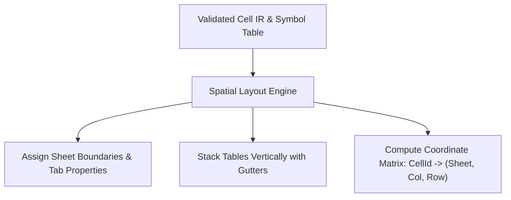

# Layout Planning & Formula Lowering

This document specifies the spatial layout engine, the formula lowering process, and Excel binary emission.

## 1. Spatial Layout Engine

The layout engine maps high-level tables and rows into concrete 2D physical coordinates on Excel worksheets.

### 1.1. Vertical Stacking & Gutters

- **Vertical stacking**: Within each worksheet, tables stack vertically by default.
- **Header & stub layout**:
  - Column A/B: Row stub labels with indentation derived from `row_groups` tree depth.
  - Section headers: Visual non-calculation rows emitted for parent and leaf `row_groups` with distinct category typography.
  - Header rows: Table title, optional super-headers (from `column_groups`), and column key headers.
  - Group styling: Automated vertical dividing borders at boundaries between adjacent column groups, and native Excel row/column outline folding levels.
- **Standard gutters**: A configurable blank row gutter (default: 2 blank rows) separates stacked tables to avoid coordinate collisions.

### 1.2. Sheet-Level Properties

The layout engine assigns worksheet attributes configured in the specification:
- `freeze_panes`: Locks row stubs (e.g. columns A and B) and column headers.
- `tab_color`: Visual color applied to worksheet tabs.
- `show_gridlines`: Explicit toggle for workbook gridline visibility.

---

## 2. Formula Lowering Engine

Formula lowering rewrites semantic AST expressions into standard Excel formula strings with appropriate relative and absolute coordinate referencing (`$`).

### 2.1. Coordinate Lowering Rules

| Reference Type | Example Syntax | Sheet Context | Lowered Excel Formula |
| :--- | :--- | :--- | :--- |
| **Active Column (`[@]`)** | `Revenue[@]` | Same sheet | Relative column: `=C10` |
| **Specific Column** | `Assumptions.tax_rate["value"]` | Different sheet (`Summary`) | Absolute coordinate: `='Summary'!$B$4` |
| **Specific Column** | `Balance["2023A"]` | Same sheet | Absolute coordinate: `=$C$10` |
| **Horizontal Range** | `Revenue[cols.forecast]` | Same sheet | Horizontal slice: `=SUM(C10:G10)` |
| **Vertical Range** | `BalanceSheet[rows.current_assets, @]` | Same sheet | Vertical slice: `=SUM(C14:C18)` |
| **2D Block Range** | `BalanceSheet[rows.current_assets, cols.forecast]` | Same sheet | 2D matrix: `=SUM(C14:G18)` |

### 2.2. AST Serialization

The lowered AST is converted into standard Excel formula syntax:
- Functions map directly to native Excel names (`SUM`, `IF`, `MAX`, `XLOOKUP`).
- Binary and unary operators map to Excel operators (`+`, `-`, `*`, `/`, `^`, `=`, `<>`).
- Lowered formulas are prepended with `=` when written to the cell.

---

## 3. Excel Binary Emission (`rust_xlsxwriter`)

The final phase streams the layout and lowered formulas into a valid `.xlsx` workbook using `rust_xlsxwriter`:

1. **Workbook initialization**: Configures calculation properties (`calcPr.iterate = false`).
2. **Format cache**: Instantiates reusable styling objects (fonts, borders, fills, number formats) to keep output size compact.
3. **Cell streaming**:
   - Literal cells: Written using `write_number`, `write_string`, or `write_boolean`.
   - Formula cells: Written using `write_formula` with the lowered expression string.
4. **Finalization**: Saves the compressed package to the target file path.

See [Addressing Syntax](../dsl/addressing.md) for input syntax and [CLI](../interfaces/cli.md) for the command-line interface.
