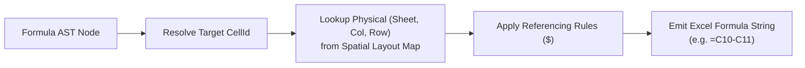

# Formula Lowering & Binary Emission

This document specifies Finx's formula lowering engine and workbook emission pipeline (Pass 6), transforming semantic AST expressions into Excel formulas and serializing `.xlsx` binaries or headless data.

## 1. Formula Lowering Engine

Formula lowering resolves high-level semantic coordinates into concrete Excel references with appropriate relative and absolute coordinate referencing (`$`):

### 1.1. Coordinate Lowering Rules

| Reference Type | Spec Syntax | Sheet Context | Lowered Excel Formula | Referencing Semantics |
| :--- | :--- | :--- | :--- | :--- |
| **Active Column (`@col`)** | `IncomeStatement["revenue", @col]` | Same sheet | `=C10` | Relative column (tracks evaluation column) |
| **Active Row (`@row`)** | `CapTable[@row, "shares"]` | Same sheet | `=C5` | Relative row (tracks evaluation row) |
| **Temporal Column Offset** | `BalanceSheet["cash", col.prev]` | Same sheet | `=C10` (at D10) | Relative column offset ($t \pm k$) |
| **Temporal Row Offset** | `DebtSchedule[row.prev, "end_balance"]` | Same sheet | `=E9` (at row 10) | Relative row offset ($r \pm k$) |
| **Specific Column** | `Assumptions["tax_rate", "value"]` | Different sheet (`Summary`) | `='Summary'!$B$4` | Absolute coordinate (fixed key) |
| **Specific Column** | `DebtSchedule["balance", "2023A"]` | Same sheet | `=$C$10` | Absolute coordinate (fixed key) |
| **Group Milestone Anchor** | `DebtSchedule["balance", cols.historical.last]` | Same sheet | `=$C$10` | Absolute coordinate (statically resolved key) |
| **Horizontal Range** | `IncomeStatement["revenue", cols.forecast]` | Same sheet | `=SUM($C$10:$G$10)` | Absolute column bounds (fixed group range) |
| **Horizontal Range (Active)** | `CapTable[@row, "shares".."invested_capital"]` | Same sheet | `=SUM(C5:E5)` | Relative row, absolute column bounds |
| **Vertical Range (Active)** | `BalanceSheet[rows.current_assets, @col]` | Same sheet | `=SUM(C$14:C$18)` | Relative column, absolute row bounds |
| **Vertical Range (Specific)** | `BalanceSheet[rows.current_assets, "2024E"]` | Same sheet | `=SUM($C$14:$C$18)` | Absolute column, absolute row bounds |
| **2D Block Range** | `BalanceSheet[rows.current_assets, cols.forecast]` | Same sheet | `=SUM($C$14:$G$18)` | Absolute 2D matrix bounds |

### 1.2. AST Serialization
- Function names map to canonical uppercase names (`SUM`, `IF`, `XLOOKUP`).
- Operators map to native Excel symbols (`+`, `-`, `*`, `/`, `^`, `=`, `<>`).
- Emitted formula strings are prefixed with `=`.

---

## 2. Excel Binary Emission (`rust_xlsxwriter`)

The binary emitter streams the spatial layout, styling, and lowered formulas into a valid `.xlsx` package:

1. **Calculation configuration**: Sets calculation properties in workbook XML:
   - `calcPr.iterate = false` (enforcing zero circularity).
   - `calcPr.fullCalcOnLoad = true` (requesting full calculation on first open).
2. **Format cache & theme translation**: Deduplicates styles, fonts, borders, fills, and number format strings by translating each coordinate's `StyleRole` and resolved `(format, decimals)` tuple through the active `Theme`, dynamically synthesizing concrete Excel number format masks via `{dec}` template expansion.
3. **Deterministic metadata & reproducible compilation**:
   - Workbook package properties (`docProps/core.xml`) are populated deterministically.
   - Dynamic wall-clock timestamps are omitted to ensure bit-for-bit reproducible binary outputs across identical Git commits (respecting `SOURCE_DATE_EPOCH`).
4. **Cell streaming**:
   - **Literal cells**: Emitted via `write_number_with_format`, `write_string_with_format`, or `write_boolean_with_format`.
   - **Formula cells**: Emitted via `write_formula_with_format`. In standard builds, each formula cell is pre-populated with its in-memory evaluated result (`set_result`). This ensures non-Excel viewers (Apple Numbers, macOS Quick Look, Google Drive preview, pandas, LibreOffice) display valid numbers immediately without an Excel recalculation pass.
   - **Values-only freezing**: When compiled with `--values-only`, formula cells are emitted as pure literals, producing frozen workbooks suitable for M&A data rooms and audit baselines.
5. **Finalization**: Compresses and saves the OpenXML package.

---

## 3. Headless Data Serialization

Because the in-memory evaluator maintains the complete `CellValue` matrix across all tables, Finx supports direct headless exports without Excel binary overhead:

- **JSON / CSV / Parquet**: Exports evaluated tables directly to structured files for AI agent consumption, CI/CD verification, and database pipelines.

See [Spatial Layout Planning](spatial-layout.md) for grid assignment, [Semantic Formatting & Themes](../dsl/formatting.md) for theme configurations, [In-Memory Evaluator](./evaluator.md) for precalculated cache values, and [Addressing Syntax](../dsl/addressing.md) for input reference formats.
