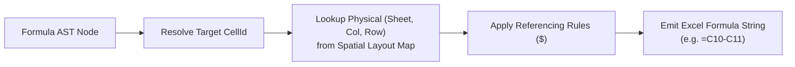

# Formula Lowering & Binary Emission

This document specifies Finx's formula lowering engine and workbook emission pipeline (Pass 6), transforming semantic AST expressions into Excel formulas and serializing `.xlsx` binaries or headless data.

## 1. Formula Lowering Engine

Formula lowering resolves high-level semantic coordinates into concrete Excel references with appropriate relative and absolute coordinate referencing (`$`):

### 1.1. Coordinate Lowering Rules

| Reference Type | Spec Syntax | Sheet Context | Lowered Excel Formula |
| :--- | :--- | :--- | :--- |
| **Active Column (`[@]`)** | `Revenue[@]` | Same sheet | Relative column: `=C10` |
| **Specific Column** | `Assumptions.tax_rate["value"]` | Different sheet (`Summary`) | Absolute coordinate: `='Summary'!$B$4` |
| **Specific Column** | `Balance["2023A"]` | Same sheet | Absolute coordinate: `=$C$10` |
| **Horizontal Range** | `Revenue[cols.forecast]` | Same sheet | Horizontal slice: `=SUM(C10:G10)` |
| **Vertical Range** | `BalanceSheet[rows.current_assets, @]` | Same sheet | Vertical slice: `=SUM(C14:C18)` |
| **2D Block Range** | `BalanceSheet[rows.current_assets, cols.forecast]` | Same sheet | 2D matrix: `=SUM(C14:G18)` |

### 1.2. AST Serialization
- Function names map to canonical uppercase names (`SUM`, `IF`, `XLOOKUP`).
- Operators map to native Excel symbols (`+`, `-`, `*`, `/`, `^`, `=`, `<>`).
- Emitted formula strings are prefixed with `=`.

---

## 2. Excel Binary Emission (`rust_xlsxwriter`)

The binary emitter streams the spatial layout, styling, and lowered formulas into a valid `.xlsx` package:

1. **Calculation configuration**: Sets calculation properties in workbook XML:
   - `calcPr.iterate = false` (enforcing zero circularity).
   - `calcPr.fullCalcOnLoad = true` (requesting full calculation on first open).
2. **Format cache**: Deduplicates styles, fonts, borders, fills, and number format strings.
3. **Cell streaming**:
   - **Literal cells**: Emitted via `write_number`, `write_string`, or `write_boolean`.
   - **Formula cells**: Emitted via `write_formula`. In standard builds, each formula cell is pre-populated with its in-memory evaluated result (`set_result`). This ensures non-Excel viewers (Apple Numbers, macOS Quick Look, Google Drive preview, pandas, LibreOffice) display valid numbers immediately without an Excel recalculation pass.
   - **Values-only freezing**: When compiled with `--values-only`, formula cells are emitted as pure literals, producing frozen workbooks suitable for M&A data rooms and audit baselines.
4. **Finalization**: Compresses and saves the OpenXML package.

---

## 3. Headless Data Serialization

Because the in-memory evaluator maintains the complete `CellValue` matrix across all tables, Finx supports direct headless exports without Excel binary overhead:

- **JSON / CSV / Parquet**: Exports evaluated tables directly to structured files for AI agent consumption, CI/CD verification, and database pipelines.

See [Spatial Layout Planning](spatial-layout.md) for grid assignment, [In-Memory Evaluator](evaluator.md) for precalculated cache values, and [Addressing Syntax](../dsl/addressing.md) for input reference formats.
