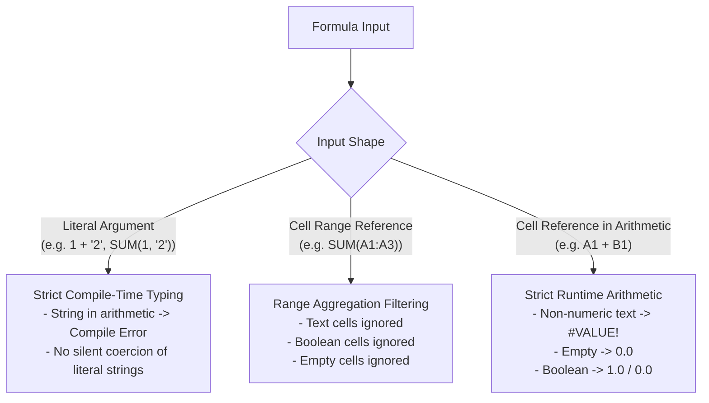

# Excel Parity & Evaluation Semantics

This document specifies Finx's calculation parity rules with Microsoft Excel, defining numeric precision, coercion mechanics, date arithmetic, and explicit scalar evaluation.

## 1. Numeric Precision & Representation

- **Floating-point standard**: All numeric calculations use IEEE 754 double-precision floats (`f64`), matching Excel's internal 64-bit float representation.
- **Subnormal numbers and zeros**: Signed zeros (`-0.0`) normalize to `0.0`. `NaN` and infinite values map to appropriate [`ExcelError`](evaluator.md#excel-error-values-excelerror) domain errors (`ExcelError::Num` or `ExcelError::Div0`).

---

## 2. Coercion & Type Semantics

Finx enforces strict static typing for formula literals while maintaining Excel's range aggregation semantics.

### 2.1. Strict Literal Typing (No Magic Literal Coercion)
Formula expressions reject string literals in arithmetic operators and numeric function arguments at compile time:
- Incompatible literal arithmetic (e.g. `1 + "2"` or `"foo" * 3`) produces a compile-time type mismatch error (`CompileError::TypeMismatch`).
- Function signatures enforce parameter types. Passing a string literal to a numeric argument (e.g. `SUM(1, "2")` or `ROUND("1.5", 0)`) fails compilation.
- Booleans passed as literals to arithmetic functions coerce to numbers according to signature: `TRUE -> 1.0`, `FALSE -> 0.0`.

### 2.2. Range Reference Aggregation Filtering
When cell coordinates are passed via range references to numeric aggregators (e.g. `SUM(A1:A3)`, `AVERAGE(A1:A3)`):
- Text cells are ignored during summation and averaging.
- Boolean cells are ignored.
- Empty cells are ignored.
- Example: If `A1 = 1.0`, `A2 = "text"`, `A3 = TRUE`, then `SUM(A1:A3)` evaluates to `1.0`.

### 2.3. Empty Cell Semantics
- **Arithmetic context**: Empty cells coerce to `0.0` (`Empty + 10.0 = 10.0`).
- **String context**: Empty cells coerce to empty strings (`""`).
- **Aggregations**: `AVERAGE` and `COUNT` ignore empty cells, whereas cells containing explicit zero (`0.0`) are counted in divisors.

### 2.4. Logical & Boolean Coercion
- In arithmetic expressions (`+`, `-`, `*`, `/`, `^`), `TRUE` coerces to `1.0` and `FALSE` coerces to `0.0`.
- Comparison expressions (`=`, `<>`, `<`, `<=`, `>`, `>=`) evaluate to `CellValue::Boolean`.

---

## 3. Evaluation Strategies

### 3.1. Explicit Scalar Evaluation (Zero Dynamic Spill)
To guarantee strict compliance with the FAST Standard and maintain full determinism:
- Every cell formula evaluates to exactly one scalar [`CellValue`](evaluator.md#3-cell-value--error-representation).
- Formulas never return dynamic arrays and never spill across neighboring cells.
- Multi-column logic is handled explicitly during grid expansion (e.g. `"expr": "Price[@] * Volume[@]"` unrolled per column), eliminating implicit matrix broadcasting.
- Ranges and 2D arrays are strictly inputs to aggregating functions (`SUM`, `AVERAGE`, `XNPV`, `XLOOKUP`).

### 3.2. Short-Circuiting vs. Eager Evaluation
- **Lazy evaluation**: `IF`, `IFS`, `IFERROR`, `IFNA`, `CHOOSE`, and `SWITCH` use `ParamKind::Lazy` for conditional branches. Dormant branches remain unevaluated, preventing false `#DIV/0!` or lookup errors.
- **Eager logical evaluation**: `AND` and `OR` evaluate all arguments eagerly, mirroring Excel. In `=IF(AND(A1 > 0, 1 / A1 > 0.5), "ok", "zero")`, if `A1 == 0`, evaluating `1 / A1` produces `#DIV/0!`.

### 3.3. Explicit Omitted Arguments (`null`)
- Omitted optional positional arguments must be explicitly marked with `null` in formula expressions (e.g. `PMT(r, n, pv, null, 1)`).
- Consecutive empty commas (e.g. `,,`) are prohibited in formula grammar to eliminate parsing ambiguity and index miscounting.
- The evaluator substitutes explicit `null` arguments with `ParameterDef::default_value` when defined, or passes `FunctionArg::Omitted` to the function implementation. During formula lowering, `null` lowers to standard Excel omitted positional argument syntax or configured defaults.

---

## 4. Date Representation & Arithmetic

Excel represents dates as floating-point day counts rather than a dedicated primitive type.

### 4.1. Serial Day Numbering
- **Excel epoch**: Serial day `1.0` represents `1900-01-01`.
- **Storage**: Dates are stored in `CellValue::Number(f64)`.
- **Unix epoch conversion**: Unix timestamp `1970-01-01 00:00:00 UTC` corresponds to Excel serial day `25569.0`:
  $$\text{excel\_serial} = \frac{\text{unix\_timestamp\_seconds}}{86400.0} + 25569.0$$
- **No implicit string coercion**: Date arithmetic and date functions require explicit numeric serial dates or explicit `DATE(year, month, day)` constructor expressions. Passing string literals (e.g. `"2024-01-31"`) directly into date math is prohibited to prevent locale-dependent parsing errors across regional spreadsheet environments.

### 4.2. Date Difference & Stepping
- **Day differences**: Subtracting two date numbers yields elapsed days ($\Delta d = d_2 - d_1$).
- **Month stepping (`EDATE`, `EOMONTH`)**: Adding or subtracting calendar months adjusts year and month components while clamping the day to the last valid day of the target month (e.g. `EDATE(DATE(2024, 1, 31), 1)` clamps to `2024-02-29` in leap years).

### 4.3. Discounting Year Fractions (`XNPV` & `XIRR`)
Non-periodic discounting functions use the Actual/365 convention with a fixed annual divisor of `365.0`:
$$\text{Year Fraction}_i = \frac{d_i - d_1}{365.0}$$

### 4.4. Contractual Day Count Conventions (`YEARFRAC`)
`YEARFRAC(start_date, end_date, [basis])` supports standard financial day count conventions:

| Basis | Day count convention | Annual divisor | Primary modeling use case |
| :--- | :--- | :--- | :--- |
| `0` (or omitted) | US (NASD) 30/360 | 360 | US corporate bond interest accrual |
| `1` | Actual/actual | Days in year (365/366) | US Treasury bond interest and government securities |
| `2` | Actual/360 | 360 | Money markets, SOFR bank loans, revolvers, commercial debt |
| `3` | Actual/365 | 365 | UK/Commonwealth money markets, corporate discounting |
| `4` | European 30/360 | 360 | European bonds and Eurobonds (ICMA rule) |

- **Basis validation**: Integer values outside `0..=4` return `ExcelError::Num`. Fractional basis arguments are truncated to integers.
- **Order independence**: If `start_date > end_date`, `YEARFRAC` evaluates the non-negative fraction between the dates.

---

## 5. Range Slicing & Error Propagation

- **Slices**: Range references (e.g. `Table.row["2024E".."2028E"]` or `Table[rows.opex, @]`) resolve to ordered vectors of `CellValue`.
- **Multi-dimensional flattening**: Aggregators (`SUM`, `MAX`, `MIN`) flatten multi-dimensional slices before calculation.
- **Error bubbling**: Domain errors (`#REF!`, `#VALUE!`, `#DIV/0!`, `#NUM!`, `#N/A`) propagate through strict scalar arithmetic operations to dependent cells.

---

## 6. Deterministic Purity (Zero Volatile Functions)

- **Zero volatile functions**: Functions with runtime environmental dependencies (`TODAY`, `NOW`, `RAND`, `RANDBETWEEN`) are strictly excluded from Finx V1.
- **Explicit assumption parameters**: All timeline dates and modeling milestones must be supplied via explicit static parameters (e.g. `Assumptions.as_of_date` or `Assumptions.model_start_date`). This guarantees that headless execution, CI/CD pipelines, and opened Excel workbooks remain bit-for-bit identical and never desynchronize over time.

See [In-Memory Evaluator](evaluator.md) for DAG execution, [Function Registry](../functions/registry.md) for registry traits, and [Standard Catalog](../functions/catalog.md) for catalog definitions.
