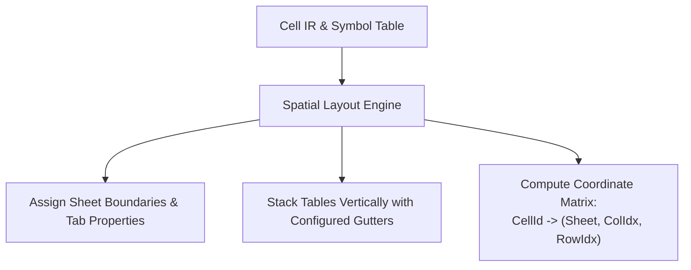

# Spatial Layout Planning

This document specifies Finx's spatial layout engine (Pass 5), mapping semantic tables and row structures into physical 2D grid coordinates on Excel worksheets.

## 1. Overview

The spatial layout engine arranges tables, row stubs, column headers, and gutters onto sheets, computing concrete row and column indices for each cell before formula lowering.

---

## 2. Vertical Stacking & Grid Structure

Within each worksheet, tables stack vertically in the order declared in `finx.json`.

### 2.1. Column Structure
- **Columns A & B (Row Stubs)**: Reserved for row labels and group outlines.
  - Category section rows: Emitted for parent `row_groups` with distinct typography.
  - Leaf row labels: Placed with indentation derived from `row_groups` tree depth.
- **Column C Onward (Data Columns)**: Assigned to table data columns in declared order.

### 2.2. Row Structure & Headers
1. **Table Title Row**: Optional styled title banner.
2. **Super-Headers**: Emitted when `column_groups` are present (spanning group child columns).
3. **Column Key Headers**: Primary column header row displaying column labels or IDs.
4. **Data Rows**: Expanded rows containing calculation or literal cells.
5. **Gutter Rows**: Configurable blank rows (default: 2) placed between adjacent stacked tables to prevent coordinate collisions.

### 2.3. Multi-Table Modularity
Stacked tables on the same sheet remain structurally independent:
- Tables do not need to share identical column counts, column keys, or timeline spans.
- An assumptions table with 1 data column can precede a 5-column forecast table on the same worksheet.
- Semantic formula references resolve via `Table[row, col]`, decoupled from physical grid locations.
- **Sheet-wide column width resolution**: Because Excel column widths apply sheet-wide, physical column width for any column index $c$ is computed as the maximum required width across all stacked tables sharing that column:
  $$\text{ColWidth}(c) = \max_{T \in \text{StackedTables}} \text{RequiredWidth}(T, c)$$
- **Modeling practice vs. compiler concern**: The layout engine applies the maximum required width to guarantee zero text clipping or `###` numeric overflow. Aligning column structures or isolating tables with disparate timelines onto dedicated worksheets is treated as a modeling practice (e.g. FAST Standard guidelines) rather than an artificial compiler barrier.

---

## 3. Worksheet-Level Properties

The layout engine applies worksheet attributes defined in the project manifest:
- **`freeze_panes`**: Freezes header rows and stub columns (`{"row": 4, "col": 2}`).
- **`tab_color`**: Applies visual hex color to worksheet tabs in Excel.
- **`show_gridlines`**: Configures workbook gridline visibility (default: `true`).

---

## 4. Coordinate Matrix Output

The spatial layout pass produces a deterministic lookup table:

$$\text{LayoutMap}: \text{CellId} \rightarrow (\text{SheetId}, \text{ColIdx}, \text{RowIdx})$$

This mapping provides the physical target coordinates consumed by the formula lowering engine.

See [Intermediate Representation (IR)](ir.md) for input cell structures and [Formula Lowering & Emission](lowering-and-emission.md) for coordinate translation and workbook writing.
