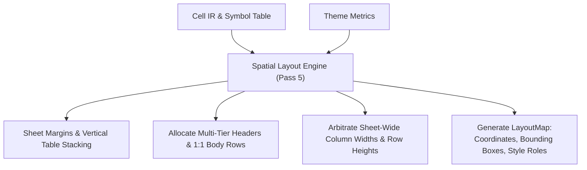

# Spatial Layout Planning

This document specifies f8's spatial layout engine (Pass 5), mapping semantic tables into physical 2D grid coordinates on Excel worksheets.

## 1. Overview

The spatial layout engine positions tables, title banners, multi-tier column headers, explicit body rows, and spacing gutters. It computes concrete cell coordinates, arbitrates sheet-wide column widths and row heights, and assigns semantic style roles before formula lowering and workbook emission.



---

## 2. Worksheet Margins & Table Placement

- **Default margins**: Worksheets begin with breathing room rather than flush at `A1`:
  - Top margin: 1 blank row (row 0, height `gutter_row_height`, default 9.0 pt).
  - Left margin: 1 blank column (col 0 / Column A, width `gutter_col_width`, default 3.0 characters).
  - Primary table origin: cell `B2` (row 1, col 1).
- **Inter-table gutters**: Stacked tables are separated by blank buffer rows (default 2 rows at `gutter_row_height`).
- **Placement modes**:
  - `StackVertical` (default): Stacks tables sequentially down the sheet.
  - `Explicit`: Positions a table at a fixed `(start_row, start_col)` coordinate.

---

## 3. Table Layout Structure

Every table occupies a contiguous physical bounding box:

$$\text{TableRows} = \text{TitleRow} + \text{SubtitleRow} + \text{TitleGutterRow} + \text{HeaderRows} + \text{BodyRows}$$

### 3.1. Header Stack
1. **Title row (optional)**: 1 row formatted with `title_size` typography and fill.
2. **Subtitle row (optional)**: 1 row formatted with muted `subtitle_size` typography.
3. **Title buffer gutter (optional)**: 1 blank row (`title_gutter_row_height`, default 8.0 pt) allocated when a title block exists.
4. **Column header rows**: Allocated if $N = \max(\text{headers.len()}) > 0$. Each tier receives uniform `header_row_height` (18.0 pt). If $N = 0$, zero header rows are allocated.

### 3.2. Body Rows (1:1 Physical Mapping)
Body rows map 1:1 to physical rows ($row_{\text{phys}} = row_{\text{body\_start}} + \text{index}$):
- **Data rows (`kind: "data"`)**: Assigned `data_row_height` (15.0 pt). Descriptor cells receive typographic indent from their cell-level `indent` attribute.
- **Section headers (`kind: "section_header"`)**: Assigned `section_row_height` (18.0 pt). Titles are placed at table `start_col` with left alignment and natural text overflow.
- **Gutters (`kind: "gutter"`)**: Assigned `gutter_row_height` (9.0 pt) with blank cells.

---

## 4. Column Structure & Width Arbitration

### 4.1. Explicit 1:1 Column Mapping
Columns map 1:1 to physical columns ($col_{\text{phys}} = col_{\text{start}} + \text{index}$):
- **Data columns (`kind: "data"`)**: Assigned arbitrated widths.
- **Gutter columns (`kind: "gutter"`)**: Assigned fixed `gutter_col_width` (3.0 characters) across all rows.

### 4.2. Sheet-Wide Column Width Arbitration
Excel column widths apply worksheet-wide. The layout engine arbitrates width as the maximum across all stacked tables sharing that column:
- **Bottom-tier header measurement**: Header string length is measured exclusively from the bottom-tier header (`headers.last()`). Multi-tier super-headers are excluded to prevent wide labels from distorting individual column widths.
- **Content measurement**: Evaluates string lengths of literals and cached values, scaled by theme typography and character padding (`col_padding`, default 2.0).
- **Safety floor**: Enforces `min_col_width` (12.0 characters) on measure columns to avoid numeric overflow (`###`).

---

## 5. Output Data Contract (`LayoutMap`)

Pass 5 produces a deterministic layout contract consumed by Formula Lowering and Workbook Emission:

```rust
pub struct LayoutMap {
    pub cells: IndexMap<CellId, PhysicalCoordinate>,
    pub tables: IndexMap<TableId, TablePlacement>,
    pub sheets: IndexMap<SheetId, SheetLayout>,
}

pub struct PhysicalCoordinate {
    pub sheet: SheetId,
    pub col: u32,
    pub row: u32,
    pub a1: String,
    pub style_role: StyleRole,
    pub indent: u8,
}

pub struct TablePlacement {
    pub sheet: SheetId,
    pub start_col: u32,
    pub start_row: u32,
    pub end_col: u32,
    pub end_row: u32,
    pub title_row: Option<u32>,
    pub subtitle_row: Option<u32>,
    pub title_gutter_row: Option<u32>,
    pub header_row_range: Option<(u32, u32)>,
    pub body_row_range: (u32, u32),
}

pub struct SheetLayout {
    pub sheet: SheetId,
    pub col_widths: IndexMap<u32, f64>,
    pub row_heights: IndexMap<u32, f64>,
    pub freeze_panes: Option<FreezePanes>,
    pub show_gridlines: bool,
    pub tab_color: Option<String>,
}
```

See [Specification Format & 2D Grid](../dsl/spec-format.md) for DSL definitions and [Formula Lowering & Emission](lowering-and-emission.md) for emission details.
