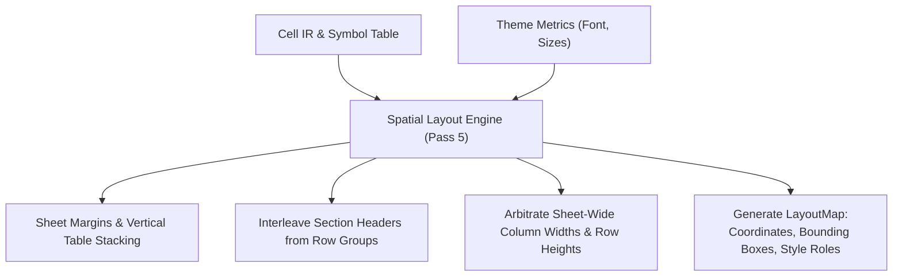

# Spatial Layout Planning

This document specifies Finx's spatial layout engine (Pass 5), mapping semantic tables, hierarchical row groups, and column groups into physical 2D grid coordinates on Excel worksheets.

## 1. Overview

The spatial layout engine arranges tables, title banners, super-headers, column headers, data rows, section headers, and gutters onto sheets. It computes concrete row and column indices, derives outline levels, resolves sheet-wide column widths and row heights using theme metrics, and assigns semantic style roles before formula lowering.



---

## 2. Worksheet Margins & Table Placement

Within each worksheet, tables stack vertically in the order declared in `finx.json` by default.

### 2.1. Sheet margins and gutters
- **Default sheet margins**: Institutional models start with visual breathing room rather than flush at `A1`. By default, the layout engine applies:
  - Top margin: 1 blank row (row index 0).
  - Left margin: 1 blank column (column index 0 / Column A as gutter).
  - Primary table origin: cell `B2` (row index 1, column index 1).
- **Inter-table gutters**: Configurable blank rows (default: 2 blank rows) separate vertically stacked tables to cleanly isolate distinct financial statements (e.g. Income Statement above Balance Sheet).
- **Configurable placement**:
  - `StackVertical` (default): Places the table below the preceding table separated by `gutter_rows`.
  - `Explicit`: Places the table at a specified `(start_row, start_col)` coordinate (e.g. for side-by-side Sources and Uses or KPI summary blocks).

---

## 3. Table Header & Row Structure

Every table occupies a contiguous physical bounding box computed from its header components, data rows, and hierarchical group structure:

$$\text{TableRows} = \text{TitleRow} + \text{SuperHeaderRows} + \text{ColumnHeaderRow} + \text{DataRows} + \text{SectionHeaderRows}$$

### 3.1. Header rows
1. **Table title row (optional)**: 1 row displaying the table title banner, formatted with elevated typography from the theme.
2. **Super-header rows (optional)**: 1 row per `column_groups` tier. Spans across grouped child column indices (e.g. "Historical Periods" spanning columns `2021A..2023A`, "Forecast Periods" spanning `2024E..2028E`).
3. **Column key header row**: 1 row displaying column display labels or identifiers.

### 3.2. Section headers & row hierarchy
- **Visual section header rows**: When `row_groups` define hierarchical categories (e.g. "Operating Expenses" grouping `r&d`, `s&m`, and `g&a`), the layout engine inserts a dedicated visual section header row:
  - Consumes 1 physical worksheet row.
  - Displays the group label in the primary descriptor column.
  - Remains blank across measure columns (or styled with group background shading).
  - Allocates no calculation `CellId` node in the DAG.
- **Hierarchy indentation & outline levels**:
  - Indents descriptor text according to tree depth in `row_groups`.
  - Computes Excel outline levels (`group_level: 1..7`) to enable native collapsible grouping `[+]` / `[-]`.
- **Subtotal & total summary styling**:
  - Rows configured with `SemanticStyle::Subtotal` or `SemanticStyle::Total` assign horizontal summary borders (`top thin` for subtotal; `top thin` + `bottom double` for total).
  - Columns configured with `SemanticStyle::Subtotal` or `SemanticStyle::Total` assign vertical summary borders (`left thin` for subtotal; `left thin` + `right double` for total).
  - Cells at the intersection of total rows and total columns compose both rules into fully framed accounting boxes.
  - Cell overrides declaring `style: "data"` cleanly suppress inherited borders on descriptor or memo cells.

---

## 4. Column Structure & Sheet-Wide Arbitration

### 4.1. Explicit 1:1 column mapping
Table columns $0 \dots C-1$ map directly to worksheet column offsets relative to the table's starting column. The compiler never injects implicit, unaddressed stub columns.

### 4.2. Sheet-wide column width resolution
Because Excel column widths apply across the entire worksheet:
- Physical column width for any column index $c$ is computed as the maximum required width across all stacked tables sharing that column:
  $$\text{ColWidth}(c) = \max_{T \in \text{StackedTables}} \text{RequiredWidth}(T, c)$$
- **Width calculation**:
  - Based on maximum string length of headers, formatted literals, and evaluate cache values.
  - Scaled by theme font family and size metrics.
  - Enforces a safe minimum column width (default: 12.0 character widths) on measure columns to prevent `###` numeric overflow on formatted currency, percentage, and negative numbers with parentheses.

### 4.3. Typography-aware row heights
Row heights are assigned based on theme typography:
- Table title rows: default 24.0 pt.
- Super-header and column header rows: default 18.0 pt.
- Section category rows: default 18.0 pt.
- Standard data rows: default 15.0 pt.

---

## 5. Worksheet Properties & Freeze Panes

- **`freeze_panes`**: Optional explicit physical coordinates `{ row: R, col: C }` configured in `SheetSpec`. When present, freezes rows above index $R$ and columns to the left of index $C$. Omitted (`None`) for unpinned sheets.
- **`tab_color`**: Optional hex color string applied to the worksheet tab.
- **`show_gridlines`**: Configures workbook gridline visibility (default: `true`).

---

## 6. Output Data Contract (`LayoutMap`)

Pass 5 produces a deterministic layout contract consumed by Pass 6a (Formula Lowering) and Pass 6b (Workbook Emission):

```rust
pub struct LayoutMap {
    /// Physical location and style role for every CellId.
    pub cells: IndexMap<CellId, PhysicalCoordinate>,
    /// Bounding boxes and header offsets for every table.
    pub tables: IndexMap<TableId, TablePlacement>,
    /// Sheet-level layout metrics, widths, heights, and visual rows.
    pub sheets: IndexMap<SheetId, SheetLayout>,
}

pub struct PhysicalCoordinate {
    pub sheet: SheetId,
    pub col: u32,
    pub row: u32,
    pub a1: String,
    pub style_role: StyleRole,
}

pub struct StyleRole {
    pub horizontal: SemanticStyle,
    pub vertical: SemanticStyle,
    pub is_highlight: bool,
}

pub struct TablePlacement {
    pub sheet: SheetId,
    pub start_col: u32,
    pub start_row: u32,
    pub end_col: u32,
    pub end_row: u32,
    pub title_row: Option<u32>,
    pub super_header_rows: Vec<SuperHeaderPlacement>,
    pub col_header_row: u32,
    pub data_row_range: (u32, u32),
}

pub struct SheetLayout {
    pub sheet: SheetId,
    pub col_widths: IndexMap<u32, f64>,
    pub row_heights: IndexMap<u32, f64>,
    pub section_header_rows: Vec<SectionHeaderRow>,
    pub freeze_panes: Option<FreezePanes>,
    pub show_gridlines: bool,
    pub tab_color: Option<String>,
}
```

See [Semantic Formatting & Themes](../dsl/formatting.md) for theme structure, and [Formula Lowering & Emission](lowering-and-emission.md) for coordinate translation and workbook writing.
