# Addressing Syntax

This document defines the reference addressing syntax used in Finx formulas and specification models.

## 1. Core Invariants

- **Mandatory table qualification**: Every cell reference must specify its target table identifier (`Table[row, col]`). Bare, unqualified references (e.g. `["revenue", @col]`) are strictly prohibited.
- **Universal 2D coordinate matrix**: All references use two-dimensional bracket indexing: `Table[RowSelector, ColSelector]`. Dot access (e.g. `Table.row[...]`) is strictly prohibited, ensuring row and column dimensions are fully symmetrical and orthogonal across both horizontal and vertical schedules.
- **Strictly quoted coordinate keys**: Every row and column key inside bracket selectors must be an explicit double-quoted string (e.g. `["revenue"]`, `["2024E"]`, `["r_and_d".."g_and_a"]`). Bare identifiers are never permitted as coordinate keys, guaranteeing immunity from keyword collisions, numeric prefixes (`2024E`), and date formats.
- **Unquoted keywords and selectors**: Built-in language constructs (`@col`, `@row`, `col.prev`, `col.next`, `row.prev`, `row.next`, `cols.<group>`, `rows.<group>`) are unquoted tokens within bracket selectors.
- **Active evaluation tokens (`@col`, `@row`)**: 
  - `@col` designates the evaluating cell's active column identifier (`ColId`) at column index $c$.
  - `@row` designates the evaluating cell's active row identifier (`RowId`) at row index $r$.
  - In cross-table references (e.g. `TableB["row", @col]` or `TableB[@row, "col"]`), the target table must declare a matching coordinate ID; positional index matching without matching IDs is strictly prohibited.
- **Strict relative temporal offsets**: `col.prev(k)` / `col.next(k)` and `row.prev(k)` / `row.next(k)` compute relative offsets along the origin cell's table axes ($t - k$ and $t + k$), binding to the corresponding coordinate in the target table. There is zero implicit string matching or calendar heuristics.
- **Syntactic sugar for group milestones**: `cols.<group>.first`, `cols.<group>.last`, `rows.<group>.first`, and `rows.<group>.last` are compile-time syntactic sugar that resolve against the target table's registered groups into concrete, static coordinates.
- **Inclusive range intervals**: All coordinate ranges (`["col_a".."col_b"]` and `["row_a".."row_b"]`) are inclusive closed intervals ($[a, b]$) and must follow strict declaration order ($start\_idx \le end\_idx$). Inverted ranges are rejected at compile time.
- **No implicit broadcasting**: Aggregations across rows or columns must provide explicit range bounds (e.g. `["2024E".."2028E"]`) or named group bounds (e.g. `[cols.forecast]`).
- **Zero alternative syntax**: There is exactly one canonical way to reference any cell, range, or block. Syntactic redundancies are eliminated.

---

## 2. Addressing Modes

```mermaid
flowchart TD
    A["Reference"] --> B{"Syntax Shape"}
    B -->|"Table['row', @col]"| C["Single Cell (Active Column)<br>e.g. IncomeStatement['revenue', @col]"]
    B -->|"Table[@row, 'col']"| D1["Single Cell (Active Row)<br>e.g. CapTable[@row, 'shares']"]
    B -->|"Table['row', 'col']"| D2["Single Cell (Specific Coordinate)<br>e.g. Assumptions['tax_rate', 'value']"]
    B -->|"Table['row', col.prev]"| E1["Single Cell (Column Temporal Offset)<br>e.g. BalanceSheet['cash', col.prev]"]
    B -->|"Table[row.prev, 'col']"| E2["Single Cell (Row Temporal Offset)<br>e.g. DebtSchedule[row.prev, 'end_balance']"]
    B -->|"Table['row', cols.group.last]"| J["Single Cell (Group Milestone Anchor)<br>e.g. DebtSchedule['balance', cols.historical.last]"]
    B -->|"Table['row', 'col_a'..'col_b']"| F["Row Range (Horizontal Slice)<br>e.g. IncomeStatement['revenue', '2024E'..'2028E']"]
    B -->|"Table['row', cols.group]"| K["Row Range (Horizontal Group Slice)<br>e.g. IncomeStatement['revenue', cols.forecast]"]
    B -->|"Table['row_a'..'row_b', @col]"| G["Column Range (Vertical Slice, Active)<br>e.g. IncomeStatement['r_and_d'..'g_and_a', @col]"]
    B -->|"Table[rows.group, @col]"| L["Column Range (Vertical Group Slice, Active)<br>e.g. BalanceSheet[rows.current_assets, @col]"]
    B -->|"Table['row_a'..'row_b', 'col']"| H["Column Range (Vertical Slice, Specific)<br>e.g. IncomeStatement['r_and_d'..'g_and_a', '2023A']"]
    B -->|"Table['row_a'..'row_b', 'col_a'..'col_b']"| I["2D Block Range (Explicit Keys)<br>e.g. IncomeStatement['r_and_d'..'g_and_a', '2024E'..'2028E']"]
    B -->|"Table[rows.group, cols.group]"| M["2D Block Range (Group Slices)<br>e.g. BalanceSheet[rows.current_assets, cols.forecast]"]
```



---

## 3. Syntax Specifications & Lowering Rules

### 3.1. Active Coordinate Cells (`@col`, `@row`)

References a coordinate tracking the cell currently being evaluated.

#### Active Column (`@col`)
Used in horizontal schedules where formulas are row-wide and track the active period:
```text
IncomeStatement["revenue", @col] - IncomeStatement["cogs", @col]
```
- **Resolution**: Binds to the column identifier (`ColId`) of the cell currently being evaluated at index $c$.
- **Cross-table validation**: Target table must declare a column with that identical `ColId`.
- **Lowering**: Emits relative column coordinates (e.g. `=C10 - C11` in column C, `=D10 - D11` in column D).

#### Active Row (`@row`)
Used in vertical schedules (Cap Tables, Debt Amortization) where formulas are column-wide:
```text
CapTable[@row, "shares"] * CapTable[@row, "share_price"]
```
- **Resolution**: Binds to the row identifier (`RowId`) of the cell currently being evaluated at index $r$.
- **Cross-table validation**: Target table must declare a row with that identical `RowId`.
- **Lowering**: Emits relative row coordinates (e.g. `=C5 * D5` at row 5, `=C6 * D6` at row 6).

### 3.2. Specific Coordinate Cell

References a concrete, static cell coordinate.

```text
IncomeStatement["ebit", @col] * Assumptions["tax_rate", "value"]
DebtSchedule["balance", "2023A"]
Scenarios["growth_rate", "Bull"]
```

- **Lowering**: Emits absolute coordinates with `$` (e.g. `='Summary'!$B$4` or `=$C$10`).

### 3.3. Relative Temporal Offsets (`col.prev`, `col.next`, `row.prev`, `row.next`)

References a relative coordinate offset from the active evaluation position.

#### Column Temporal Offsets (`col.prev`, `col.next`)
```text
BalanceSheet["cash", col.prev] + CashFlow["net_change", @col]
CashFlow["ar_change", @col] = BalanceSheet["accounts_receivable", @col] - BalanceSheet["accounts_receivable", col.prev]
```
- **Supported forms**: `col.prev`, `col.prev(k)`, `col.next`, `col.next(k)`.
- **Lowering**: Emits relative column coordinates in Excel (e.g. `=C10` when evaluating at column D).

#### Row Temporal Offsets (`row.prev`, `row.next`)
```text
DebtSchedule[row.prev, "end_balance"]
```
- **Supported forms**: `row.prev`, `row.prev(k)`, `row.next`, `row.next(k)`.
- **Lowering**: Emits relative row coordinates in Excel (e.g. `=E9` when evaluating at row 10).

#### Offset Rules & Bounds Enforcement
- Evaluates strictly against index $t \pm k$ within the origin table's declared axis items.
- If $t - k < 0$, compilation fails with `TemporalUnderflow`.
- If $t + k \ge \text{len()}$, compilation fails with `TemporalOverflow`.
- **Base Anchor Requirement**: The initial boundary coordinate (e.g. $t = 0$) using `prev` requires an explicit base anchor provided via a point cell override in `cells`.

### 3.4. Semantic Group Milestones (`cols.<group>.first`, `cols.<group>.last`, `rows.<group>.first`, `rows.<group>.last`)

References a named boundary within a declared column or row group.

```text
DebtSchedule["balance", cols.historical.last]
DebtSchedule["balance", cols.forecast.first]
Comps["market_cap", cols.market_data.first]
BalanceSheet[rows.current_assets.first, @col]
BalanceSheet[rows.current_assets.last, "2024E"]
```

- **Syntactic sugar**: Resolves at compile time into the concrete coordinate key of the group's boundary (e.g. `"2023A"` or `"cash"`), lowering to an absolute coordinate (e.g. `=$C$10` or `='Summary'!$B$4`).
- **Target table scoping**: The group token is strictly resolved against the declared `column_groups` or `row_groups` of the **target table**.
- **Safety guarantee**: Validated at schema ingestion to ensure groups are non-empty (`len >= 1`) and contiguous.

### 3.5. Horizontal Range (Row Slice)

Aggregates multiple columns along a single row.

```text
SUM(IncomeStatement["revenue", "2024E".."2028E"])
SUM(IncomeStatement["revenue", cols.forecast])
```

- **Inclusive intervals**: Both boundary keys are included ($[start, end]$).
- **Declaration order**: Requires $start\_idx \le end\_idx$ in declaration order; inverted ranges fail with `InvalidColRange`.
- **Lowering**: Static coordinate keys and group boundaries lower to absolute cell ranges (e.g. `=SUM($C$10:$G$10)`).

### 3.6. Vertical Range (Column Slice)

Aggregates multiple rows within a single column using explicit row key bounds or semantic row groups.

```text
SUM(IncomeStatement["r_and_d".."g_and_a", @col])
SUM(BalanceSheet[rows.current_assets, @col])
SUM(BalanceSheet[rows.current_assets, "2024E"])
```

- **Inclusive intervals**: Both boundary rows are included ($[start, end]$). Inverted row ranges fail with `InvalidRowRange`.
- **Lowering**: Resolves `rows.<group>` to the contiguous vertical row slice of all flattened descendant rows of the targeted group, emitting vertical ranges with relative column for active column (`=SUM(C$14:C$18)`) or absolute column for specific column keys (`=SUM($B$14:$B$18)`).

### 3.7. 2D Block Range

Aggregates a two-dimensional matrix across multiple rows and columns.

```text
SUM(IncomeStatement["r_and_d".."g_and_a", "2024E".."2028E"])
SUM(BalanceSheet[rows.current_assets, cols.forecast])
```

- **Inclusive intervals**: Rectangular closed interval across both dimensions.
- **Lowering**: Emits 2D rectangular ranges (e.g. `=SUM($C$14:$G$18)`).

---

## 4. Cross-Sheet & Coordinate Anchoring Semantics

All table references are resolved through the workbook symbol table:

- **Intra-sheet**: When referencing a table located on the same worksheet, coordinates omit sheet prefixes (`=C10`).
- **Inter-sheet**: When referencing a table on a different worksheet, the compiler automatically adds quoted sheet qualification (`='Summary'!$B$4`).
- **Dynamic vs. absolute coordinate anchoring**:
  - **Dynamic coordinates (`@col`, `@row`, `col.prev`, `col.next`, `row.prev`, `row.next`)**: Lower to relative coordinates so that formulas track active positions across rows or columns.
  - **Static coordinates (explicit `["col"]`, `["row"]`, `["start".."end"]`, groups, milestones)**: Lower to absolute coordinates (`$`) so they remain fixed when evaluated across the grid.

See [Formula Grammar](grammar.md) for the complete EBNF specification and [Formula Lowering & Emission](../compiler/lowering-and-emission.md) for coordinate resolution details.
