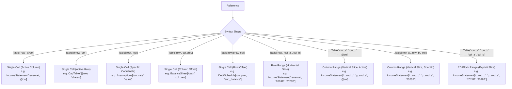

# Addressing Syntax

This document defines the reference addressing syntax used in f8 formulas and specification models.

## 1. Core Invariants

- Mandatory table qualification: Every cell reference must specify its target table identifier (`Table[row, col]`). Bare, unqualified references are strictly prohibited.
- Universal 2D coordinate matrix: All references use two-dimensional bracket indexing: `Table[RowSelector, ColSelector]`.
- Strictly quoted coordinate keys: Every row and column key inside bracket selectors must be an explicit double-quoted string (e.g. `["revenue"]`, `["2024E"]`, `["r_and_d".."g_and_a"]`).
- Unquoted keywords and selectors: Built-in language constructs (`@col`, `@row`, `col.prev`, `col.next`, `row.prev`, `row.next`) are unquoted tokens within bracket selectors.
- Active evaluation tokens (`@col`, `@row`): 
  - `@col` designates the evaluating cell's active column identifier (`ColId`).
  - `@row` designates the evaluating cell's active row identifier (`RowId`).
  - Cross-table references require target tables to declare matching coordinate IDs.
- Relative axis navigation (`RelativeOffset`):
  - `col.prev(k)` / `col.next(k)` navigate strictly across `measure` columns, bypassing gutters and halting at descriptor boundaries.
  - `row.prev(k)` / `row.next(k)` navigate strictly across calculable data rows, bypassing section headers and gutters.
  - Offset parameter `(k)` defaults to `1` when omitted (`col.prev` == `col.prev(1)`).
- Inclusive range intervals: All coordinate ranges (`["col_a".."col_b"]` and `["row_a".."row_b"]`) are inclusive closed intervals (`[a, b]`) and must follow declared declaration order.
- Zero implicit broadcasting: Aggregations across rows or columns require explicit slice bounds (e.g. `["2024E".."2028E"]`).

---

## 2. Addressing Modes



---

## 3. Syntax Specifications & Lowering Rules

### 3.1. Active Coordinate Cells (`@col`, `@row`)

References a coordinate tracking the cell currently being evaluated.

- Active column (`@col`): Tracks the evaluating column index `c`. Lowers to relative column references (e.g. `=C10 - C11`).
- Active row (`@row`): Tracks the evaluating row index `r`. Lowers to relative row references (e.g. `=C5 * D5`).

### 3.2. Specific Coordinate Cell

References a static coordinate key. Lowers to absolute coordinates (e.g. `=$C$10` or `='Summary'!$B$4`).

```text
IncomeStatement["ebit", @col] * Assumptions["tax_rate", "value"]
DebtSchedule["balance", "2023A"]
```

### 3.3. Relative Offsets (`col.prev`, `col.next`, `row.prev`, `row.next`)

References an offset from the active evaluation position along the calculable axis sequence.

- Column offsets: `col.prev`, `col.prev(k)`, `col.next`, `col.next(k)`.
- Row offsets: `row.prev`, `row.prev(k)`, `row.next`, `row.next(k)`.
- Descriptor boundary protection: Relative column navigation crossing descriptor boundaries or table bounds produces `TemporalOffsetOutOfBounds`.
- Base anchor requirement: Boundary coordinates (e.g. initial period) using `prev` require an explicit point override in `cells`.

### 3.4. Horizontal Range (Row Slice)

Aggregates multiple columns along a single row:

```text
SUM(IncomeStatement["revenue", "2024E".."2028E"])
```

Static column bounds lower to absolute horizontal cell ranges (e.g. `=SUM($C$10:$G$10)`).

### 3.5. Vertical Range (Column Slice)

Aggregates multiple rows within a single column:

```text
SUM(IncomeStatement["r_and_d".."g_and_a", @col])
SUM(IncomeStatement["r_and_d".."g_and_a", "2024E"])
```

Active column slices lower with relative column references (`=SUM(C$14:C$18)`); specific column slices lower with absolute column references (`=SUM($C$14:$C$18)`).

### 3.6. 2D Block Range

Aggregates a rectangular two-dimensional block across rows and columns:

```text
SUM(IncomeStatement["r_and_d".."g_and_a", "2024E".."2028E"])
```

Lowers to a 2D rectangular range (e.g. `=SUM($C$14:$G$18)`).

---

## 4. Cross-Sheet & Coordinate Anchoring Semantics

- Intra-sheet: References on the same worksheet omit sheet prefixes (`=C10`).
- Inter-sheet: References across worksheets include single-quoted sheet qualification (`='Summary'!$B$4`).
- Anchoring:
  - Dynamic coordinates (`@col`, `@row`, `col.prev`, `row.prev`) emit relative coordinates so formulas track active cells.
  - Static coordinates (explicit keys and slice bounds) emit absolute coordinates (`$`).

See `docs/dsl/grammar.md` for the complete EBNF specification.
