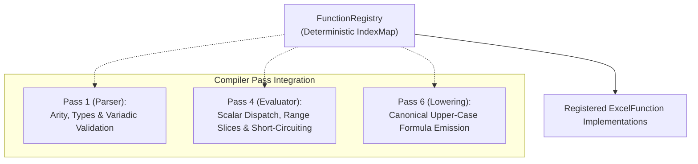

# Function Registry Architecture

This document specifies f8's Excel function registry, parameter contracts, runtime dispatch model, and compiler lifecycle integration.

---

## 1. Overview & Architectural Role

The function registry decouples built-in Excel function implementations from compiler internals, providing a centralized single source of truth across three compiler passes:

- **Static call validation (Pass 1)**: Verifies function identifiers, arity bounds, variadic pair rules, and argument omission constraints during formula AST construction.
- **In-memory evaluation (Pass 4)**: Dispatches arguments to registered Rust implementations, supporting range aggregations, lazy branch short-circuiting, and returning scalar cell values.
- **Formula lowering (Pass 6)**: Emits canonical uppercase Excel formula strings (`SUM`, `XLOOKUP`), leaving OpenXML syntax and prefixes to the emission layer.

---

## 2. Parameter Contracts & Evaluation Strategies

Each registered function defines parameter expectations using strongly typed metadata (`ParameterDef`).

### 2.1. Parameter Kinds (`ParamKind`)

| Kind | Description | Handling in Evaluator | Example Functions |
| :--- | :--- | :--- | :--- |
| **`Scalar`** | Single cell value | Evaluated eagerly to a scalar `CellValue` | `ABS`, `ROUND`, `YEAR` |
| **`RangeOrArray`** | 1D or 2D rectangular range slice | Pre-evaluated range slice preserving dimensions and range provenance | `SUM`, `AVERAGE`, `XLOOKUP` (`lookup_array`) |
| **`Lazy`** | Conditional branch expression | Passed as an unevaluated expression branch (`&Expr`), evaluated on demand | `IF`, `IFS`, `IFERROR`, `CHOOSE`, `SWITCH` |

### 2.2. Variadic Repetition Rules (`VariadicRule`)

| Rule | Repetition Constraint | Example Functions |
| :--- | :--- | :--- |
| **`None`** | Fixed parameter count; no repeating arguments | `ABS` (1), `ROUND` (2), `PMT` (3–5) |
| **`Single`** | Single trailing argument repeats indefinitely | `SUM(num1, [num2], ...)`, `AND(cond1, [cond2], ...)` |
| **`Pairs`** | Trailing arguments repeat in exact pairs | `IFS(test1, val1, [test2, val2], ...)`, `SUMIFS(rng, crit_rng1, crit1, ...)` |

---

## 3. Function Trait & Runtime Execution

Every built-in and user-registered Excel function implements the `ExcelFunction` contract:

- **Metadata**: Canonical uppercase name (`name()`), category (`category()`), and ordered parameter definitions (`parameters()`).
- **Arity contracts**:
  - `min_args()`: Derived from non-optional parameters.
  - `max_args()`: Finite bound for `VariadicRule::None`; unbounded for `Single` and `Pairs`.
- **Runtime execution (`evaluate`)**:
  - Consumes bound `FunctionArg` inputs (`Scalar`, `Array`, `Lazy`, `Omitted`).
  - Accesses contextual expression evaluation via `EvalContext`.
  - Always returns a single scalar `Result<CellValue, FunctionError>`.
  - Formulas never produce dynamic arrays or spill across neighboring cells, preserving a pure 1:1 cell dependency DAG.

---

## 4. Compiler Lifecycle Integration

1. **Parser & signature validation**:
   - Matches function names case-insensitively against `FunctionRegistry`. Unknown functions trigger `FunctionError::UnknownFunction`.
   - Validates argument counts against `min_args()` and `max_args()`.
   - Enforces variadic constraints (e.g. `VariadicRule::Pairs` requires paired arguments).
   - Verifies that omitted arguments (`_`) occur only where `ParameterDef::optional` is `true`.
2. **In-memory evaluation**:
   - Dispatches inputs according to `ParameterDef::kind`:
     - `Scalar`: Evaluates eagerly to `CellValue`.
     - `RangeOrArray`: Resolves coordinate ranges into `FunctionArg::Array` with `is_range_ref: true`.
     - `Lazy`: Binds unevaluated AST branches for conditional execution.
   - Normalizes omitted arguments (`_`) to parameter defaults or `FunctionArg::Omitted`.
   - Stores the evaluated scalar `CellValue` in the model matrix at `(TableId, RowId, ColId)`.
3. **Formula lowering**:
   - Emits canonical uppercase formula names (`SUM`, `XLOOKUP`, `IF`).
   - Translates omitted arguments (`_`) into standard Excel comma spacing (e.g. `, ,`).

---

## 5. Related Specifications & Reference Documents

- [Standard Function Catalog](./catalog.md): Supported Excel built-ins, signatures, and calculation behaviors.
- [Excel Function Registry Living Spec](../../specs/living-specs/functions/registry.md): Code-level trait contracts, exhaustive types, and BDD verification scenarios.
- [In-Memory Evaluator](../compiler/evaluator.md): Topological DAG evaluation loop and runtime state.
- [Excel Parity](../compiler/parity.md): Precision, coercion mechanics, date arithmetic, and criteria syntax.
