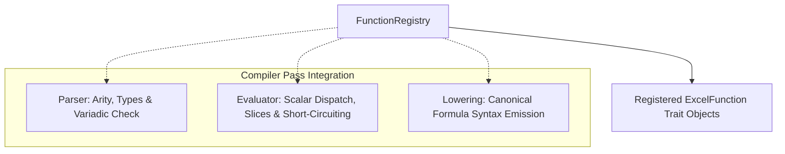

# Function Registry Architecture

This document specifies Finx's Excel function registry, parameter contracts, runtime dispatch types, and compiler lifecycle integration.

## 1. Overview

The function registry decouples built-in Excel function implementations from compiler internals, providing a unified contract across three compiler passes:

- **Static validation**: Verifies function names, arity bounds, variadic repetition rules, and argument omission constraints during AST construction.
- **Formula lowering**: Emits canonical uppercase Excel formula strings (`SUM(...)`, `XLOOKUP(...)`), leaving OpenXML prefixing (`_xlfn.`) to `rust_xlsxwriter`.
- **In-memory evaluation**: Dispatches argument evaluation to registered Rust implementations, supporting range aggregations, lazy short-circuiting, and returning scalar cell values.



---

## 2. Parameter & Argument Contracts

Signatures define parameter expectations using strongly typed metadata:

```rust
/// Classification of how a parameter consumes inputs.
#[derive(Debug, Clone, Copy, PartialEq, Eq)]
pub enum ParamKind {
    /// Scalar value. Expects a single CellValue.
    Scalar,
    /// Consumes 1D or 2D ranges/arrays as an aggregate (e.g. SUM, XLOOKUP lookup_array).
    RangeOrArray,
    /// Unevaluated AST expression branch evaluated conditionally on demand (e.g. IF, IFS).
    Lazy,
}

/// Variadic repetition constraints.
#[derive(Debug, Clone, Copy, PartialEq, Eq)]
pub enum VariadicRule {
    /// Fixed arity; no repeated arguments.
    None,
    /// Variadic single argument repetition (e.g. SUM(num1, [num2], ...)).
    Single,
    /// Arguments repeat in exact pairs (e.g. IFS(test1, val1, [test2, val2], ...)).
    Pairs,
}

/// Excel functional category.
#[derive(Debug, Clone, Copy, PartialEq, Eq)]
pub enum FunctionCategory {
    Math,
    Logical,
    Financial,
    Lookup,
    DateTime,
    Text,
    Information,
}

/// Strongly typed parameter definition.
#[derive(Debug, Clone)]
pub struct ParameterDef {
    /// Programmatic parameter name (e.g. "lookup_value", "basis").
    pub name: &'static str,
    /// Concise description for tooling, diagnostics, and AI agents.
    pub description: &'static str,
    /// Evaluation and binding strategy.
    pub kind: ParamKind,
    /// Whether the argument can be omitted by the caller.
    pub optional: bool,
    /// Default value assigned when the argument is omitted or empty.
    pub default_value: Option<CellValue>,
}
```

---

## 3. Runtime Argument Types

During topological evaluation, arguments are prepared as `FunctionArg`:

```rust
/// Argument passed into function evaluation.
pub enum FunctionArg<'a> {
    /// Unevaluated AST expression branch for conditional evaluation.
    Lazy(&'a ExprAst),
    /// Pre-evaluated scalar value.
    Scalar(CellValue),
    /// Evaluated range slice preserving dimensions and range provenance.
    Array {
        rows: usize,
        cols: usize,
        values: Vec<CellValue>,
        is_range_ref: bool,
    },
    /// Explicitly omitted positional argument (e.g. FUNC(a, null, c)).
    Omitted,
}

impl<'a> FunctionArg<'a> {
    /// Resolves argument to a scalar, evaluating lazy branches or extracting single-cell values.
    pub fn eval_scalar(&self, ctx: &EvalContext) -> Result<CellValue, EvalError>;

    /// Resolves argument to an array slice, preserving row and column dimensions.
    pub fn eval_array(&self, ctx: &EvalContext) -> Result<(usize, usize, Vec<CellValue>), EvalError>;
}
```

Every function execution evaluates strictly to a scalar `Result<CellValue, EvalError>`, maintaining 1:1 mapping with target `CellId` nodes.

---

## 4. The `ExcelFunction` Trait

Every built-in and user-registered Excel function implements `ExcelFunction`:

```rust
pub trait ExcelFunction: Send + Sync {
    /// Canonical uppercase Excel function name (e.g. "XLOOKUP").
    fn name(&self) -> &'static str;

    /// Excel functional category.
    fn category(&self) -> FunctionCategory;

    /// Ordered parameter definitions.
    fn parameters(&self) -> &'static [ParameterDef];

    /// Variadic repetition constraints.
    fn variadic_rule(&self) -> VariadicRule {
        VariadicRule::None
    }

    /// Minimum required arguments.
    fn min_args(&self) -> usize {
        self.parameters().iter().take_while(|p| !p.optional).count()
    }

    /// Maximum allowed arguments, or None if variadic.
    fn max_args(&self) -> Option<usize> {
        match self.variadic_rule() {
            VariadicRule::None => Some(self.parameters().len()),
            VariadicRule::Single | VariadicRule::Pairs => None,
        }
    }

    /// Evaluates function arguments against cell context, returning a scalar cell value.
    fn evaluate(&self, args: &[FunctionArg], ctx: &EvalContext) -> Result<CellValue, EvalError>;
}
```

---

## 5. Compiler Lifecycle Integration

1. **Parser & signature validation**:
   - Matches `FunctionName` against keys in `FunctionRegistry`. Unknown functions trigger `CompileError::UnknownFunction`.
   - Validates argument counts against `min_args()` and `max_args()`.
   - Enforces variadic repetition rules (e.g. `VariadicRule::Pairs` requires an even number of conditional arguments).
   - Verifies that omitted arguments occur only where `ParameterDef::optional` is `true`.
2. **Formula lowering**:
   - Emits canonical uppercase formula names (`SUM`, `XLOOKUP`, `IF`).
   - Formulas are written as standard formula cells via `write_formula`.
3. **In-memory evaluation**:
   - Dispatches inputs according to `ParameterDef::kind`:
     - `Scalar`: Evaluates expression eagerly to a single `CellValue`.
     - `RangeOrArray`: Resolves coordinate ranges into `FunctionArg::Array` with `is_range_ref: true`.
     - `Lazy`: Passed as `FunctionArg::Lazy` for conditional execution.
   - Substitutes omitted arguments with defaults or `FunctionArg::Omitted`.
   - Stores the resulting scalar `CellValue` in the evaluated matrix at `(TableId, RowId, ColId)`.

See [Standard Catalog](catalog.md) for built-in catalog definitions, [Excel Parity](../compiler/parity.md) for calculation semantics, and [In-Memory Evaluator](../compiler/evaluator.md) for DAG execution.
