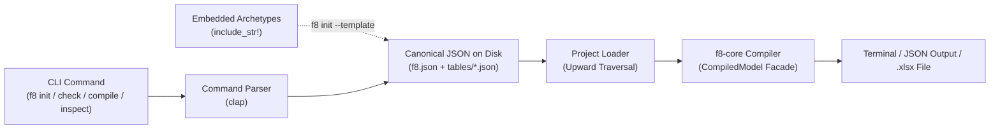

# Command-Line Interface (CLI)

This document defines the architecture, command hierarchy, and workflows of f8's command-line interface binary (`f8-cli`).

---

## 1. Overview & Role

The command-line interface (`f8-cli`) provides a direct terminal entrypoint for financial analysts (CFA personal workflow) and autonomous coding agents operating with shell access (such as Antigravity, Claude Code, or Cursor Composer).

`f8-cli` is the foundational outer interface built on top of `f8-core`:
- **Zero protocol overhead**: Provides instant, native execution without requiring MCP clients or JSON-RPC process management.
- **Dual human & agent access**: Shell-enabled AI agents execute CLI commands directly in terminal tools, enabling agentic modeling workflows from day one.
- **Pure compiler delegation**: The CLI delegates directly to:
  - **Embedded Archetypes**: Bundled institutional model templates compiled directly into the binary (`include_str!`) and unpacked to disk by `f8 init --template`.
  - **`f8-core`**: For specification validation, DAG acyclicity proofs, topological evaluation, spatial layout planning, formula lowering, and in-memory `.xlsx` buffer emission via the unified `CompiledModel` facade.
- **Declarative file authoring**: f8 strictly enforces declarative specifications over imperative CLI flag mutations. Model authoring is performed by directly editing `f8.json` and `tables/*.json` using standard text/JSON tools.



---

## 2. Project Discovery & Loading

The CLI discovers and loads projects deterministically across subdirectories:

1. **Manifest discovery**:
   - If `--project <path>` (or `-p <path>`) is specified, the CLI targets that file or directory directly. As a global flag, `-p` can be positioned before or after any subcommand (e.g. `f8 -p ./models check` or `f8 check -p ./models`).
   - Otherwise, the CLI starts in the current working directory and traverses upward through parent directories until it locates `f8.json` (identical to `cargo` finding `Cargo.toml` or `git` finding `.git`).
   - If no `f8.json` is found, the CLI returns exit code `1` with a descriptive error.
2. **Table discovery and resolution**:
   - The CLI scans the `tables/` directory adjacent to `f8.json` for all `*.json` files in deterministic sorted order.
   - Each table's logical identity is determined solely by its internal `"id"` property (e.g. `"IncomeStatement"`). Filenames are decoupled from table IDs.
   - Duplicate table IDs across discovered files are rejected with an operational error before compilation.
   - Manifest sheets reference tables purely by logical `TableId` (e.g. `"IncomeStatement"`).
3. **Theme resolution**:
   - Built-in themes (such as `"corporate_navy"`) resolve instantly via in-memory catalog.
   - Custom theme paths are resolved relative to the project directory and validated via `Theme::from_json_str`.

---

## 3. Command Hierarchy

All CLI operations are grouped under clear, noun-first subcommands with consistent global flags:

```text
f8 init [path] [--template <name>] [--theme <name>]
f8 check [-p <path>] [--json]
f8 compile [-p <path>] [-o <path>] [--theme <name>] [--values-only] [--omit-cache]
f8 inspect [-p <path>] [--json]
f8 inspect sheet <sheet_id> [--view <values|formulas|expr|addresses|both>] [--format <markdown|table|json>] [--json] [-p <path>]
f8 inspect table <table_id> [--view <values|formulas|expr|addresses|both>] [--format <markdown|table|json>] [--json] [-p <path>]
f8 inspect cell <table_id> <row_id> <col_id> [-p <path>] [--json]
f8 inspect precedents <table_id> <row_id> <col_id> [--recursive] [-p <path>] [--json]
f8 inspect dependents <table_id> <row_id> <col_id> [--recursive] [-p <path>] [--json]
```

---

### 3.1. Project Initialization (`f8 init`)

#### `f8 init [path] [options]`
Initializes a new f8 project directory with `f8.json` and a `tables/` directory.

```bash
# Initialize a blank project in a new directory
f8 init LBO_Model --theme corporate_navy

# Initialize a blank project in the current directory
f8 init .

# Initialize from an institutional template archetype
f8 init M_and_A_Comps --template trading-comps
```

**Options**:
- `--template <archetype>`, `-t <archetype>`: Model template to unpack. Supported archetypes:
  - `blank`: Minimal starter model with a single table.
  - `three-statement`: Integrated Income Statement, Balance Sheet, Cash Flow, and operating driver schedules.
  - `lbo`: Transaction assumptions, sources & uses, debt amortization schedules, and cash sweep waterfalls.
  - `trading-comps`: Peer valuation matrix with metric columns, valuation multiples, and summary benchmark aggregations.
  - `cap-table`: Ownership capitalization table with pre-/post-money valuation schedules and dilution tracking.
- `--theme <theme>`: Theme preset for the workbook (default: `corporate_navy`).

Templates are stored as canonical, valid JSON projects in `crates/f8-cli/templates/<archetype>/` (`f8.json` + `tables/*.json`), verified by unit tests during CI, and unpacked into the target project path. Formulas, typographic indentations, and semantic subtotal styles are pre-wired, ready for direct editing.

---

### 3.2. Verification & Compilation (`f8 check`, `f8 compile`)

#### `f8 check [options]`
Executes fast, headless compiler verification through Passes 1–6a without generating an `.xlsx` archive:
- Validates JSON schemas and AST domain invariants (Pass 1).
- Expands cell IR grid and constructs symbol table (Pass 2).
- Resolves all formula references and verifies DAG acyclicity (Pass 3).
- Executes in-memory topological calculation (Pass 4).
- Plans 2D spatial layout and boundary metrics (Pass 5).
- Lowers all formula expressions into concrete Excel syntax (Pass 6a).

Running all passes up to emission guarantees that if `f8 check` succeeds, subsequent `f8 compile` will never fail due to layout or lowering errors.

```bash
# Fast verification check
f8 check

# Machine-readable output for AI agents
f8 check --json
```

**Output (Human)**:
```text
✓ Validated 4 sheets, 6 tables, 142 cells
✓ DAG acyclicity verified (0 cycles)
✓ Evaluated 142 cells in 1.4ms
✓ Planned spatial layouts and verified formula lowering across 4 sheets
Status: OK
```

**Output (Agent / JSON)**:
```json
{
  "status": "ok",
  "summary": {
    "sheets": 4,
    "tables": 6,
    "cells": 142,
    "duration_ms": 1.4
  }
}
```

#### `f8 compile [options]`
Executes the full compiler pipeline (Passes 1–6b) and emits a compiled OpenXML `.xlsx` workbook:

```bash
# Compile and emit to default ./<model_name>.xlsx
f8 compile

# Compile and emit to explicit output path
f8 compile -o output/final_model.xlsx

# Compile with theme override
f8 compile --theme classic_charcoal -o dist/model.xlsx

# Compile and freeze formulas into values (for distribution)
f8 compile --values-only -o dist/client_presentation.xlsx
```

**Options**:
- `-o`, `--out <path>`: Destination path for the `.xlsx` workbook. Defaults to `./<model_name>.xlsx` using `model_name` from `f8.json`. Pass `-` for stdout streaming.
- `-p`, `--project <path>`: Project directory or manifest file path (defaults to searching current and parent directories).
- `--theme <name>`: Overrides the workbook theme configured in `f8.json`.
- `--values-only`: Emits the workbook with calculated formulas frozen into static values, omitting live Excel formulas.
- `--omit-cache`: Disables precalculated `<v>` calculation result caches in OpenXML cells.

---

### 3.3. Auditing & Inspection (`f8 inspect`)

All inspection subcommands query `f8-core`'s unified `CompiledModel` facade, operating purely in memory.

#### `f8 inspect [options]`
Renders a high-level summary overview of the workbook model, sheets, and tables:

```bash
f8 inspect
```

**Output (Human)**:
```text
Model:     Corporate LBO Model
Theme:     corporate_navy
Sheets (3):
  • Financials (2 tables, 120 cells)
      - Assumptions [6 rows x 2 cols] (12 cells)
      - IncomeStatement [18 rows x 6 cols] (108 cells)
  • BalanceSheet (1 table, 72 cells)
      - BalanceSheet [12 rows x 6 cols] (72 cells)
  • CashFlow (1 table, 60 cells)
      - CashFlow [10 rows x 6 cols] (60 cells)
Total:     3 sheets, 4 tables, 252 cells (48 driver inputs, 204 formulas)
Status:    DAG acyclic (0 cycles), evaluated in 1.8ms
```

**Options**:
- `-p`, `--project <path>`: Project directory or manifest file path.
- `--json`: Emits structured JSON summary of the model structure and metrics.

---

---

#### `f8 inspect sheet <sheet_id> [options]`
Renders the complete physical 2D worksheet grid across all stacked tables, title banners, multi-tier headers, and gutters.

```bash
# View physical worksheet grid in Markdown (default)
f8 inspect sheet Financials

# View aligned Unicode terminal table with physical row numbers and column letters
f8 inspect sheet Financials --format table

# View physical Excel cell addresses across the sheet
f8 inspect sheet Financials --view addresses
```

**Options**:
- `--view <values|formulas|expr|addresses|both>`:
  - `values` (default): Evaluated numbers with accounting typography.
  - `formulas`: Concrete lowered Excel formulas for calculations, formatted values for inputs.
  - `expr`: High-level f8 model DSL expressions for calculations, formatted values for inputs.
  - `addresses`: Physical Excel sheet cell addresses (e.g. `C7`).
  - `both`: Dual stacked view showing evaluated value on line 1 and lowered Excel formula on line 2.
- `--format <markdown|table|json>`:
  - `markdown` (default): GitHub Flavored Markdown table.
  - `table`: Aligned Unicode terminal table with clean box-drawing borders.
  - `json`: Machine-readable JSON representation.
- `--json`: Convenience shortcut equivalent to `--format json`.

---

#### `f8 inspect table <table_id> [options]`
Renders a 2D table cell matrix directly to stdout for immediate terminal auditing.

```bash
# View evaluated values formatted in GitHub Flavored Markdown (default)
f8 inspect table IncomeStatement

# View aligned Unicode terminal table with box-drawing borders
f8 inspect table IncomeStatement --format table

# Formula auditing mode (Excel Ctrl + ~ parity)
f8 inspect table IncomeStatement --view formulas

# Expression auditing mode (DSL AST string)
f8 inspect table IncomeStatement --view expr

# Physical cell addresses
f8 inspect table IncomeStatement --view addresses

# Dual auditing view (value + formula)
f8 inspect table IncomeStatement --view both
```

**Options**:
- `--view <values|formulas|expr|addresses|both>`:
  - `values` (default): Evaluated and formatted numbers with accounting typography.
  - `formulas`: Concrete lowered Excel formulas for calculations, formatted values for inputs.
  - `expr`: High-level f8 model DSL expressions for calculations, formatted values for inputs.
  - `addresses`: Physical Excel sheet cell addresses (e.g. `C7`).
  - `both`: Dual stacked view showing evaluated value on line 1 and lowered Excel formula on line 2.
- `--format <markdown|table|json>`:
  - `markdown` (default): GitHub Flavored Markdown table.
  - `table`: Aligned Unicode terminal table with clean box-drawing borders.
  - `json`: Machine-readable JSON representation.
- `--json`: Convenience shortcut equivalent to `--format json`.

---

#### `f8 inspect cell <table_id> <row_id> <col_id> [options]`
Inspects an individual calculation cell by explicit semantic coordinates or canonical IR string (`Table["row", "col"]`), showing evaluated values, formatting, formula ASTs, lowered Excel formulas, physical sheet addresses, precedents, and dependents:

```bash
# Three-argument syntax
f8 inspect cell IncomeStatement total_opex 2028E

# Canonical IR string syntax
f8 inspect cell 'IncomeStatement["total_opex", "2028E"]'
```

**Output (Human)**:
```text
Coordinate:     IncomeStatement["total_opex", "2028E"]
Sheet Address:  Financials!C18
Evaluated:      74.2 (Currency, 1 decimal, USD)
Formula Expr:   SUM(IncomeStatement["cogs".."sga", @col])
Excel Formula:  =SUM(C14:C16)

Precedents (3):
  ├── IncomeStatement["cogs", "2028E"] = 40.0
  ├── IncomeStatement["rd", "2028E"] = 20.0
  └── IncomeStatement["sga", "2028E"] = 14.2

Dependents (1):
  └── IncomeStatement["ebit", "2028E"] = 25.8
```

**Options**:
- `-p`, `--project <path>`: Project directory or manifest file path.
- `--json`: Emits structured JSON representation of the cell inspection record.

---

#### `f8 inspect precedents <table_id> <row_id> <col_id> [options]`
Performs upstream root-cause analysis by querying incoming DAG edges (`dependencies_of`):

```bash
# Direct precedents (three arguments)
f8 inspect precedents IncomeStatement net_income 2024E

# Transitive upstream calculation tree (canonical IR string)
f8 inspect precedents 'IncomeStatement["net_income", "2024E"]' --recursive
```

**Output**:
```text
Coordinate:     IncomeStatement["net_income", "2024E"]
Direct Precedents (2):
  ├── IncomeStatement["ebt", "2024E"] = 35.0
  └── IncomeStatement["tax", "2024E"] = 7.35

Transitive Precedent Tree (5 calculations):
  ├── IncomeStatement["ebt", "2024E"] = 35.0
  │   ├── IncomeStatement["ebit", "2024E"] = 39.0
  │   │   ├── IncomeStatement["gross_profit", "2024E"] = 65.0
  │   │   │   ├── IncomeStatement["revenue", "2024E"] = 100.0
  │   │   │   └── IncomeStatement["cogs", "2024E"] = 35.0
  │   │   └── IncomeStatement["total_opex", "2024E"] = 26.0
  │   └── IncomeStatement["interest_expense", "2024E"] = 4.0
  └── IncomeStatement["tax", "2024E"] = 7.35
```

---

#### `f8 inspect dependents <table_id> <row_id> <col_id> [options]`
Performs blast-radius impact analysis by querying outgoing DAG edges (`dependents_of`):

```bash
# Direct dependents of a driver cell (three arguments)
f8 inspect dependents Assumptions rev_growth 2024E

# Transitive blast radius across all tables and statements (canonical IR string)
f8 inspect dependents 'Assumptions["rev_growth", "2024E"]' --recursive
```

**Output**:
```text
Coordinate:     Assumptions["rev_growth", "2024E"]
Direct Dependents (1):
  └── IncomeStatement["revenue", "2024E"] = 100.0

Transitive Blast Radius (6 downstream calculations affected):
  └── IncomeStatement["revenue", "2024E"] = 100.0
      ├── IncomeStatement["gross_profit", "2024E"] = 65.0
      │   └── IncomeStatement["ebit", "2024E"] = 39.0
      │       ├── IncomeStatement["net_income", "2024E"] = 27.65
      │       │   ├── BalanceSheet["retained_earnings", "2024E"] = 145.0
      │       │   └── CashFlow["net_income", "2024E"] = 27.65
```

---

## 4. Exit Codes & Error Output

The CLI enforces standard exit codes for deterministic scripting by humans and autonomous agents:

| Exit Code | Classification | Trigger Scenarios |
|---|---|---|
| `0` | Success | Command completed cleanly with zero errors. |
| `1` | Operational / CLI / I/O Error | CLI argument syntax error, `f8.json` not found on disk, unreadable table JSON, filesystem permission error. |
| `2` | Compiler Error | Fail-fast compiler error across Passes 1–6a (specification schema errors, duplicate IDs, formula parse failures, unassigned driver inputs, unresolved coordinate references, circular calculation references, spatial layout overflows, lowering errors). |

On compilation failure, the CLI emits the error message with exact cell coordinates directly to `stderr`.

### Terminal Error Output
```text
Error: Formula in cell 'IncomeStatement["tax", "2024E"]' references unknown row 'ebit_adjusted' in table 'IncomeStatement'
```

### Structured Output (`--json`)
When invoked with `--json`, failure information is formatted as a simple JSON object on `stderr`:
```json
{
  "status": "error",
  "exit_code": 2,
  "error": "Formula in cell 'IncomeStatement[\"tax\", \"2024E\"]' references unknown row 'ebit_adjusted' in table 'IncomeStatement'"
}
```

---

## 5. Binary Architecture & Module Structure

```text
crates/f8-cli/
├── Cargo.toml
├── templates/                  # Canonical, testable JSON template archetypes
│   ├── three-statement/        # f8.json + tables/*.json
│   ├── lbo/
│   ├── trading-comps/
│   └── cap-table/
└── src/
    ├── main.rs                 # Entrypoint, clap dispatch, top-level error mapping to exit codes
    ├── cli.rs                  # Clap command definitions, subcommands, and flags
    ├── project/
    │   ├── loader.rs           # Upward directory traversal, f8.json loading, table reading
    │   └── writer.rs           # Project initialization and canonical JSON writer
    ├── archetypes/             # Embedded institutional templates (include_str! / rust-embed)
    │   └── mod.rs              # Template extractor and catalog
    ├── commands/
    │   ├── check.rs            # Fast verification execution (Passes 1–6a) and summary
    │   ├── compile.rs          # OpenXML emission, values-only freezing, and file writing
    │   ├── inspect.rs          # Summary, cell, table, precedents, and dependents inspection
    │   └── init.rs             # Project creation and template unpacking
    └── render/
        ├── cell.rs             # Terminal card formatting for cell inspection
        ├── summary.rs          # Workbook overview summary rendering
        ├── table.rs            # Terminal & Markdown table rendering
        └── tree.rs             # Dependency tree and blast-radius rendering
```

See [Architecture Overview](../architecture.md) for compiler passes.
