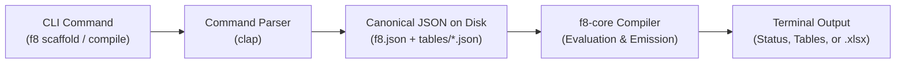

# Command-Line Interface (CLI)

This document defines the architecture, command hierarchy, and workflows of f8's command-line interface binary (`f8-cli`).

---

## 1. Overview & Role

The command-line interface (`f8-cli`) provides a direct terminal entrypoint for financial analysts (CFA personal workflow) and autonomous coding agents operating with shell access (such as Antigravity, Claude Code, or Cursor Composer).

`f8-cli` is the foundational outer interface built on top of `f8-core`:
- **Zero protocol overhead**: Provides instant, native execution without requiring MCP clients or JSON-RPC process management.
- **Dual human & agent access**: Shell-enabled AI agents execute CLI commands directly in terminal tools, enabling agentic modeling workflows from day one.
- **Pure compiler delegation**: The CLI delegates directly to:
  - **`templates/`**: Bundled institutional model archetypes scaffolded directly into the project as canonical JSON.
  - **`f8-core`**: For specification validation, DAG acyclicity proofs, topological evaluation, and `.xlsx` emission.



---

## 2. Command Hierarchy

All CLI operations are grouped under clear, noun-first subcommands:

### 2.1. Project & Workspace Management (`f8 init`, `f8 sheet`)

#### `f8 init <model_name> [options]`
Initializes a new f8 model directory with root `f8.json` and standard subdirectories:
```bash
f8 init LBO_Simple --theme corporate_navy
```

#### `f8 sheet add <sheet_name> [options]`
Appends a worksheet tab to `f8.json`:
```bash
f8 sheet add Financials --freeze-row 6 --freeze-col 2 --tab-color "#1B365D"
```

---

### 2.2. Model Scaffolding & Ingest (`f8 scaffold`, `f8 table`)

#### `f8 scaffold <archetype> [options]`
Scaffolds pre-configured institutional templates directly onto disk as canonical JSON files (`f8.json` + `tables/*.json`):
```bash
f8 scaffold three-statement --sheet Financials
```
Supported archetypes include:
- `three-statement`: Integrated Income Statement, Balance Sheet, Cash Flow, and operating driver schedules.
- `lbo`: Transaction assumptions, sources & uses, debt amortization schedules, and cash sweep waterfalls.
- `trading-comps`: Peer valuation matrix with metric columns, valuation multiples, and summary benchmark aggregations.
- `cap-table`: Ownership capitalization table with pre-/post-money valuation schedules and dilution tracking.

Scaffolded templates arrive with pre-wired financial formulas, typographic indentations, and semantic subtotal styles, but with historical inputs and driver assumptions left unpopulated.

#### `f8 table create <table_id> [options]`
Ingests a canonical table specification from a JSON file (or stdin), validates domain invariants, and mounts it into the specified worksheet:
```bash
# Ingest canonical table JSON file
f8 table create IncomeStatement --from tables/income_statement.json --sheet Financials

# Pipe directly from agent script / stdin
cat << 'EOF' | f8 table create IncomeStatement --from - --sheet Financials
{
  "id": "IncomeStatement",
  "title": "Income Statement",
  "columns": [ ... ],
  "rows": [ ... ]
}
EOF
```

---

### 2.3. Model Authoring & Editing Workflow

f8 strictly enforces **declarative specifications over imperative CLI flag mutations**. f8 deliberately omits fine-grained CLI commands for inserting rows, updating cells, or extending timelines.

Instead, coding agents and human developers edit the canonical JSON specification files (`tables/*.json`) directly using standard text/JSON tools:
1. **Scaffold or author**: Generate an initial model skeleton via `f8 scaffold` or `f8 table create`.
2. **Direct JSON edit**: Add rows, update cell inputs, or tweak formulas directly in the target `tables/<id>.json` file.
3. **Compile and verify**: Run `f8 compile --check` to validate changes and inspect calculated results.

---

### 2.4. Compilation & Verification (`f8 compile`, `f8 inspect`)

#### `f8 compile [options]`
Executes the full compiler pipeline, evaluates DAG dependencies, and emits compiled `.xlsx` workbooks or headless data exports:
```bash
# Compile and emit live workbook with precalculated cell cache
f8 compile --out output/model.xlsx

# Headless verification check without writing workbook
f8 compile --check
```

In the "Scaffold-and-Fill" workflow, `f8 compile --check` scans the entire workbook and aggregates **all** unpopulated driver cells into a comprehensive diagnostic checklist (rather than failing fast on the first unassigned cell), enabling agents and analysts to populate all missing inputs in a single editing pass:
```text
MissingRequiredInput: Assumptions["rev_growth", "2024E"] has no value or formula.
MissingRequiredInput: Assumptions["rev_growth", "2025E"] has no value or formula.
MissingRequiredInput: IncomeStatement["revenue", "2023A"] has no historical actual value.
```

#### `f8 inspect cell <table_id> <row_id> <col_id>`
Evaluates and inspects an individual calculation cell via `f8-core`'s unified `CompiledModel` facade, printing calculated values, formula ASTs, upstream precedents, and downstream dependents:
```bash
f8 inspect cell IncomeStatement total_opex 2028E
```
**Output:**
```text
Coordinate:     IncomeStatement["total_opex", "2028E"]
Evaluated:      74.2 (Currency, 1 decimal)
Formula Expr:   SUM(IncomeStatement["cogs".."sga", @col])
Excel Formula:  =SUM(C14:C16)

Precedents:     [IncomeStatement["cogs", "2028E"], IncomeStatement["rd", "2028E"], IncomeStatement["sga", "2028E"]]
Dependents:     [IncomeStatement["ebit", "2028E"]]
```

#### `f8 inspect dependents <table_id> <row_id> <col_id> [options]`
Performs blast-radius impact analysis by querying outgoing DAG edges (`dependents_of`) from `DependencyGraph`:
```bash
# Direct dependents of a driver cell
f8 inspect dependents Assumptions rev_growth 2024E

# Transitive blast radius across all tables and statements
f8 inspect dependents Assumptions rev_growth 2024E --recursive
```
**Output:**
```text
Coordinate:     Assumptions["rev_growth", "2024E"]
Direct Dependents (1):
  └── IncomeStatement["revenue", "2024E"]

Transitive Blast Radius (6 downstream calculations affected):
  └── IncomeStatement["revenue", "2024E"]
      ├── IncomeStatement["gross_profit", "2024E"]
      │   └── IncomeStatement["ebit", "2024E"]
      │       ├── IncomeStatement["net_income", "2024E"]
      │       │   ├── BalanceSheet["retained_earnings", "2024E"]
      │       │   └── CashFlow["net_income", "2024E"]
```

Key use cases for analysts and agents:
- **Refactoring & renaming safety**: Predicts every formula that will break before modifying row or column IDs.
- **Dynamic linkage verification**: Proves that financial statements are dynamically linked (e.g. confirming Cash Flow feeds Cash on the Balance Sheet).
- **Orphan calculation detection**: Identifies calculation rows that have zero downstream dependents, flagging redundant or forgotten rows.

#### `f8 inspect table <table_id> [options]`
Renders the headless 2D cell matrix directly to stdout as an aligned table for immediate terminal verification.

Options:
- `--view <values|formulas|both>`:
  - `values` (default): Evaluated and formatted numbers with accounting typography.
  - `formulas`: Parity with Excel's Formula Auditing Mode (`Ctrl + ~`), showing formula expressions for calculation cells and raw inputs for literal cells.
  - `both`: Dual-row auditing view displaying both evaluated value and formula.
- `--format <table|markdown|json>`: Output rendering format.

```bash
# Formula auditing mode
f8 inspect table IncomeStatement --view formulas --format markdown
```
**Output:**
```markdown
| Line Item    | 2023A  | 2024E                                                         | 2025E                                                         |
|:-------------|-------:|:--------------------------------------------------------------|:--------------------------------------------------------------|
| Net Revenue  | 100.0  | IncomeStatement["revenue", col.prev] * (1.0 + Assumptions...) | IncomeStatement["revenue", col.prev] * (1.0 + Assumptions...) |
| COGS         |  40.0  | IncomeStatement["revenue", @col] * Assumptions["cogs_pct"...] | IncomeStatement["revenue", @col] * Assumptions["cogs_pct"...] |
| Gross Profit |  60.0  | IncomeStatement["revenue", @col] - IncomeStatement["cogs"...] | IncomeStatement["revenue", @col] - IncomeStatement["cogs"...] |
```

#### `f8 inspect cycle`
When cyclic dependencies are detected, outputs the full semantic cycle loop traced by Tarjan's Strongly Connected Components pass:
```bash
f8 inspect cycle
```
**Output:**
```text
CyclicDependencyDetected:
IncomeStatement["tax", "2024E"] ──► IncomeStatement["ebit", "2024E"] ──► IncomeStatement["tax", "2024E"]
```

---

## 3. Exit Codes & Error Diagnostics

The CLI enforces standard exit codes for automated agent scripting:
- `0`: Success.
- `1`: Validation or command syntax error.
- `2`: Compilation error (formula parse failure, unresolved coordinate, type mismatch, missing required input).
- `3`: Cyclic dependency error (emits semantic Tarjan SCC cycle trace to stderr).

See [Model Context Protocol (MCP)](mcp.md) for JSON-RPC agent tool equivalents and [Architecture Overview](../architecture.md) for compiler passes.
