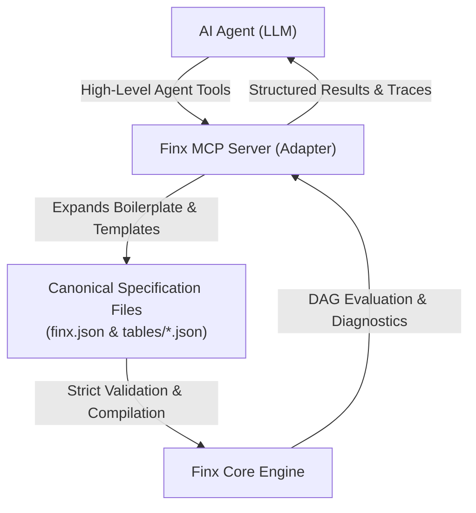

# Model Context Protocol (MCP) Interface

This document defines the architecture and role of Finx's Model Context Protocol (MCP) server.

## 1. Overview & Role

The Model Context Protocol (MCP) server provides the **Adapter / Tooling Layer** between autonomous AI agents and the Finx compiler core.

## 2. Core Architectural Principles

- **Ergonomics in the adapter, purity in the core**: The underlying JSON specification format is an explicit, orthogonal 2D intermediate representation (IR). High-level domain conveniences (such as template scaffolding, timeline generation, and unit column partitioning) live entirely in the MCP tool layer.
- **Domain scaffolding**: The MCP server translates concise agent requests into the rigorous, unambiguous JSON required by the compiler (e.g. automatically scaffolding financial statement schemas, axis roles, descriptor columns, and vector rules).
- **Two-way feedback loop**: The MCP interface provides both write tools (authoring and modifying models) and read tools (inspecting evaluated cell values, dependency graphs, and compile-time cycle traces).

---

## 3. Tool Categories (Design Blueprint)

### 3.1. Project & Sheet Management
- `finx_init_project`: Initializes a standard model repository with `finx.json` and directory layout.
- `finx_add_sheet`: Adds or configures a physical worksheet (freeze panes, tab colors, gridlines).
- `finx_register_table`: Mounts a standalone table JSON file into a sheet's vertical stacking layout.

### 3.2. Table & Model Authoring
- `finx_create_statement`: Scaffolds standard financial statements (Income Statement, Balance Sheet, Cash Flow) given timeline bounds, unit configurations, and line items.
- `finx_create_table`: Creates a generalized orthogonal 2D table (Cap Table, Comps, Sensitivity matrix, or Vertical waterfall).
- `finx_add_row`: Inserts or modifies a calculation row, configuring row vector rules and point cell overrides.

### 3.3. Compilation, Diagnostics & Inspection
- `finx_compile`: Executes full compilation, topological DAG sorting, and `.xlsx` emission. Returns structured compilation status.
- `finx_inspect_cell`: Evaluates and returns the calculated value, formula AST, and resolved dependencies for any `CellId` (`Table[row, col]`).
- `finx_explain_cycle`: When circular references occur, returns the formatted semantic cycle trace emitted by Tarjan's SCC algorithm.

---

See [Architecture Overview](../architecture.md) for core compiler pipeline details and [Specification Format](../dsl/spec-format.md) for JSON schema definitions.
