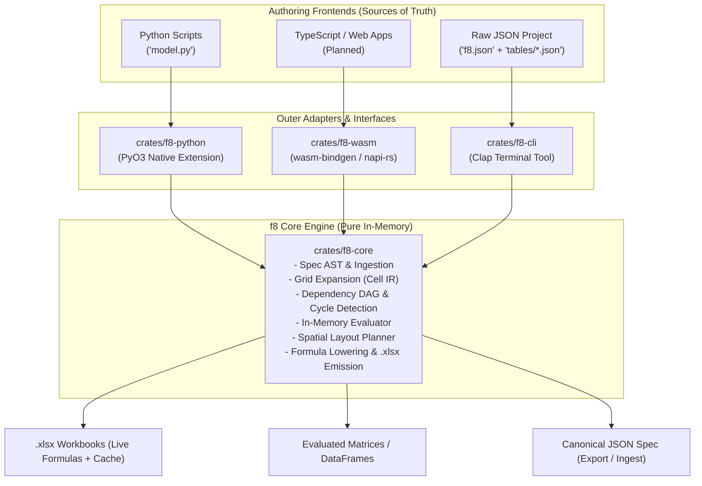

# Software Development Kits (SDK) Architecture & Design

This document defines the architecture, API design, and implementation plan for the f8 Python SDK (`f8-python`).

---

## 1. Executive Summary & Design Principles

The f8 SDK transforms financial modeling from manual spreadsheet data entry into standard software engineering:

- **Dual-layer architecture**: A thin, high-performance native Rust extension crate (`crates/f8-python`) wraps `f8-core` via [PyO3](https://pyo3.rs/) and [Maturin](https://www.maturin.rs/), while an outer, idiomatic Python package (`f8`) provides a fluent modeling DSL.
- **Zero CLI dependency**: The CLI (`f8-cli`) and SDK (`f8-python`) are sibling adapters built on top of `f8-core`. The SDK executes in-process via C-ABI with zero subprocess overhead, shipping as self-contained precompiled wheels (`pip install f8`).
- **"Code as Model" source of truth**: Python scripts (`.py`) serve as the authoring source of truth for analysts and AI agents, enabling standard Git version control, branch diffs, and pull request reviews.
- **Canonical IR preservation**: The multi-file JSON specification (`f8.json` + `tables/*.json`) remains the language-agnostic Intermediate Representation (IR) for serialization, cross-language interop, and headless verification.
- **First-class data science interop**: Bidirectional integration with `pandas` and standard Python data structures enables direct ingestion of financial filings and in-memory analysis without writing JSON or markdown to disk. Polars users can seamlessly consume models via `pl.from_pandas()` or `pl.DataFrame(table.to_dict())`.



---

## 2. Architecture: Core vs. SDK vs. CLI

| Dimension | `f8-core` (Compiler) | `f8-python` (SDK) | `f8-cli` (CLI) |
| :--- | :--- | :--- | :--- |
| **Responsibility** | Specification AST, DAG validation, evaluation, layout, `.xlsx` emission. | Fluent authoring DSL, data ingestion (`pandas`), in-process execution. | Standalone terminal workflow, CI validation, file discovery, human inspections. |
| **Environment** | Pure in-memory Rust (`no_std` / WASM-ready, zero OS I/O). | Python runtime via PyO3 C-extensions. | Standalone zero-dependency native binary (`clap`). |
| **Input** | `ProjectManifest` (logical `TableId`s), `TableSpec`, `Theme`. | Fluent Python objects, variables, DataFrames. | Filesystem paths (`f8.json`, `tables/*.json`). |
| **Output** | In-memory `CompiledModel`, `.xlsx` byte buffer. | Python objects, DataFrames, saved `.xlsx` files. | Terminal tables, formatted JSON stdout, written `.xlsx` files. |
| **Inter-dependency** | None (root crate). | Depends on `f8-core`. **Zero CLI dependency.** | Depends on `f8-core`. **Zero SDK dependency.** |

### Role of the CLI in a Python-Centric Workflow

With Python established as the primary authoring layer:
- **`f8-python` as the authoring and execution engine**: Replaces manual JSON authoring with programmatic scripts (`model.py`), variables, loops, and direct `.xlsx` emission.
- **`f8-cli` as the headless CI and inspection runner**: Preserved as a zero-dependency static executable (~10MB) ideal for Docker containers, CI validation (`f8 check`, `f8 verify`), and rapid terminal auditing without requiring a Python runtime or virtual environment.

---

## 3. Python SDK Design

### 3.1. Layer 1: Rust Native Extension (`crates/f8-python`)

The native crate links directly to `f8-core` in the Cargo workspace and exposes low-level compilation primitives:

- **Thin C-ABI marshaling facade**: Rather than exposing fine-grained PyO3 wrappers (`#[pyclass]`) for every AST node in `f8-core`—which causes massive glue boilerplate and maintenance drift—Layer 1 acts as a thin compilation bridge. The Python DSL constructs lightweight in-memory structures and converts them directly into `f8-core` Serde types (`ProjectManifest`, `Vec<TableSpec>`, `Theme`) via `pythonize` in microseconds with zero disk I/O.
- **Logical table references**: `SheetSpec.tables` directly accepts `Vec<TableId>`, completely eliminating path-based heuristics (`matches_table_id`) and keeping the core engine strictly in-memory.
- **`Compiler` bridge**: Deserializes inputs and invokes `Compiler::compile`.
- **`CompiledModel` bridge**: Exposes in-memory inspection methods directly to Python:
  - `emit_workbook(options) -> bytes`: Generates `.xlsx` binary buffers.
  - `inspect_cell(table, row, col) -> CellInspection`: Returns evaluated value, lowered Excel formula, physical A1 address, and dependency edges.
  - `table_matrix(table) -> Vec<Vec<CellValue>>`: Returns 2D evaluation grids.
  - `precedents_of(cell, recursive) -> Vec<String>` / `dependents_of(cell, recursive) -> Vec<String>`: Blast-radius dependency queries.
- **Structured typed exceptions**: Maps `CompilerError` variants into Python exception classes with structured diagnostic attributes for programmatic agent self-correction:
  - `f8.CycleDetectedError`: Exposes `cycle: list[str]` (ordered cycle path).
  - `f8.ReferenceResolutionError`: Exposes `coordinate: str`, `table: str`, `row: str`, `col: str`.
  - `f8.SpecificationError`: Exposes `table: str`, `reason: str` on schema or lattice format conflicts.
  - `f8.FormulaParseError`: Exposes `table: str`, `row: str | None`, `col: str | None`, `token_offset: int`, `message: str`.

### 3.2. Layer 2: High-Level Fluent Modeling DSL (`f8`)

The pure Python package wraps the native extension into an expressive, type-safe API.

#### Static Typing & Autocomplete (PEP 561)
The package ships with a `py.typed` marker and utilizes `typing.Literal` definitions for constrained string options, giving instant IDE autocompletion and static verification via `mypy` / `pyright`:
- `role: Literal["descriptor", "measure"]`
- `format: Literal["currency", "percentage", "number", "multiple", "basis_points", "date", "text", "integer"]`
- `style: Literal["data", "subtotal", "total", "header"]`

#### Model & Table Initialization
```python
from f8 import Model

# Initialize model container
model = Model("LBO_Acquisition_Model", theme="corporate_navy")

# Add sheet and table
sheet = model.add_sheet("Operations & Returns", tab_color="#1F4E79", show_gridlines=True)
ops = sheet.add_table(
    id="OPERATIONS",
    title="Operating Performance",
    subtitle="($ in Millions)",
)

# Explicit column definitions (symmetrical with add_row, zero class imports)
ops.add_column(id="line_item", role="descriptor", header="Line Item")
ops.add_column(id="2023A", role="measure", headers=["Historical", "2023A"])
ops.add_column(id="2024E", role="measure", headers=["Forecast", "2024E"])
ops.add_column(id="2025E", role="measure", headers=["Forecast", "2025E"])
```

#### Variables as Assumptions & Dimensions
Python variables provide a single source of truth for assumptions, eliminating duplicate constants:

```python
TAX_RATE = 0.25
FORECAST_PERIODS = ["2024E", "2025E"]
REVENUE_GROWTH = {"2024E": 0.08, "2025E": 0.06}

ops.add_row(
    id="rev_growth",
    label="Revenue Growth (YoY)",
    cells=REVENUE_GROWTH,
    format="percentage",
)
```

#### Formula Expressions & Canonical Syntax
Formulas are authored directly using canonical f8 formula strings, matching the exact grammar defined in [`docs/dsl/grammar.md`](../dsl/grammar.md) and used in the multi-file JSON specification (`tables/*.json`):

```python
# Direct formula strings (Primary & Canonical for AI agents and modelers)
ops.add_row(
    id="gross_profit",
    label="Gross Profit",
    expr='OPERATIONS["revenue", @col] - OPERATIONS["cogs", @col]',
    format="currency",
    style="subtotal",
)

# Visual section header row
ops.add_section_header("Operating Expenses", indent=0)

ops.add_row(
    id="r_and_d",
    label="Research & Development",
    expr='OPERATIONS["revenue", @col] * 0.08',
    format="currency",
    indent=1,
)

# Aggregation across a row slice
ops.add_row(
    id="total_opex",
    label="Total Operating Expenses",
    expr='SUM(OPERATIONS["r_and_d".."g_and_a", @col])',
    format="currency",
    style="subtotal",
)

# Blank spacing row gutter
ops.add_gutter()

ops.add_row(
    id="ebitda",
    label="EBITDA",
    expr='OPERATIONS["gross_profit", @col] - OPERATIONS["total_opex", @col]',
    format="currency",
    style="total",
)

# Cross-table references, temporal offsets, and Excel conditional branching
ops.add_row(
    id="interest_expense",
    label="Interest Expense",
    expr='DEBT_SCHEDULE["ending_balance", col.prev] * ASSUMPTIONS["interest_rate", "value"]',
    format="currency",
)

ops.add_row(
    id="dividend",
    label="Dividend Distribution",
    expr='IF(OPERATIONS["ebitda", @col] > 0, OPERATIONS["ebitda", @col] * 0.20, 0.0)',
    format="currency",
)
```

**Why String Expressions Over AST Builders / `f8.fn`**:
- **Single source of truth**: `f8-core`'s Pratt parser and function registry remain the sole authority on formula grammar, operator precedence, and Excel function execution. Python does not re-implement or wrap Excel parity functions.
- **Agent and LLM native**: AI agents already have extensive training on Excel formulas. Generating string formulas is direct, predictable, and free from Python-specific syntax traps (such as Python's eager `and`/`or` operators or keyword conflicts like `if` vs `IF`).
- **Holistic deferred validation**: Python builder calls remain lightweight, pure in-memory data structures. Formula parsing, AST validation, dependency DAG resolution, and cycle detection are performed holistically in Rust during `model.compile()`, returning structured error diagnostics with exact coordinates and token positions.

#### Cell Overrides (0D Point Overrides)
Under the f8 compiler IR lattice, **0D cell overrides take highest precedence**, overriding row-level vector formulas (`row.expr`) and column-level vector formulas (`col.expr`). The SDK supports two complementary patterns:

**1. Bulk Overrides at Row Declaration (`add_row(..., cells={...})`)**:
Standard pattern for financial statements where historical columns contain actuals while forecast columns evaluate the row's vector formula:

```python
# Forecast periods calculate via expr; historical periods override with literal numbers
ops.add_row(
    id="revenue",
    label="Revenue",
    expr='OPERATIONS["revenue", col.prev] * (1 + OPERATIONS["rev_growth", @col])',
    cells={
        "2022A": 1000.0,  # Literal number override
        "2023A": 1200.0,  # Literal number override
    },
    format="currency",
)

# Bespoke formula override or cell-level metadata (audit note / formatting)
ops.add_row(
    id="capex",
    label="Capital Expenditures",
    expr='OPERATIONS["revenue", @col] * 0.05',
    cells={
        "2022A": 50.0,
        "2023A": 60.0,
        "2024E": {
            "expr": 'OPERATIONS["revenue", @col] * 0.08',
            "note": "Includes one-off manufacturing plant expansion",
        },
    },
    format="currency",
)
```

**2. Point Overrides on Table (`table.set_cell(...)`)**:
Imperative point overrides for setting boundary conditions, tuning assumptions, or attaching cell notes and formatting:

```python
# 1. Override a specific cell with a literal value and audit note
ops.set_cell(
    row="debt_balance",
    col="2023A",
    value=500.0,
    note="Opening balance per Credit Agreement Schedule 1",
)

# 2. Override a specific cell with a bespoke formula
ops.set_cell(
    row="tax_expense",
    col="2024E",
    expr='OPERATIONS["ebt", @col] * 0.21',
)

# 3. Apply cell-level visual emphasis or formatting overrides
ops.set_cell(
    row="ebitda",
    col="2025E",
    highlight=True,
    note="Target exit EBITDA threshold",
)
```


### 3.3. Document Ingestion & DataFrame Bridge

AI agents frequently extract historical tables from SEC filings, PDF annual reports, or SQL warehouses into Pandas DataFrames. The SDK allows direct ingestion of DataFrames into tables:

```python
import pandas as pd
from f8 import Model

# Ingested DataFrame from raw filing (e.g. via pdfplumber or read_html)
df = pd.DataFrame({
    "line_item": ["Product Revenue", "Service Revenue", "Total Revenue"],
    "2022A": [1000.0, 250.0, 1250.0],
    "2023A": [1200.0, 310.0, 1510.0],
})

model = Model("Corporate_Model")
sheet = model.add_sheet("Income Statement")

# Automatically generates descriptor column and measure columns from DataFrame schema
table = sheet.add_table_from_dataframe(
    id="INCOME_STMT",
    title="Consolidated Income Statement",
    df=df,
    descriptor_col="line_item",
    default_format="currency",
)

# Extend with forecast columns
for col in ["2024E", "2025E"]:
    table.add_column(col, role="measure")
```

### 3.4. Compilation & In-Memory Inspection

The compilation lifecycle executes in-memory with zero temporary disk writes:

```python
import f8

# 1. Compile in-memory (<5ms)
compiled = model.compile()

# 2. Inspect evaluated results as a Pandas DataFrame or raw dictionary
df_evaluated = compiled.table("OPERATIONS").to_pandas()
dict_evaluated = compiled.table("OPERATIONS").to_dict()

# 3. Direct cell auditing
cell_info = compiled.inspect_cell("OPERATIONS", "gross_profit", "2024E")
print(cell_info.physical_address)  # "C15"
print(cell_info.lowered_formula)   # "=C12-C13"
print(cell_info.evaluated_value)   # 450000.0
print(cell_info.precedents)        # ["OPERATIONS[revenue, 2024E]", "OPERATIONS[cogs, 2024E]"]

# 4. Save native Excel file
compiled.save("output/lbo_model.xlsx")

# 5. Optional export to canonical multi-file JSON spec for Git / CLI parity
model.export_project("./models/lbo_project")

# 6. Direct in-memory compilation of existing JSON projects (zero CLI subprocess)
compiled_from_json = f8.compile_project("./models/lbo_project")
```

---

## 4. Source of Truth & Artifact Lifecycle

The introduction of the SDK establishes a distinct, three-tier artifact lifecycle:

| Tier | Format | Role | Primary Consumers |
| :--- | :--- | :--- | :--- |
| **Tier 1: Authoring Source of Truth** | Python scripts (`model.py`) | Living model logic, parametric variables, loops, data ingestion. | Human modelers, quantitative analysts, AI agents. |
| **Tier 2: Intermediate Representation (IR)** | Canonical JSON (`f8.json` + `tables/*.json`) | Schema-validated declarative IR, deterministic Git diffs, cross-language contract. | `f8-core`, `f8-cli`, web/WASM interfaces, automated linters. |
| **Tier 3: Compiled Output** | `.xlsx` workbook | Production spreadsheet with live formulas, styles, and cached values `<v>`. | Auditors, investment committees, institutional clients, third-party viewers. |

### Project Export & Direct Compilation

To guarantee seamless interoperability between Python code, CLI workflows, and agents:

1. **Python $\to$ JSON Project**: `model.export_project(dir)` generates standardized `f8.json` and `tables/*.json` files from any Python-defined model. Handled entirely in pure Python using `pathlib` and `json`, preserving `f8-core`'s zero-I/O in-memory purity.
2. **Direct Project Compilation**: `f8.compile_project(dir) -> CompiledModel` loads an existing multi-file JSON project directly in pure Python and compiles in-memory via `f8-core`, eliminating subprocess calls to `f8-cli` while respecting core's zero-filesystem boundary.

---

## 5. Architectural Alignment & Future Extensibility

- **In-memory purity**: `f8-core` is architected with zero filesystem I/O and compiles to `wasm32-unknown-unknown`.
- **Future adapters**: The same in-memory core can be wrapped via `wasm-bindgen` for browser runtimes or TypeScript environments in the future without changing core AST, dependency, or layout logic.

---

## 6. Implementation Roadmap

### Phase 1: Native PyO3 Extension (`crates/f8-python`)
- Initialize `crates/f8-python` in Cargo workspace using `maturin` and `pyo3`.
- Implement thin C-ABI bridge using `pythonize` to marshal `ProjectManifest`, `Vec<TableSpec>`, and `Theme` into `f8-core`.
- Bind `Compiler::compile`, `CompiledModel` inspection methods, and `.xlsx` byte emission.
- Implement structured Python exceptions with typed diagnostic attributes (`cycle`, `coordinate`, `token_offset`).

### Phase 2: Pythonic Modeling DSL (`f8`)
- Implement pure Python `Model`, `Sheet`, and `Table` builder classes with `py.typed` and `Literal` type definitions.
- Implement symmetrical table APIs: `table.add_column(...)`, `table.add_row(...)`, `table.add_section_header(...)`, `table.add_gutter()`, and `table.set_cell(...)`.
- Support canonical formula string expressions and 0D cell overrides on rows and tables.
- Implement pure Python project export (`model.export_project`) and direct project compilation (`f8.compile_project`).

### Phase 3: Ecosystem Interop & Inspection
- Implement `.to_pandas()` and `.to_dict()` on `TableInspection`.
- Implement `sheet.add_table_from_dataframe(...)` ingestion helper.
- Implement interactive auditing methods (`inspect_cell`, `precedents_of`, `dependents_of`).

