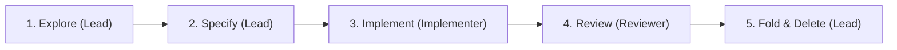

# Spec-Driven Development Guidelines

Spec-driven development (SDD) aligns architectural design, data contracts, and acceptance criteria before code execution.

## Core philosophy

- **Truth hierarchy**:
  - **Code, types & tests**: Authoritative source of truth for implementation behavior, data structures, and edge-case verification.
  - **Reference docs** (`docs/`): High-level system architecture (`docs/architecture.md`), DSL schemas (`docs/dsl/`), and function catalog (`docs/functions/catalog.md`).
  - **Draft specs** (`docs/specs/drafts/`): Ephemeral execution contracts defining scope, technical decisions, data contracts, acceptance criteria, and tasks for active work.
- **Proportional workflow**:
  - **Full Tri-Agent SDD**: Mandatory for cross-crate features, compiler pass changes, new DSL/IR semantics, and multi-step refactors.
  - **Direct execution**: Bug fixes, localized ergonomic tweaks, documentation/skill updates, and test additions execute directly in the Lead session (still verified against `AGENTS.md` gates) without draft specs or subagent dispatch.
- **Autonomous increments**: One draft spec represents one independently verifiable increment. Decompose multi-phase initiatives into sequential specs.
- **Spec custody**: Draft specs (`docs/specs/drafts/`) are exclusively authored and deleted by the Lead Orchestrator. Subagents never edit, move, or delete spec files.
- **Verification as proof**: Acceptance criteria map 1:1 to executable tests, compiler checks, and static analysis.

## Tri-Agent Workflow

### 1. Explore & align (Lead Orchestrator)

- **Inspect reality**: Ground designs in existing Rust/Python source modules, AST/IR types, and `docs/architecture.md`.
- **Evaluate trade-offs**: Surface candidate approaches with explicit pros/cons when design choices exist.
- **Align intent**: Confirm scope, invariants, and trade-offs with the user before writing code when requirements are ambiguous.

### 2. Specify (Lead Orchestrator)

- **Instantiate template**: Create `docs/specs/drafts/YYYY-MM-DD-<feature-name>.md` from `docs/specs/templates/draft-spec.md`.
- **High-signal contracts**: Define data structures, trait/method signatures, invariants, and `Given / When / Then` acceptance criteria without repeating file lists across multiple sections.
- **Durable references**: Cite source paths via backtick code spans (e.g. `crates/f8-core/src/compiler/mod.rs`). Reserve relative markdown links for stable reference docs (`docs/`).

### 3. Implement (Implementer Subagent)

- **Dispatch**: Invoke an isolated Implementer Subagent (`TypeName: 'self'`, `Workspace: inherit`) referencing `.agents/prompts/prompt-implementer.md` and the target draft spec path.
- **Contract adherence**: Implement strictly to the draft spec contracts and `AGENTS.md` standards. Do not edit the draft spec file.
- **Verification gate**: Pass the verification suite defined in `AGENTS.md` (Rust suite always; Python suite when touching `crates/f8-python` or `python/`) and return a concise completion summary.

### 4. Review (Reviewer Subagent)

- **Dispatch**: Invoke an independent Reviewer Subagent (`TypeName: 'self'`, `Workspace: inherit`) instructing it to run the `review-implementation` skill against the target draft spec and current git diff.
- **Report-only audit**: Reviewer verifies gate status, checks 1:1 spec conformance, audits the diff against the inlined checklist in `.agents/skills/review-implementation/SKILL.md`, and probes suspected edge cases.
- **Verdict triage**:
  - `Changes required`: Any `Blocker` or `Major` finding. Lead Orchestrator re-dispatches Implementer with findings to remediate.
  - `Approve with flags`: Zero `Blocker`/`Major` findings; surfaces architectural `Flag` items for user/Lead attention.
  - `Approve`: Clean review. Proceed to Fold & Delete.

### 5. Fold & Delete (Lead Orchestrator)

- **Fold durable knowledge**: Reconcile any lasting architectural changes, invariants, or external contract updates into living reference docs (`docs/architecture.md`, `docs/dsl/`, `docs/functions/catalog.md`).
- **Delete draft spec**: Remove the completed draft spec from `docs/specs/drafts/` so zero stale transition specs remain in the working tree; distill key rationale into the git commit message.
