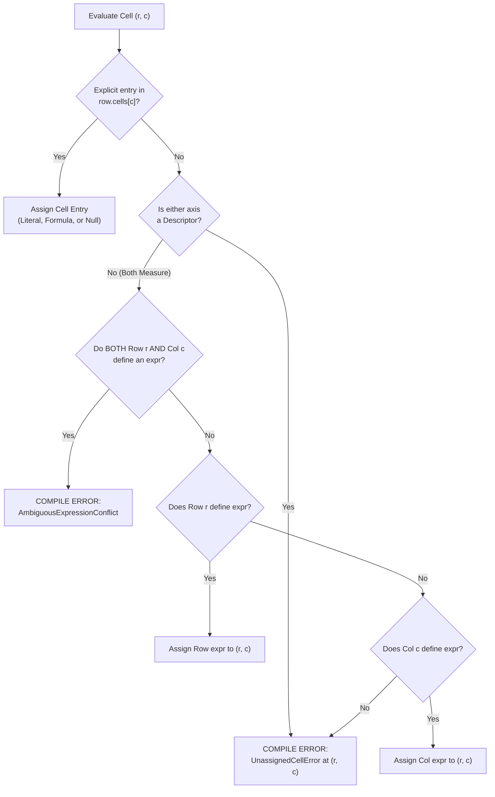

# Unified 2D Matrix Model

This document specifies the unified, orthogonal 2D matrix data model for Finx. It provides a self-contained definition of table schemas, symmetrical axis roles, vector rules, strictly typed 1-to-1 cell inputs, and deterministic conflict resolution invariants.

---

## 1. Core Principles

- **Orthogonal 2D matrix**: A table is an $R \times C$ grid of addressable cells $(row, col)$. Both row and column dimensions are symmetrical first-class calculation axes in the compiler intermediate representation (`Matrix2D`).
- **Explicit axis roles**: Both columns and rows declare their functional role:
  - `role: "descriptor"`: Categorical labels, line item descriptions, units, tickers, or metadata. Serves as the anchor for hierarchy indentation and presentation stubs.
  - `role: "measure"`: Numerical data, financial time series, and calculation outputs (default).
- **Vector rule isolation**: Vector formulas (`row.expr`, `col.expr`) and vector formats broadcast strictly across opposing `measure` axes. They never bleed into or evaluate across `descriptor` axes.
- **Every column is explicit**: Every physical column rendered on a worksheet maps 1:1 to an explicit column declaration in `columns`. The compiler never injects implicit, unaddressed stub columns (e.g. magic Columns A and B).
- **Three-tier specificity lattice**: Cell properties resolve through a deterministic 3-tier hierarchy:
  $$\text{Cell Override (0D Point)} > \text{Vector Rule (1D Row or Column)} > \text{Explicit Null}$$
- **Zero silent precedence**: If both a row rule and a column rule target the same measure cell without an explicit cell override, the compiler halts with a hard `AmbiguousExpressionConflict` error.
- **Zero silent blanks**: Every measure cell must resolve to a value, formula, or an explicit `null`. Unassigned measure cells halt compilation with `UnassignedCellError`. Silent fallback to Excel zeros is strictly prohibited.
- **Strictly typed 1-to-1 cell inputs**: The `cells` map pairs a single column identifier (`ColId`) directly to a single cell payload (`CellInput`). Every entry represents strictly one cell (0D point). Positional arrays and string prefix hacks (e.g. `=`) are eliminated in favor of typed objects (`{ "expr": "..." }`).
- **Symmetrical coordinate referencing**: Formula references use symmetrical active tokens: `@row` for the active row and `@col` for the active column (`Table[@row, "shares"]`, `Table["revenue", @col]`), along with symmetrical temporal offsets (`col.prev` / `col.next` along columns and `row.prev` / `row.next` along rows).

---

## 2. Specification Schema

### 2.1. Table Specification (`TableSpec`)

```json
{
  "id": "string",
  "title": "string",
  "columns": [
    {
      "id": "string",
      "role": "measure | descriptor (optional, default: measure)",
      "label": "string (optional, defaults to id)",
      "format": "FormatPreset (optional)",
      "expr": "string (optional, column-wide formula)",
      "note": "string (optional)",
      "source": "string or object (optional)"
    }
  ],
  "column_groups": [
    {
      "id": "string",
      "label": "string",
      "columns": ["string"]
    }
  ],
  "row_groups": [
    {
      "id": "string",
      "label": "string",
      "children": ["string | RowGroup"]
    }
  ],
  "rows": [
    {
      "id": "string",
      "role": "measure | descriptor (optional, default: measure)",
      "format": "FormatPreset (optional)",
      "expr": "string (optional, row-wide formula)",
      "note": "string (optional)",
      "source": "string or object (optional)",
      "cells": {
        "<col_id>": "ValueLiteral | { \"expr\": \"string\" } | DetailedCellInput"
      }
    }
  ]
}
```

### 2.2. Cell Input Syntax in `cells`

Every key under `cells` is strictly a discrete column identifier (`ColId`). Each value represents strictly one cell and must be one of:
- **Number literal**: `100000.0` or `42`
- **String literal**: `"Total Revenue"` or `"USD"`
- **Boolean literal**: `true` or `false`
- **Explicit empty**: `null`
- **Formula object**: `{ "expr": "IncomeStatement[\"revenue\", col.prev] * 1.08" }`
- **Detailed override object**: `{ "value": 85000, "note": "Audited actuals", "format": "currency" }`

---

## 3. The 2D Property Resolution Lattice

Every cell coordinate $(r, c)$ in table $T$ resolves its payload, format, and notes through a deterministic evaluation lattice.

### 3.1. Cell Payload Resolution Algorithm



1. **Step 1 (Cell Override)**: Check if `row.cells` explicitly defines an entry for column $c$. If present, use this payload (literal, formula, or explicit `null`).
2. **Step 2 (Descriptor Boundary Check)**: If row $r$ or column $c$ is marked `role: "descriptor"`, vector rules do not broadcast across it. If no explicit entry exists in `row.cells`, halt compilation with `UnassignedCellError`.
3. **Step 3 (Ambiguity Check)**: For measure-on-measure intersections, check if row $r$ defines `row.expr` **AND** column $c$ defines `col.expr`. If both exist without an explicit cell override, halt compilation with `AmbiguousExpressionConflict`.
4. **Step 4 (Row Vector Rule)**: If only `row.expr` is defined, assign `row.expr` to cell $(r, c)$.
5. **Step 5 (Column Vector Rule)**: If only `col.expr` is defined, assign `col.expr` to cell $(r, c)$.
6. **Step 6 (Exhaustive Verification)**: If neither defines an expression and no entry was provided in `row.cells`, halt compilation with `UnassignedCellError`.

### 3.2. Format Preset Resolution Algorithm

1. **Cell format override**: An explicit point format declared on the cell always wins.
2. **Descriptor boundary**: A `descriptor` axis specifies text formatting for its labels. Measure formats (`currency`, `percentage`) never broadcast to descriptor coordinates.
3. **Measure vector conflict**: If row $r$ and column $c$ are both measures and specify differing format presets (e.g. `row.format: "currency_total"` and `col.format: "percentage"`), compilation halts with `FormatConflictError` unless resolved by an explicit cell format override.
4. **Single vector format**: If only the row or only the column specifies a format preset, that preset applies.
5. **Default**: Unspecified numbers default to general numeric presentation; unspecified text defaults to standard string alignment.

### 3.3. Note & Provenance Resolution

- **Precedence**: `Cell.note > Row.note > Col.note`.
- **Inheritance**: A cell inherits its row or column note/source unless explicitly overridden at the cell level.

---

## 4. Modeling Patterns & Archetypes

### 4.1. Horizontal Financial Statement (Income Statement)

Formulas and formatting are primarily row-driven. Descriptor columns (`line_item`, `unit`) isolate labels from calculations:

```json
{
  "id": "IncomeStatement",
  "title": "Income Statement",
  "columns": [
    { "id": "line_item", "role": "descriptor", "label": "Line Item" },
    { "id": "unit", "role": "descriptor", "label": "Unit" },
    { "id": "2021A", "label": "2021A" },
    { "id": "2022A", "label": "2022A" },
    { "id": "2023A", "label": "2023A" },
    { "id": "2024E", "label": "2024E" },
    { "id": "2025E", "label": "2025E" }
  ],
  "column_groups": [
    { "id": "historical", "label": "Historical Actuals", "columns": ["2021A", "2022A", "2023A"] },
    { "id": "forecast", "label": "Forecast Projections", "columns": ["2024E", "2025E"] }
  ],
  "rows": [
    {
      "id": "revenue",
      "format": "currency",
      "expr": "IncomeStatement[\"revenue\", col.prev] * 1.08",
      "cells": {
        "line_item": "Total Revenue",
        "unit": "USD",
        "2021A": 85000,
        "2022A": 92000,
        "2023A": 100000
      }
    },
    {
      "id": "cogs",
      "format": "currency",
      "expr": "IncomeStatement[\"revenue\", @col] * 0.45",
      "cells": {
        "line_item": "Cost of Goods Sold",
        "unit": "USD"
      }
    },
    {
      "id": "gross_profit",
      "format": "currency_total",
      "expr": "IncomeStatement[\"revenue\", @col] - IncomeStatement[\"cogs\", @col]",
      "cells": {
        "line_item": "Gross Profit",
        "unit": "USD"
      }
    },
    {
      "id": "gross_margin",
      "format": "percentage",
      "expr": "IncomeStatement[\"gross_profit\", @col] / IncomeStatement[\"revenue\", @col]",
      "cells": {
        "line_item": "Gross Margin",
        "unit": "%"
      }
    }
  ]
}
```

#### Why this is robust and concise:
- In row `revenue`, `expr` defines forecast growth. Historical values are discrete point overrides (`"2021A": 85000`). The forecast timeline (`2024E..2025E`) is automatically generated by the vector rule without authoring cell entries.
- In `cogs`, `gross_profit`, and `gross_margin`, the formula is written once via `expr` with `@col`.
- Because `line_item` and `unit` are marked `role: "descriptor"`, the row's `expr` and `currency` format never broadcast to them.

---

### 4.2. Vertical Schedule (Cap Table)

Formulas and formatting are column-driven. Rows supply data inputs:

```json
{
  "id": "CapTable",
  "title": "Capitalization Table",
  "columns": [
    { "id": "investor", "role": "descriptor", "label": "Investor Name" },
    { "id": "share_class", "role": "descriptor", "label": "Share Class" },
    { "id": "shares", "label": "Shares Held", "format": "integer" },
    { "id": "share_price", "label": "Issue Price", "format": "currency" },
    {
      "id": "invested_capital",
      "label": "Invested Capital",
      "format": "currency",
      "expr": "CapTable[@row, \"shares\"] * CapTable[@row, \"share_price\"]"
    },
    {
      "id": "ownership_pct",
      "label": "Ownership %",
      "format": "percentage",
      "expr": "CapTable[@row, \"shares\"] / CapTable[\"total\", \"shares\"]"
    }
  ],
  "rows": [
    {
      "id": "founders",
      "cells": {
        "investor": "Founding Team",
        "share_class": "Common",
        "shares": 5000000,
        "share_price": 0.001,
        "invested_capital": 5000.0
      }
    },
    {
      "id": "series_seed",
      "cells": {
        "investor": "First Step Capital",
        "share_class": "Seed Preferred",
        "shares": 1200000,
        "share_price": 1.25
      }
    },
    {
      "id": "series_a",
      "cells": {
        "investor": "Acme Ventures",
        "share_class": "Series A Preferred",
        "shares": 2500000,
        "share_price": 2.00
      }
    },
    {
      "id": "total",
      "format": "currency_total",
      "cells": {
        "investor": "Total",
        "shares": { "expr": "SUM(CapTable[\"founders\"..\"series_a\", \"shares\"])" },
        "share_price": null,
        "invested_capital": { "expr": "SUM(CapTable[\"founders\"..\"series_a\", \"invested_capital\"])" },
        "ownership_pct": 1.0
      }
    }
  ]
}
```

#### Why this is robust and concise:
- `invested_capital` and `ownership_pct` are authored once at the column level using `@row`.
- In row `founders`, an explicit point override for `invested_capital` ($5,000.00) takes precedence over the formula without structural workarounds.

---

### 4.3. Cross-Footing Conflict & Resolution

When a summary row intersects a summary column, both vector rules collide:

```json
{
  "id": "Matrix",
  "columns": [
    { "id": "q1" },
    { "id": "q2" },
    { "id": "total", "expr": "SUM(Matrix[@row, \"q1\"..\"q2\"])" }
  ],
  "rows": [
    { "id": "a", "cells": { "q1": 10, "q2": 20 } },
    { "id": "b", "cells": { "q1": 30, "q2": 40 } },
    { 
      "id": "sum_ab", 
      "expr": "Matrix[\"a\", @col] + Matrix[\"b\", @col]",
      "cells": {
        "total": { "expr": "Matrix[\"a\", \"total\"] + Matrix[\"b\", \"total\"]" }
      }
    }
  ]
}
```

- At `Cell("sum_ab", "total")`, row `sum_ab` defines an `expr` and column `total` defines an `expr`.
- Because the author supplied an explicit cell override under `"cells": { "total": { "expr": "..." } }`, the compiler evaluates the override without raising an `AmbiguousExpressionConflict`.

---

### 4.4. Transposed Entity Schedule (Comps Table)

In a transposed peer comparison table, entities are columns and metrics are rows. The model handles this with complete symmetry:

```json
{
  "id": "PeerComps",
  "title": "Public Comps",
  "columns": [
    { "id": "metric", "role": "descriptor", "label": "Metric" },
    { "id": "AAPL", "label": "Apple Inc." },
    { "id": "MSFT", "label": "Microsoft Corp." },
    { "id": "GOOG", "label": "Alphabet Inc." }
  ],
  "rows": [
    {
      "id": "ticker",
      "role": "descriptor",
      "cells": {
        "metric": "Ticker Symbol",
        "AAPL": "AAPL",
        "MSFT": "MSFT",
        "GOOG": "GOOG"
      }
    },
    {
      "id": "share_price",
      "format": "currency",
      "cells": {
        "metric": "Share Price",
        "AAPL": 180.50,
        "MSFT": 420.00,
        "GOOG": 175.25
      }
    }
  ]
}
```

Row `ticker` is marked `role: "descriptor"`, protecting its strings from numeric formatting while establishing coordinate metadata across the column dimensions.

---

## 5. Spatial Layout & Grid Alignment

1. **Physical sheet coordinates**: Column index 0 maps directly to the table's starting worksheet column offset.
2. **Zero phantom stubs**: The layout engine never reserves arbitrary Columns A/B for row labels.
3. **Outline and hierarchy anchor**: The spatial layout engine uses the designated `role: "descriptor"` column (the first declared descriptor column if multiple are defined) as the anchor for row group indentations, hierarchy typography, and collapsible outline brackets.
4. **Multi-table stacking**: Adjacent stacked tables define their layout boundaries cleanly. Descriptors and data columns align deterministically.

---

## 6. Comparison: Old Spec vs Unified Matrix Model

| Dimension | Old Finx Spec | Unified 2D Matrix Model |
| :--- | :--- | :--- |
| **Column Declarations** | Data columns only; `row.label` implicit | 100% explicit; descriptors are explicit columns |
| **Axis Roles** | Implicit (rows drive calculations) | Explicit: `role: "measure"` vs `role: "descriptor"` on both axes |
| **Row Formulas** | Broadcast across all columns (breaks on metadata) | Applies only to unassigned opposing measure cells |
| **Column Formulas** | Unsupported; required repeating in every row | First-class via `column.expr` using `@row` |
| **Cell Inputs** | Positional arrays (`value: [...]`) or `match` | Strictly typed 1-to-1 map (`ColId -> CellInput`); no arrays |
| **Formula Disambiguation** | Separate fields (`value` vs `expr`) | Typed object `{ "expr": "..." }`; no magic `=` prefix |
| **Active Coordinate Token** | `@` (asymmetrical column token) | Symmetrical `@row` and `@col` |
| **Rule Collision** | Not possible (row-only) | Detected at compile time with hard error |
| **Unassigned Cells** | Hard error on missing columns in `match` | Hard error (`UnassignedCellError`) unless explicitly `null` |
| **IR Representation** | `(TableId, RowId, ColId)` (labels omitted) | `(TableId, RowId, ColId)` (all cells present) |

---

## 7. Concrete Rust Data Structures & Implementation Architecture

The architecture separates the **Authoring AST** (the Serde projection) from the **Pure Symmetrical Data Model** (the internal compiler IR).

### 7.1. Authoring AST (`model::table` - Serde Ingestion)

```rust
use indexmap::IndexMap;
use serde::{Deserialize, Serialize};

use crate::model::format::FormatPreset;
use crate::model::id::{ColGroupId, ColId, RowGroupId, RowId, TableId};

/// Functional semantic role of an axis coordinate.
#[derive(Debug, Clone, Copy, PartialEq, Eq, Serialize, Deserialize, Default)]
#[serde(rename_all = "snake_case")]
pub enum AxisRole {
    /// Numerical measures and calculation targets (default).
    #[default]
    Measure,
    /// Textual descriptors, line item names, units, and hierarchical stubs.
    Descriptor,
}

/// Standalone table specification as authored in JSON.
#[derive(Debug, Clone, PartialEq, Serialize, Deserialize)]
pub struct TableSpec {
    pub id: TableId,
    pub title: String,
    pub columns: Vec<ColumnSpec>,
    #[serde(default, skip_serializing_if = "Vec::is_empty")]
    pub column_groups: Vec<ColumnGroup>,
    #[serde(default, skip_serializing_if = "Vec::is_empty")]
    pub row_groups: Vec<RowGroup>,
    pub rows: Vec<RowSpec>,
}

/// Column declaration on the column axis.
#[derive(Debug, Clone, PartialEq, Eq, Serialize, Deserialize)]
pub struct ColumnSpec {
    pub id: ColId,
    #[serde(default)]
    pub role: AxisRole,
    #[serde(default, skip_serializing_if = "Option::is_none")]
    pub label: Option<String>,
    #[serde(default, skip_serializing_if = "Option::is_none")]
    pub format: Option<FormatPreset>,
    /// Column-wide vector rule (broadcast down the column across measure rows).
    #[serde(default, skip_serializing_if = "Option::is_none")]
    pub expr: Option<String>,
    #[serde(default, skip_serializing_if = "Option::is_none")]
    pub note: Option<String>,
    #[serde(default, skip_serializing_if = "Option::is_none")]
    pub source: Option<serde_json::Value>,
}

/// Row declaration on the row axis.
#[derive(Debug, Clone, PartialEq, Serialize, Deserialize)]
pub struct RowSpec {
    pub id: RowId,
    #[serde(default)]
    pub role: AxisRole,
    #[serde(default, skip_serializing_if = "Option::is_none")]
    pub format: Option<FormatPreset>,
    /// Row-wide vector rule (broadcast horizontally across unassigned measure columns).
    #[serde(default, skip_serializing_if = "Option::is_none")]
    pub expr: Option<String>,
    #[serde(default, skip_serializing_if = "Option::is_none")]
    pub note: Option<String>,
    #[serde(default, skip_serializing_if = "Option::is_none")]
    pub source: Option<serde_json::Value>,
    /// Explicit 1-to-1 cell point overrides.
    #[serde(default, skip_serializing_if = "IndexMap::is_empty")]
    pub cells: IndexMap<ColId, CellInput>,
}

/// Strictly typed 0D point cell input.
#[derive(Debug, Clone, PartialEq, Serialize, Deserialize)]
#[serde(untagged)]
pub enum CellInput {
    /// Direct scalar literal: number, string, boolean, or null.
    Literal(ValueLiteral),
    /// Dedicated formula object.
    Formula { expr: String },
    /// Detailed cell object with custom format, note, or source override.
    Detailed(DetailedCellInput),
}

#[derive(Debug, Clone, PartialEq, Serialize, Deserialize)]
#[serde(untagged)]
pub enum ValueLiteral {
    Number(f64),
    String(String),
    Boolean(bool),
    Null,
}

#[derive(Debug, Clone, PartialEq, Serialize, Deserialize)]
pub struct DetailedCellInput {
    #[serde(default, skip_serializing_if = "Option::is_none")]
    pub value: Option<ValueLiteral>,
    #[serde(default, skip_serializing_if = "Option::is_none")]
    pub expr: Option<String>,
    #[serde(default, skip_serializing_if = "Option::is_none")]
    pub format: Option<FormatPreset>,
    #[serde(default, skip_serializing_if = "Option::is_none")]
    pub note: Option<String>,
    #[serde(default, skip_serializing_if = "Option::is_none")]
    pub source: Option<serde_json::Value>,
}
```

### 7.2. Pure Symmetrical In-Memory Model (`compiler::matrix`)

The internal compiler representation treats row and column axes with identical status using a generic `AxisDimension<Id>`:

```rust
use indexmap::IndexMap;
use crate::model::format::FormatPreset;
use crate::model::id::{ColId, RowId, TableId};
use crate::model::table::{AxisRole, ValueLiteral};
use crate::expr::ast::Expr;

/// Fully generic axis dimension (used for both Row and Column axes).
#[derive(Debug, Clone, PartialEq, Eq)]
pub struct AxisDimension<Id> {
    pub items: Vec<AxisItem<Id>>,
    pub index: IndexMap<Id, usize>,
}

/// Metadata and vector rule for a single coordinate on an axis.
#[derive(Debug, Clone, PartialEq, Eq)]
pub struct AxisItem<Id> {
    pub id: Id,
    pub role: AxisRole,
    pub label: Option<String>,
    pub format: Option<FormatPreset>,
    /// 1D Vector formula rule.
    pub vector_expr: Option<Expr>,
    pub note: Option<String>,
}

/// A fully symmetrical, orthogonal 2D matrix.
#[derive(Debug, Clone)]
pub struct Matrix2D {
    pub table_id: TableId,
    pub row_axis: AxisDimension<RowId>,
    pub col_axis: AxisDimension<ColId>,
    /// Explicit 0D point cell overrides at (RowId, ColId).
    pub point_overrides: IndexMap<(RowId, ColId), PointCell>,
}

#[derive(Debug, Clone)]
pub struct PointCell {
    pub payload: CellPayload,
    pub format: Option<FormatPreset>,
    pub note: Option<String>,
    pub source: Option<serde_json::Value>,
}

#[derive(Debug, Clone, PartialEq)]
pub enum CellPayload {
    Literal(ValueLiteral),
    Formula(Expr),
}
```

### 7.3. 2D Specificity Resolution Engine

```rust
use thiserror::Error;

#[derive(Debug, Error, PartialEq)]
pub enum ResolutionError {
    #[error("Conflicting expressions at {table}[\"{row}\", \"{col}\"]: row defines '{row_expr}' while column defines '{col_expr}'")]
    AmbiguousExpressionConflict {
        table: TableId,
        row: RowId,
        col: ColId,
        row_expr: String,
        col_expr: String,
    },

    #[error("Conflicting formats at {table}[\"{row}\", \"{col}\"]: row specifies '{row_format}' while column specifies '{col_format}'")]
    FormatConflict {
        table: TableId,
        row: RowId,
        col: ColId,
        row_format: FormatPreset,
        col_format: FormatPreset,
    },

    #[error("Unassigned cell at {table}[\"{row}\", \"{col}\"]: measure cell must resolve to a value, formula, or explicit null")]
    UnassignedCell {
        table: TableId,
        row: RowId,
        col: ColId,
    },
}

impl Matrix2D {
    /// Resolves the payload and format for cell coordinate (row, col)
    /// using the 3-tier specificity lattice.
    pub fn resolve_cell(
        &self,
        row_id: &RowId,
        col_id: &ColId,
    ) -> Result<ResolvedCell, ResolutionError> {
        let row_item = &self.row_axis.items[self.row_axis.index[row_id]];
        let col_item = &self.col_axis.items[self.col_axis.index[col_id]];
        let point_override = self.point_overrides.get(&(row_id.clone(), col_id.clone()));

        // 1. Resolve Payload
        let payload = match point_override {
            // Tier 1: Explicit 0D Point Override wins
            Some(point) => point.payload.clone(),

            // Tier 2: Vector Rules (broadcast only if opposing axis is a Measure)
            None => {
                let is_both_measure =
                    row_item.role == AxisRole::Measure && col_item.role == AxisRole::Measure;
                let row_rule = is_both_measure
                    .then_some(row_item.vector_expr.as_ref())
                    .flatten();
                let col_rule = is_both_measure
                    .then_some(col_item.vector_expr.as_ref())
                    .flatten();

                match (row_rule, col_rule) {
                    (Some(r_expr), Some(c_expr)) => {
                        return Err(ResolutionError::AmbiguousExpressionConflict {
                            table: self.table_id.clone(),
                            row: row_id.clone(),
                            col: col_id.clone(),
                            row_expr: r_expr.to_string(),
                            col_expr: c_expr.to_string(),
                        });
                    }
                    (Some(r_expr), None) => CellPayload::Formula(r_expr.clone()),
                    (None, Some(c_expr)) => CellPayload::Formula(c_expr.clone()),
                    (None, None) => {
                        return Err(ResolutionError::UnassignedCell {
                            table: self.table_id.clone(),
                            row: row_id.clone(),
                            col: col_id.clone(),
                        });
                    }
                }
            }
        };

        // 2. Resolve Format
        let format = self.resolve_format(row_item, col_item, point_override)?;

        // 3. Resolve Note
        let note = point_override
            .and_then(|p| p.note.clone())
            .or_else(|| row_item.note.clone())
            .or_else(|| col_item.note.clone());

        Ok(ResolvedCell { payload, format, note })
    }

    fn resolve_format(
        &self,
        row: &AxisItem<RowId>,
        col: &AxisItem<ColId>,
        point: Option<&PointCell>,
    ) -> Result<Option<FormatPreset>, ResolutionError> {
        // Point format override always wins
        if let Some(p_fmt) = point.and_then(|p| p.format) {
            return Ok(Some(p_fmt));
        }

        // Descriptors do not participate in measure format collisions
        if col.role == AxisRole::Descriptor {
            return Ok(col.format.or(Some(FormatPreset::Text)));
        }
        if row.role == AxisRole::Descriptor {
            return Ok(row.format.or(Some(FormatPreset::Text)));
        }

        match (row.format, col.format) {
            (Some(r_fmt), Some(c_fmt)) if r_fmt == c_fmt => Ok(Some(r_fmt)),
            (Some(r_fmt), Some(c_fmt)) => Err(ResolutionError::FormatConflict {
                table: self.table_id.clone(),
                row: row.id.clone(),
                col: col.id.clone(),
                row_format: r_fmt,
                col_format: c_fmt,
            }),
            (Some(r_fmt), None) => Ok(Some(r_fmt)),
            (None, Some(c_fmt)) => Ok(Some(c_fmt)),
            (None, None) => Ok(None),
        }
    }
}
```

---

## 8. Obsolete Documentation Audit & Purge Target List

Once the migration begins, the following legacy documentation must be purged or reconciled:

| File | Obsolete Content to Purge | Target Reconciled Content |
| :--- | :--- | :--- |
| [`docs/dsl/spec-format.md`](dsl/spec-format.md) | `RowSpec.label` field, `match` blocks, `value` arrays, mutually exclusive payload rules | Replace with `ColumnSpec`, `AxisRole`, `RowSpec.cells`, vector rules, and 2D resolution |
| [`docs/compiler/spatial-layout.md`](compiler/spatial-layout.md) | Hardcoded "Columns A & B (Row Stubs)" and "Column C Onward (Data Columns)" | Replace with dynamic column layout mapping table columns $0 \dots m-1$ directly, anchored by descriptor columns |
| [`docs/architecture.md`](architecture.md) | "Row labels as visual presentation stubs" decoupling invariant | Update to state all cells (descriptors and measures) are first-class IR nodes |
| [`docs/compiler/ir.md`](compiler/ir.md) | Omission of descriptor cells from IR | State that descriptor cells are registered calculation/literal nodes in `CellGrid` |
| [`docs/interfaces/mcp.md`](interfaces/mcp.md) | References to MCP "absorbing match block boilerplate" | Simplify tool signatures since the core spec is already concise |
| [`specs/living-specs/model/spec-ast.md`](../specs/living-specs/model/spec-ast.md) | `MatchSelector`, `MatchArmSpec`, mutual exclusivity between `value`/`expr`/`match` | Update to validate `ColumnSpec`, `RowSpec`, `AxisRole`, and `CellInput` structures |
| [`specs/living-specs/compiler/cell-ir.md`](../specs/living-specs/compiler/cell-ir.md) | `expand_table` row-only unrolling logic | Update to document the 3-tier specificity resolution engine and `@row`/`@col` lowering |
| [`specs/living-specs/expr/formula-parser.md`](../specs/living-specs/expr/formula-parser.md) | Bare `@` active column selector | Update to specify `@row` and `@col` active coordinate tokens |
