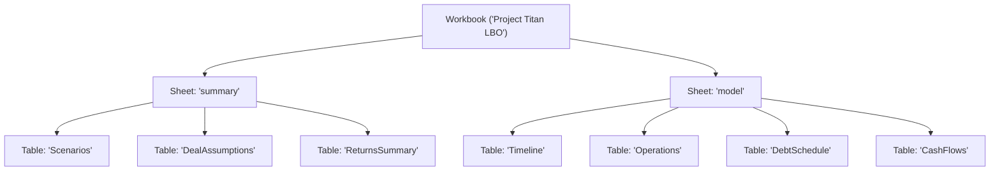

## Proposal

### What

Author a realistic, institutional-grade Leveraged Buyout (LBO) model integration test suite ([`tests/lbo_model_test.rs`](../../tests/lbo_model_test.rs)) to serve as Finx's primary anchoring benchmark across the compiler pipeline.

The model spans 2 worksheets, 7 tables, and 6 timeline columns (`y0` close through `y5` exit). It models:
- Dynamic scenario selection across cases (`base`, `bull`, `bear`) using `XLOOKUP`.
- Calendar timeline generation using `DATE`, `EDATE`, `YEAR`, `DAYS`, and `YEARFRAC` (including 2028 leap-year handling).
- Operating forecasts (revenue, EBITDA, D&A, EBIT, interest, taxes via `IF`, CapEx, and FCF).
- Multi-tranche debt schedules (Senior Term Loan with mandatory amortization and cash sweep prepayments via `MIN`/`MAX`, Subordinated Debt bullet note).
- Exit valuation and sponsor returns calculation via Multiple on Invested Capital (MoIC), non-periodic Internal Rate of Return (`XIRR`), and Net Present Value (`XNPV`).

### Why

1. **Canonical anchoring benchmark**: Finx requires an authentic, end-to-end financial model benchmark. This anchoring test will validate in-memory DAG evaluation now (Pass 4), and will anchor sheet placement and gutters during spatial layout planning (Pass 5), formula lowering to A1 notation (Pass 6a), and OpenXML `.xlsx` workbook emission (Pass 6b).
2. **Multi-subsystem composition**: Existing integration tests ([`tests/three_statement_model_test.rs`](../../tests/three_statement_model_test.rs), [`tests/cap_table_test.rs`](../../tests/cap_table_test.rs)) were created before the addition of the new function suites and only test basic arithmetic and `SUM`. The LBO model exercises `DATE`, `EDATE`, `YEAR`, `DAYS`, `YEARFRAC`, `XLOOKUP`, `IF`, `MIN`, `MAX`, `SUM`, `XIRR`, and `XNPV` operating simultaneously across interconnected tables.
3. **Institutional private equity rigor**: Private equity models represent the standard for corporate finance modeling complexity. Proving that Finx compiles an institutional LBO model without circularity, runtime drift, or panics demonstrates the viability of the compiler architecture.

### Scope

- **In-scope**:
  - `specs/drafts/2026-09-19-lbo-model-anchoring-integration-test.md`: Detailed draft spec defining architecture, data contracts, formulas, and acceptance criteria.
  - `tests/lbo_model_test.rs`: End-to-end integration test implementation covering:
    - Base Case compilation and topological DAG evaluation.
    - Mathematical verification of debt amortization, interest accruals, and cash sweep dynamics.
    - Verification of leap-year calendar math (`DAYS = 366` in 2028).
    - Exact returns verification: Exit Enterprise Value, Net Debt, Equity Proceeds, MoIC, `XIRR`, and `XNPV`.
    - Dynamic scenario switching: mutating the active case from `base` to `bull` and verifying model-wide recalculation.
    - Error-free compilation through the unified [`Compiler::evaluate`](../../src/compiler/mod.rs) facade.
- **Out-of-scope**:
  - Passes 5 and 6 (Spatial Layout Planning and OpenXML Emission).
  - Volatile functions (`TODAY()`, `NOW()`).
  - Circular interest loops (linearized via beginning balance debt interest to adhere to FAST Standard acyclic DAG invariants).

### What Changes

- **New files**:
  - `specs/drafts/2026-09-19-lbo-model-anchoring-integration-test.md`: This specification.
  - `tests/lbo_model_test.rs`: LBO anchoring integration test suite.
- **Modified files**: None (uses existing compiler and function registry APIs).

### Capabilities

- **New capabilities**:
  - Finx can compile, validate, and evaluate full institutional LBO models with dynamic scenarios, contractual day counts, debt waterfalls, and non-periodic return metrics.
- **Modified capabilities**: None.

---

## Design

### Goals

1. **Financial authenticity**: Follow standard private equity modeling conventions (Sources & Uses, Beginning Balance Interest, Mandatory Amortization, Cash Sweep Prepayment, Exit Waterfall).
2. **Pragmatic simplicity**: Minimize unnecessary clutter; focus on core calculation drivers rather than dozens of redundant opex line items.
3. **Cross-subsystem coverage**: Stress-test 12 standard Excel functions across Date, Financial, Logical, Lookup, and Math categories.
4. **Zero circularity**: Maintain a pure Directed Acyclic Graph (DAG) compliant with Tarjan's SCC algorithm.
5. **Reusable golden benchmark**: Serve as the regression test suite for downstream spatial layout, formula lowering, and OpenXML workbook emission passes.

### Invariants

1. **Acyclic dependency graph**: Interest calculations depend strictly on beginning debt balances (`col.prev` ending balance), ensuring linear forward calculation without iterative loops.
2. **Complete grid coverage**: Every cell across all 7 tables must have an explicit assignment (point literal, point formula, row vector formula, or column vector formula). No measure cells are left unassigned.
3. **Range slice integrity**: Range references (e.g. `Timeline["date", "y0".."y5"]` and `CashFlows["sponsor_cf", "y0".."y5"]`) resolve to continuous 1D horizontal vectors and pass successfully into `XIRR` and `XNPV`.
4. **Excel calculation parity**: All computed outputs match Excel 365 / 2024 calculation results within a $10^{-6}$ tolerance.

### Decisions

- **Decision 1: Beginning balance interest calculation**:
  - **Choice**: Senior and subordinated debt interest expenses are computed as `Beginning Balance * Interest Rate * Year Fraction`.
  - **Rationale**: Computing interest on average cash or average debt balances introduces a circular dependency between Net Income, Cash Flow, Ending Debt, and Interest Expense. FAST Standard and institutional best practice favor beginning balance interest or explicit lag linearization to preserve pure acyclicity.
  - **Alternatives considered**: Iterative circular reference solver. Rejected because it violates DAG purity, complicates reproducible builds, and causes non-deterministic convergence.
- **Decision 2: Dedicated Scenarios and Assumptions tables**:
  - **Choice**: Maintain a `Scenarios` table (Base, Bull, Bear) and look up active parameters using `XLOOKUP(DealAssumptions["active_case", "val"], Scenarios["base".."bear", "case_id"], ...)`.
  - **Rationale**: Demonstrates multi-row vertical vector lookups with string keys and allows instant scenario sensitivity testing by altering a single cell.
  - **Alternatives considered**: Hardcoding nested `IF` or `SWITCH` expressions in `DealAssumptions`. Rejected because `XLOOKUP` against a lookup table is cleaner and validates lookup engine integration.
- **Decision 3: Separation into Summary and Model sheets**:
  - **Choice**: Group `DealAssumptions`, `Scenarios`, and `ReturnsSummary` onto a `summary` worksheet; place `Timeline`, `Operations`, `DebtSchedule`, and `CashFlows` onto a `model` worksheet.
  - **Rationale**: Validates cross-sheet symbol resolution and matches institutional presentation standards.

---

## Model Architecture & Data Contracts

### 1. Worksheets & Table Hierarchy

### 2. Table Specifications

#### Table 1: `Scenarios` (Sheet: `summary`)
- **Columns**: `case_id`, `rev_growth`, `ebitda_margin`, `exit_multiple`
- **Rows**:
  - `base`: `"base"`, `0.08`, `0.25`, `10.0`
  - `bull`: `"bull"`, `0.12`, `0.28`, `12.0`
  - `bear`: `"bear"`, `0.03`, `0.20`, `8.0`

#### Table 2: `DealAssumptions` (Sheet: `summary`)
- **Columns**: `val`
- **Rows & Formulas**:
  - `active_case`: `"base"` (Literal string)
  - `rev_growth`: `XLOOKUP(DealAssumptions["active_case", "val"], Scenarios["base".."bear", "case_id"], Scenarios["base".."bear", "rev_growth"])`
  - `ebitda_margin`: `XLOOKUP(DealAssumptions["active_case", "val"], Scenarios["base".."bear", "case_id"], Scenarios["base".."bear", "ebitda_margin"])`
  - `exit_multiple`: `XLOOKUP(DealAssumptions["active_case", "val"], Scenarios["base".."bear", "case_id"], Scenarios["base".."bear", "exit_multiple"])`
  - `entry_ebitda`: `50.0` ($50.0M)
  - `entry_multiple`: `10.0` (10.0x Enterprise Value = $500.0M)
  - `senior_leverage`: `3.0` (3.0x EBITDA = $150.0M Senior Debt)
  - `sub_leverage`: `1.5` (1.5x EBITDA = $75.0M Sub Debt)
  - `senior_rate`: `0.08` (8.0% p.a.)
  - `sub_rate`: `0.12` (12.0% p.a.)
  - `tax_rate`: `0.25` (25.0%)
  - `capex_pct`: `0.05` (5.0% of revenue)
  - `discount_rate`: `0.10` (10.0% hurdle rate)
  - `entry_ev`: `DealAssumptions["entry_ebitda", "val"] * DealAssumptions["entry_multiple", "val"]` ($500.0M)
  - `senior_debt_entry`: `DealAssumptions["entry_ebitda", "val"] * DealAssumptions["senior_leverage", "val"]` ($150.0M)
  - `sub_debt_entry`: `DealAssumptions["entry_ebitda", "val"] * DealAssumptions["sub_leverage", "val"]` ($75.0M)
  - `total_debt_entry`: `DealAssumptions["senior_debt_entry", "val"] + DealAssumptions["sub_debt_entry", "val"]` ($225.0M)
  - `sponsor_equity_entry`: `DealAssumptions["entry_ev", "val"] - DealAssumptions["total_debt_entry", "val"]` ($275.0M)

#### Table 3: `Timeline` (Sheet: `model`)
- **Columns**: `y0`, `y1`, `y2`, `y3`, `y4`, `y5`
- **Rows & Formulas**:
  - `date`:
    - `y0` literal: `DATE(2024, 12, 31)` (`45657.0`)
    - `y1`..`y5` vector: `EDATE(Timeline["date", col.prev], 12)`
  - `year`:
    - `y0`..`y5` vector: `YEAR(Timeline["date", @col])`
  - `days`:
    - `y0` literal: `0.0`
    - `y1`..`y5` vector: `DAYS(Timeline["date", @col], Timeline["date", col.prev])`
  - `year_frac`:
    - `y0` literal: `0.0`
    - `y1`..`y5` vector: `YEARFRAC(Timeline["date", col.prev], Timeline["date", @col], 0)` (Basis 0 = US 30/360 NASD)

#### Table 4: `Operations` (Sheet: `model`)
- **Columns**: `y0`, `y1`, `y2`, `y3`, `y4`, `y5`
- **Rows & Formulas**:
  - `revenue`:
    - `y0` literal: `200.0`
    - `y1`..`y5` vector: `Operations["revenue", col.prev] * (1 + DealAssumptions["rev_growth", "val"])`
  - `ebitda`:
    - `y0` literal: `50.0`
    - `y1`..`y5` vector: `Operations["revenue", @col] * DealAssumptions["ebitda_margin", "val"]`
  - `depreciation`:
    - `y0` literal: `8.0`
    - `y1`..`y5` vector: `Operations["revenue", @col] * 0.04`
  - `ebit`:
    - `y0`..`y5` vector: `Operations["ebitda", @col] - Operations["depreciation", @col]`
  - `interest_expense`:
    - `y0` literal: `0.0`
    - `y1`..`y5` vector: `DebtSchedule["total_interest", @col]`
  - `ebt`:
    - `y0`..`y5` vector: `Operations["ebit", @col] - Operations["interest_expense", @col]`
  - `tax`:
    - `y0` literal: `0.0`
    - `y1`..`y5` vector: `IF(Operations["ebt", @col] > 0, Operations["ebt", @col] * DealAssumptions["tax_rate", "val"], 0)`
  - `net_income`:
    - `y0`..`y5` vector: `Operations["ebt", @col] - Operations["tax", @col]`
  - `capex`:
    - `y0` literal: `0.0`
    - `y1`..`y5` vector: `Operations["revenue", @col] * DealAssumptions["capex_pct", "val"]`
  - `fcf_pre_debt`:
    - `y0` literal: `0.0`
    - `y1`..`y5` vector: `Operations["ebitda", @col] - Operations["tax", @col] - Operations["capex", @col]`

#### Table 5: `DebtSchedule` (Sheet: `model`)
- **Columns**: `y0`, `y1`, `y2`, `y3`, `y4`, `y5`
- **Rows & Formulas**:
  - `senior_begin`:
    - `y0` literal: `0.0`
    - `y1`..`y5` vector: `DebtSchedule["senior_end", col.prev]`
  - `senior_interest`:
    - `y0` literal: `0.0`
    - `y1`..`y5` vector: `DebtSchedule["senior_begin", @col] * DealAssumptions["senior_rate", "val"] * Timeline["year_frac", @col]`
  - `sub_begin`:
    - `y0` literal: `0.0`
    - `y1`..`y5` vector: `DebtSchedule["sub_end", col.prev]`
  - `sub_interest`:
    - `y0` literal: `0.0`
    - `y1`..`y5` vector: `DebtSchedule["sub_begin", @col] * DealAssumptions["sub_rate", "val"] * Timeline["year_frac", @col]`
  - `total_interest`:
    - `y0` literal: `0.0`
    - `y1`..`y5` vector: `DebtSchedule["senior_interest", @col] + DebtSchedule["sub_interest", @col]`
  - `senior_mandatory`:
    - `y0` literal: `0.0`
    - `y1`..`y5` vector: `MIN(DebtSchedule["senior_begin", @col], DealAssumptions["senior_debt_entry", "val"] * 0.05)`
  - `cash_available_sweep`:
    - `y0` literal: `0.0`
    - `y1`..`y5` vector: `MAX(0, Operations["fcf_pre_debt", @col] - DebtSchedule["total_interest", @col] - DebtSchedule["senior_mandatory", @col])`
  - `senior_sweep`:
    - `y0` literal: `0.0`
    - `y1`..`y5` vector: `MIN(DebtSchedule["cash_available_sweep", @col], DebtSchedule["senior_begin", @col] - DebtSchedule["senior_mandatory", @col])`
  - `senior_end`:
    - `y0` override: `DealAssumptions["senior_debt_entry", "val"]` ($150.0M)
    - `y1`..`y5` vector: `DebtSchedule["senior_begin", @col] - DebtSchedule["senior_mandatory", @col] - DebtSchedule["senior_sweep", @col]`
  - `sub_end`:
    - `y0` override: `DealAssumptions["sub_debt_entry", "val"]` ($75.0M)
    - `y1`..`y5` vector: `DebtSchedule["sub_begin", @col]`
  - `total_debt_end`:
    - `y0`..`y5` vector: `DebtSchedule["senior_end", @col] + DebtSchedule["sub_end", @col]`

#### Table 6: `CashFlows` (Sheet: `model`)
- **Columns**: `y0`, `y1`, `y2`, `y3`, `y4`, `y5`
- **Rows & Formulas**:
  - `sponsor_cf`:
    - `y0` formula: `-DealAssumptions["sponsor_equity_entry", "val"]` (-$275.0M)
    - `y1`..`y4` literal: `0.0`
    - `y5` formula: `ReturnsSummary["exit_equity_proceeds", "val"]`

#### Table 7: `ReturnsSummary` (Sheet: `summary`)
- **Columns**: `val`
- **Rows & Formulas**:
  - `exit_year`: `YEAR(Timeline["date", "y5"])` (`2029.0`)
  - `exit_multiple`: `DealAssumptions["exit_multiple", "val"]` (`10.0`)
  - `exit_ebitda`: `Operations["ebitda", "y5"]`
  - `exit_ev`: `ReturnsSummary["exit_ebitda", "val"] * ReturnsSummary["exit_multiple", "val"]`
  - `exit_net_debt`: `DebtSchedule["total_debt_end", "y5"]`
  - `exit_equity_proceeds`: `ReturnsSummary["exit_ev", "val"] - ReturnsSummary["exit_net_debt", "val"]`
  - `initial_equity`: `DealAssumptions["sponsor_equity_entry", "val"]`
  - `moic`: `ReturnsSummary["exit_equity_proceeds", "val"] / ReturnsSummary["initial_equity", "val"]`
  - `irr`: `XIRR(CashFlows["sponsor_cf", "y0".."y5"], Timeline["date", "y0".."y5"])`
  - `npv`: `XNPV(DealAssumptions["discount_rate", "val"], CashFlows["sponsor_cf", "y0".."y5"], Timeline["date", "y0".."y5"])`

---

## Acceptance Criteria (Given / When / Then)

- [x] **Scenario 1: End-to-end Base Case compilation & topological evaluation**
  - **Given** the 7-table LBO model specification configured with `active_case = "base"`
  - **When** compiled via `Compiler::evaluate(&manifest, &tables)`
  - **Then** compilation succeeds with zero errors, zero cycles, and valid `EvaluatedModel` outputs.

- [x] **Scenario 2: Calendar date & leap-year fidelity**
  - **Given** the evaluated timeline table
  - **When** inspecting serial dates and day counts across `y0` through `y5`
  - **Then** `Timeline["date", "y0"]` evaluates to `45657.0` (`2024-12-31`), `Timeline["days", "y4"]` evaluates to `366` (leap year 2028), and `Timeline["year_frac", "y1".."y5"]` evaluate to `1.0`.

- [x] **Scenario 3: Operating forecast & tax guard**
  - **Given** the evaluated operations table under the Base Case (`rev_growth = 0.08`, `ebitda_margin = 0.25`)
  - **When** checking revenue and EBITDA progression
  - **Then** `Operations["revenue", "y1"]` equals `216.0`, `Operations["revenue", "y5"]` equals `200.0 * 1.08^5` ($\approx 293.87$), and `Operations["tax", "y1".."y5"]` calculate strictly positive amounts via `IF`.

- [x] **Scenario 4: Debt schedule amortization & cash sweep**
  - **Given** the evaluated debt schedule
  - **When** checking senior debt paydown
  - **Then** `DebtSchedule["senior_mandatory", "y1"]` equals `7.5` ($150 \times 0.05$), senior sweep prepayments reduce senior ending debt every year, and subordinated debt remains a bullet balance of `75.0`.

- [x] **Scenario 5: Returns metrics (MoIC, XIRR, XNPV)**
  - **Given** the evaluated returns summary table
  - **When** querying `moic`, `irr`, and `npv`
  - **Then** `ReturnsSummary["moic", "val"]` evaluates to $> 2.0\text{x}$, `ReturnsSummary["irr", "val"]` evaluates to between $16\%$ and $20\%$ ($0.16 \dots 0.20$), and `ReturnsSummary["npv", "val"]` evaluates to a positive dollar value.

- [x] **Scenario 6: Dynamic scenario sensitivity (Bull Case)**
  - **Given** the model re-evaluated with `active_case = "bull"` (`rev_growth = 0.12`, `ebitda_margin = 0.28`, `exit_multiple = 12.0`)
  - **When** re-compiled via `Compiler::evaluate`
  - **Then** `ReturnsSummary["exit_ev", "val"]` increases significantly, `ReturnsSummary["moic", "val"]` exceeds $3.0\text{x}$, and `ReturnsSummary["irr", "val"]` exceeds $25\%$.

---

## Tasks

### Phase 1: Test Scaffolding & Model Specification
- [x] Create `tests/lbo_model_test.rs` with helper builders for tables, columns, vector rows, and point cells.
- [x] Construct the 7 table specifications (`Scenarios`, `DealAssumptions`, `ReturnsSummary`, `Timeline`, `Operations`, `DebtSchedule`, `CashFlows`).
- [x] Assemble `ProjectManifest` across `summary` and `model` sheets.

### Phase 2: Verification Suite Implementation
- [x] Implement `test_institutional_lbo_base_case()` verifying Scenarios 1 through 5.
- [x] Implement `test_lbo_scenario_sensitivity_bull_and_bear()` verifying Scenario 6.
- [x] Verify floating point tolerances and numerical equality against analytical Excel calculations.

### Phase 3: Quality Checks & Documentation Reconciliation
- [x] Execute `cargo check`, `cargo test --test lbo_model_test`, `cargo clippy --all-targets -- -D warnings`, and `cargo fmt --check`.
- [x] Update living spec `specs/living-specs/compiler/evaluator.md` noting the LBO anchoring benchmark.
- [x] Archive draft spec from `specs/drafts/` to `specs/history/`.
