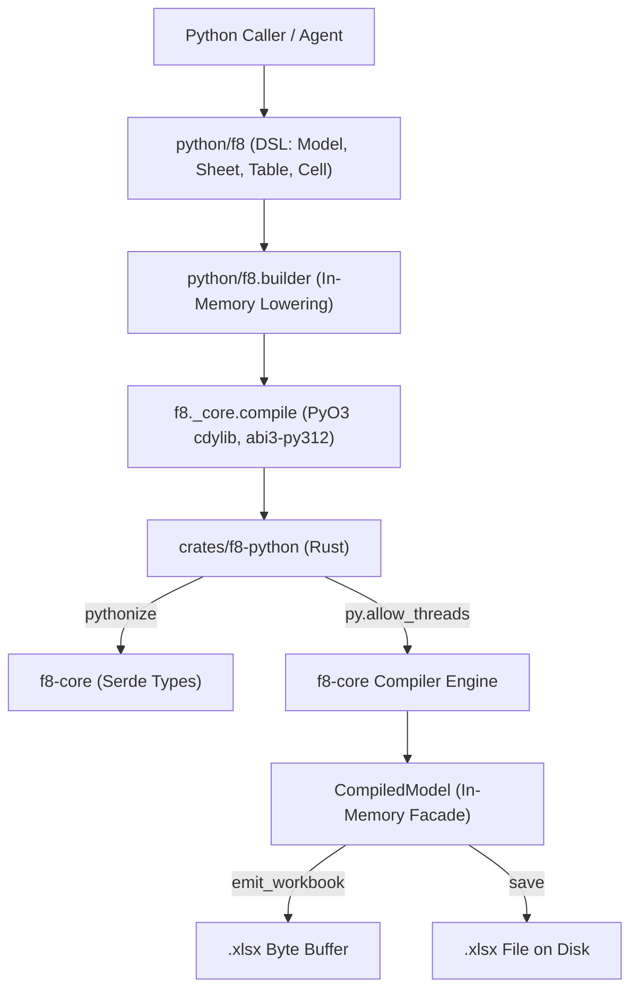

## Purpose

The Python SDK provides both a fluent, strongly typed modeling DSL (`f8.Model`, `Sheet`, `Table`, `Cell`) and a high-performance in-process native extension (`crates/f8-python` / `f8._core`). It enables quantitative modelers and autonomous AI agents to author financial models programmatically, compile them in memory, inspect calculation graphs, emit or persist production OpenXML `.xlsx` workbooks, and diagnose modeling errors via structured Python exceptions.

## Architecture & Boundaries

- **`python/f8/builder.py`**: Pure Python authoring DSL providing `Model`, `Sheet`, `Table`, and `Cell` builders with in-memory specification synthesis (`to_spec()`), direct compilation (`compile()`), and multi-file project export (`export_project()`).
- **`python/f8/loader.py`**: Pure Python on-disk project loader and direct compiler (`compile_project()`) discovering and assembling `f8.json` and `tables/*.json` without invoking CLI subprocesses.
- **`python/f8/audit.py`**: Pure Python high-level table auditing and tabular data export wrapper (`TableAuditor`) providing unboxed scalar conversion, `.to_dict()` across 4 orientations, and aligned 2D Markdown rendering.
- **`python/f8/types.py`**: Strict PEP 561 / `pyright` type contracts, `Literal` choices, and `TypedDict` schemas covering both compiler inspection models and authoring specifications.
- **`crates/f8-python`**: PyO3 C-ABI native extension crate compiled as `cdylib` targeting Python stable ABI `abi3-py312`.
- **Marshaling layer**: Uses `pythonize` for microsecond conversion of Python dictionaries directly into `f8-core` Serde types (`ProjectManifest`, `TableSpec`, `Theme`).
- **Concurrency**: Explicitly releases the Python GIL (`py.allow_threads`) during CPU-bound compilation, OpenXML workbook synthesis, and filesystem disk writes.

## Requirements & Invariants

### 1. Fluent Authoring DSL

The modeling DSL provides hierarchical, in-memory model construction with strict PEP 561 typing and autocomplete.

- **Model and sheet containers**:
  - `Model(name="Model", theme="corporate_navy")`: Root container holding ordered worksheets.
  - `model.add_sheet(name, tab_color=None, show_gridlines=True, freeze_panes=None)`: Adds and returns a `Sheet`. Duplicate sheet names raise `ValueError`.
  - `model.get_sheet(name)`: Resolves a worksheet by name, raising `KeyError` if absent.
  - `model.get_table(id)`: Searches all worksheets and resolves a table by unique identifier, raising `KeyError` if absent.
  - `sheet.add_table(id, title, ...)`: Adds a `Table` to the worksheet. Enforces globally unique table IDs across the entire model, raising `ValueError` on duplicates.
  - `sheet.get_table(id)`: Resolves a table within the worksheet, raising `KeyError` if absent.
- **Freeze panes convention**:
  - `freeze_panes: tuple[int, int]` defines explicit `(row, col)` 0-indexed split coordinates (number of top frozen rows, number of left frozen columns). Negative values raise `ValueError`.
- **Table grid structure**:
  - `table.add_column(id, role="measure", header=None, headers=None, ...)`: Declares a data column. `header` and `headers` are mutually exclusive; specifying both raises `ValueError`.
  - Symmetrical gutters: Visual grid spacing is declared via `table.add_column_gutter()` on columns and `table.add_row_gutter()` on rows. Redundant aliases are rejected.
  - `table.add_section_header(title, indent=None, note=None)`: Adds full-width non-calculable visual section dividing rows.
  - `table.add_row(id, cells=None, expr=None, ...)`: Declares a calculable data row with vector formula or literal cells. Duplicate row IDs raise `ValueError`.
- **Strict 0D cell indentation & overrides**:
  - Indentation is modeled at the cell level via `Cell(value, indent=N)` or dictionary overrides (`{"value": value, "indent": N}`), eliminating temporal row-level coupling or phantom row descriptor heuristics.
  - `table.set_cell(row, col, cell=None, value=..., expr=..., ...)`: Overrides or updates specific point coordinates. Raises `KeyError` if `row` is not declared, and raises `ValueError` if a new cell lacks both `value` and `expr` or specifies both.
  - `Cell`: Frozen dataclass utilizing an internal sentinel to distinguish explicit nulls (`value=None`) from omitted values.
- **Currency casing normalization**:
  - `CurrencyCode` accepts all 15 supported currencies in ISO uppercase or lowercase. Builders normalize codes to lowercase (`'usd'`, `'eur'`, etc.) during `to_spec()` synthesis.
- **Multi-file project export**:
  - `model.export_project(dir_path, overwrite=False, indent=2)`: Serializes in-memory model to `<dir_path>/f8.json` and `<dir_path>/tables/<table_id>.json`. Validates specs via `to_spec()` before I/O, creates directories automatically, and enforces fail-fast overwrite safety (`FileExistsError`) if files exist without `overwrite=True`.

#### Scenarios

- **Model compilation**:
  - **When** calling `model.compile()`.
  - **Then** synthesizes `ProjectManifestDict` and `list[TableSpecDict]` via `to_spec()` and returns a `CompiledModel`.
- **Multi-file project export**:
  - **When** calling `model.export_project(dir_path)`.
  - **Then** creates `<dir_path>/f8.json` and `<dir_path>/tables/<table_id>.json` formatted with 2-space indentation and UTF-8 encoding.
- **Point cell overrides**:
  - **When** calling `table.set_cell("rev", "2024E", expr="PREV * 1.10")` or updating an existing cell's presentation attributes with `table.set_cell("rev", "2023A", note="Audited")`.
  - **Then** updates target cell payload or metadata while preserving unchanged fields.

### 2. In-Memory Compilation & On-Disk Ingestion

The SDK supports both pure in-memory compilation via PyO3 native entrypoints and direct on-disk project compilation without CLI subprocesses.

- **Theme resolution order**:
  1. `theme is None`: Resolves theme declared in `manifest.theme` via `ProjectManifest::resolve_theme` (defaults to built-in `corporate_navy`). Checks for local theme file on disk before resolving built-in catalog.
  2. `isinstance(theme, str)`: If matching an existing file path on disk, loads the JSON theme; otherwise resolves built-in theme catalog by name via `Theme::resolve_builtin`.
  3. `isinstance(theme, dict)`: Deserializes explicit custom theme specification via `pythonize`.
- **Zero core filesystem I/O**: `f8-core` remains purely in-memory. All project disk I/O is managed cleanly in Python `f8.loader` using `pathlib.Path`.
- **Direct on-disk compilation**:
  - `f8.compile_project(dir_path, theme=None) -> CompiledModel`: Discovers `<dir_path>/f8.json` (or accepts direct `f8.json` path) and contained `<dir_path>/tables/*.json` files.
  - Validates uniqueness of table IDs, raising `ValueError` on duplicates.
  - Raises `FileNotFoundError` if destination path or `f8.json` does not exist.
  - Round-trip fidelity guarantee: Models compiled directly in memory produce identical cell values, formulas, coordinates, and summaries as models exported to disk and recompiled via `compile_project`.

#### Scenarios

- **Compilation success**:
  - **When** valid manifest and table specifications are passed to `f8.compile(manifest, tables)`.
  - **Then** returns a `CompiledModel` instance wrapping evaluated cell values, dependency graph, and spatial layout.
- **Direct on-disk project compilation**:
  - **When** calling `f8.compile_project(dir_path)`.
  - **Then** loads manifest and table specifications from disk, assembling them and compiling directly into a `CompiledModel`.

### 3. Workbook Binary Emission & Disk Persistence

`CompiledModel` provides workbook synthesis directly in memory or saved to disk outside the Python GIL.

- **Emission options**:
  - Supports dictionary with optional keys: `values_only` (bool), `omit_formula_cache` (bool), `title` (str), `author` (str).
  - Defaults to preserving live formulas and evaluated cache values `<v>`.
- **In-memory byte emission**:
  - `compiled.emit_workbook(options=None) -> bytes`: Synthesizes OpenXML byte buffers starting with `PK\x03\x04`.
- **Direct disk persistence**:
  - `compiled.save(path, options=None) -> None`: Accepts `str` or `os.PathLike`/`pathlib.Path`, creates parent directories recursively, and writes `.xlsx` workbook bytes directly outside the Python GIL.

#### Scenarios

- **Live formula emission**:
  - **When** calling `compiled.emit_workbook()`.
  - **Then** returns bytes starting with `PK\x03\x04` containing live Excel formulas and cached evaluation results.
- **Values-only freezing**:
  - **When** calling `compiled.emit_workbook({"values_only": True})`.
  - **Then** returns bytes emitting calculated values without live formulas.
- **Direct workbook persistence**:
  - **When** calling `compiled.save("nested/dir/model.xlsx")`.
  - **Then** creates `nested/dir` if missing and writes valid OpenXML `.xlsx` bytes.

### 4. Model & Dependency Inspection

The compiled model exposes read-only inspection methods returning native Python dictionaries:
- `summary()`: Model metadata, sheets, tables, cell counts, drivers, and formula totals.
- `inspect_cell(target, row=None, col=None)`: Physical address, evaluated value, formula, and immediate neighbor dependencies.
- `inspect_table(table)`: 2D table grid metadata, columns, rows, and cell records.
- `inspect_sheet(sheet)`: Physical worksheet 2D dimensions, column widths, and cell grid.
- `precedents_of(target, row=None, col=None, recursive=False)`: Upstream calculation dependency tree.
- `dependents_of(target, row=None, col=None, recursive=False)`: Downstream blast-radius impact tree.

- **Flexible coordinate arguments**: Coordinate methods accept either 3 positional tokens (`table, row, col`) or a single canonical IR string (`TABLE["row", "col"]`).

#### Scenarios

- **Flexible coordinate parity**:
  - **When** querying `inspect_cell("OPERATIONS", "gross_profit", "2024E")` and `inspect_cell('OPERATIONS["gross_profit", "2024E"]')`.
  - **Then** both queries resolve identically via `CompiledModel::parse_coordinate`.

### 5. Table Auditing, Coordinate Inspection & Tabular Data Export

`TableAuditor` wraps `TableInspection` in pure Python, providing high-level cell lookups, scalar unboxing, zero-dependency tabular exports, and aligned 2D Markdown rendering:

- **Table accessor**:
  - `compiled.table(table_id: str) -> TableAuditor`: Resolves table inspection. Raises `InspectionError` if `table_id` does not exist in the model.
- **Table dimensions & metadata**:
  - `table.id`: Table identifier.
  - `table.title`: Table display title.
  - `table.subtitle`: Optional table subtitle or units label (`str | None`).
  - `table.sheet`: Parent worksheet name.
  - `table.columns`: Ordered list of non-gutter column IDs (`list[str]`).
  - `table.rows`: Ordered list of non-gutter, non-section calculable data row IDs (`list[str]`).
  - `table.shape`: `(len(rows), len(columns))` dimension tuple.
  - `len(table)`: Number of calculable data rows.
- **Unboxed scalar cell lookups**:
  - `table.value(row, col)` / `table[row, col]`: Returns unboxed scalar values (`float`, `str`, `bool`, or `None`). Unknown coordinates raise `KeyError`. Indexing requires a 2-tuple `(row, col)` of strings, raising `TypeError` otherwise.
  - `table.formula(row, col)`: Returns lowered Excel formula string (e.g. `"=C5*1.15"`), or `None` if driver/literal input.
  - `table.expr(row, col)`: Returns high-level f8 expression string, or `None` if driver/literal input.
  - `table.address(row, col)`: Returns physical sheet A1 cell coordinate (e.g. `"C18"`).
  - `table.cell(row, col)`: Returns raw `TableCellInfo` dictionary.
- **Scalar unboxing engine (`unbox_cell_value`)**:
  - Converts Serde-tagged enum variants (`Number` -> `float`, `Text` -> `str`, `Boolean` -> `bool`, bare string `"Empty"` or tagged `Empty` -> `None`).
  - Maps evaluated error variants to canonical Excel literals: `"Div0"` -> `"#DIV/0!"`, `"Value"` -> `"#VALUE!"`, `"Ref"` -> `"#REF!"`, `"Num"` -> `"#NUM!"`, `"Na"` -> `"#N/A"`, `"Name"` -> `"#NAME?"`.
- **Tabular data export (`to_dict`)**:
  - `table.to_dict(orient="records" | "dict" | "index" | "split" = "records")`:
    - `records`: `list[dict[str, CellScalarValue]]`
    - `dict`: `dict[str, list[CellScalarValue]]`
    - `index`: `dict[str, dict[str, CellScalarValue]]`
    - `split`: `SplitDict` (`columns`, `index`, `data`)
  - Strict rectangular guarantee: all non-gutter data rows contain 100% of non-gutter columns. Unassigned or empty cells map to `None`.
  - Gutter columns, gutter rows, and section header rows are omitted from tabular data exports.
- **Aligned 2D Markdown rendering (`to_markdown`)**:
  - `table.to_markdown(view="values" | "formulas" | "expr" | "addresses" = "values") -> str`:
    - Produces aligned GitHub-Flavored Markdown tables with space-padded columns matching maximum content width.
    - Stacks multi-tier column headers, formatting bottom headers as `{header} [{id}]` when header text differs from column ID.
    - Section header rows render as full-width bold divider rows (`| **{title}** | | ... |`).
    - Descriptor column cells preserve declared indentation (`"  " * indent`) and label `{label} [{id}]` formatting across all view modes.
    - `view="values"` renders pre-formatted accounting typography (`formatted_value`).
    - `view="formulas"` displays lowered Excel formulas for calculated cells and formatted values for inputs.

#### Scenarios

- **Table auditing & unboxing**:
  - **When** calling `compiled.table("Performance").value("revenue", "2024E")`.
  - **Then** returns primitive `float` (`115.0`) unboxed from Serde dictionary.
- **Tabular export rectangularity**:
  - **When** calling `table.to_dict("records")`.
  - **Then** returns list of row dictionaries containing 100% of `table.columns` keys, mapping unassigned cells to `None`.
- **Markdown visual inspection**:
  - **When** calling `table.to_markdown()`.
  - **Then** returns aligned Markdown text with stacked headers, section dividers, and accounting numbers.

### 6. Structured Exception Hierarchy

All engine errors map to typed Python exception classes inheriting from `f8.F8Error(Exception)`:

| Exception Class | Parent | Diagnostic Attributes | Description |
| :--- | :--- | :--- | :--- |
| `F8Error` | `Exception` | `message: str` | Base exception for all f8 errors |
| `CycleDetectedError` | `F8Error` | `cycle: list[str]`, `message: str` | Circular formula calculation dependency |
| `ReferenceResolutionError` | `F8Error` | `coordinate: str`, `target_table: str | None`, `row: str | None`, `col: str | None`, `message: str` | Unresolved table, row, or column reference |
| `SpecificationError` | `F8Error` | `table: str | None`, `reason: str`, `message: str` | Specification validation or deserialization failure |
| `FormulaParseError` | `F8Error` | `table: str`, `row: str | None`, `col: str | None`, `token_offset: int | None`, `message: str` | Syntax error in formula expression |
| `InspectionError` | `F8Error` | `entity: str`, `message: str` | Queried table, cell, or worksheet not found |
| `EmissionError` | `F8Error` | `message: str` | OpenXML binary emission failure |

- **String representation**: Base exception message is populated so `str(err)` and Python tracebacks display the full formatted compiler diagnostic.

### 7. Specification Typed Contracts

Authoring models, inspection auditors, and PyO3 native entrypoints exchange strictly typed dictionary structures defined in `f8.types`:

| Contract | Type | Description |
| :--- | :--- | :--- |
| `AxisRole` | `Literal["measure", "descriptor"]` | Column calculation axis role |
| `FormatPreset` | `Literal[...]` | 8 supported numerical format presets |
| `SemanticStyle` | `Literal["data", "subtotal", "total"]` | Visual presentation typography tiers |
| `CurrencyCode` | `Literal[...]` | 15 ISO currency codes (upper/lowercase) |
| `CellValueLiteral` | `float \| int \| str \| bool \| None` | Primitive cell literal value |
| `CellScalarValue` | `float \| int \| str \| bool \| None` | Unboxed primitive cell scalar value |
| `TableOrient` | `Literal["records", "dict", "index", "split"]` | Tabular data export orientation |
| `TableViewMode` | `Literal["values", "formulas", "expr", "addresses"]` | 2D table grid inspection view mode |
| `SplitDict` | `TypedDict` | Tabular dataset split into columns, index, and data |
| `DetailedCellDict` | `TypedDict` | 0D cell override specification dictionary |
| `CellInputValue` | `CellValueLiteral \| Cell \| DetailedCellDict` | Union of acceptable cell inputs |
| `ColumnSpecDict` | `DataColumnSpecDict \| GutterColumnSpecDict` | Column definition specification |
| `RowSpecDict` | `DataRowSpecDict \| SectionHeaderRowSpecDict \| GutterRowSpecDict` | Row definition specification |
| `TableSpecDict` | `TypedDict` | Table definition specification |
| `SheetSpecDict` | `TypedDict` | Worksheet definition specification |
| `ProjectManifestDict` | `TypedDict` | Root project manifest specification |
