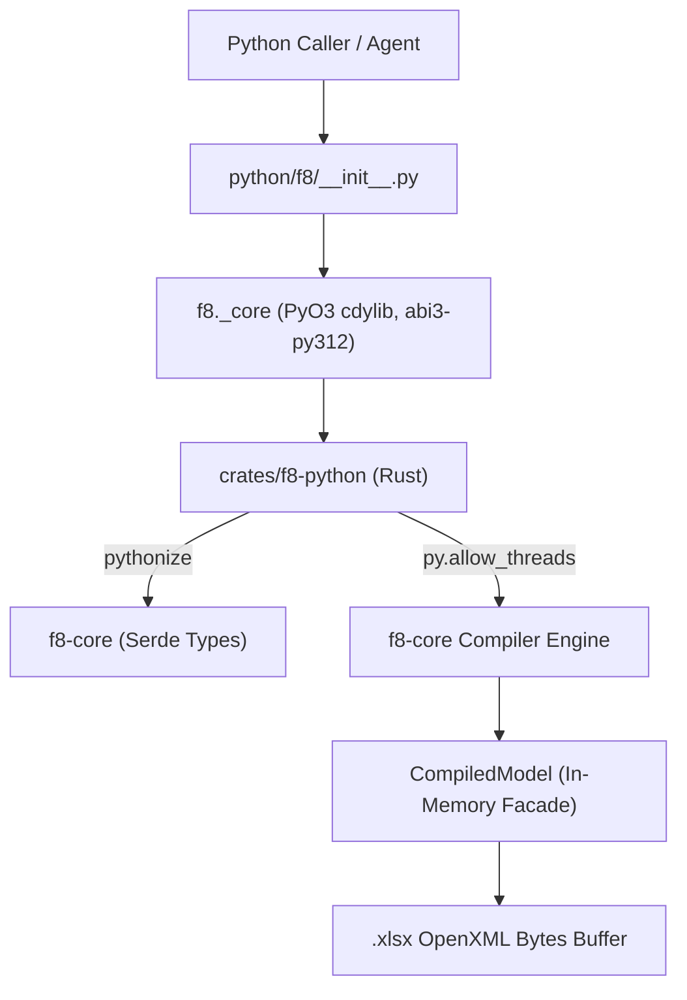

## Purpose

The Python SDK native extension (`crates/f8-python` / `f8._core`) provides an in-process, zero-I/O C-ABI bridge between Python applications and the `f8-core` financial modeling engine. It enables quantitative modelers and autonomous AI agents to compile models in-memory, inspect cell grids and calculation dependency graphs, emit OpenXML workbooks, and programmatically diagnose modeling errors through strongly typed Python exceptions without CLI subprocess overhead.

## Architecture & Boundaries

- **`crates/f8-python`**: PyO3 C-ABI native extension crate compiled as `cdylib` targeting Python stable ABI `abi3-py312`.
- **`python/f8`**: Python package root distributing type stubs ([`_core.pyi`](../../../python/f8/_core.pyi)), PEP 561 marker ([`py.typed`](../../../python/f8/py.typed)), and package re-exports ([`__init__.py`](../../../python/f8/__init__.py)).
- **Marshaling layer**: Uses `pythonize` for microsecond conversion of lightweight Python dictionaries directly into `f8-core` Serde types (`ProjectManifest`, `TableSpec`, `Theme`).
- **Concurrency**: Explicitly releases Python GIL (`py.allow_threads`) during CPU-bound compilation and OpenXML workbook emission.

## Requirements & Invariants

### 1. In-Memory Compilation & Theme Resolution

The native entrypoint `f8._core.compile(manifest, tables, theme=None)` compiles high-level model definitions into an in-memory `CompiledModel`.

- **Theme resolution order**:
  1. `theme is None`: Resolves theme declared in `manifest.theme` via `ProjectManifest::resolve_theme` (defaults to built-in `corporate_navy`).
  2. `isinstance(theme, str)`: Resolves built-in theme catalog by name via `Theme::resolve_builtin`.
  3. `isinstance(theme, dict)`: Deserializes explicit custom theme specification via `pythonize`.
- **Zero filesystem I/O**: Operates purely on in-memory data structures without reading or writing disk files.

#### Scenarios

- **Compilation success**:
  - **When** valid manifest and table specifications are passed to `f8.compile(manifest, tables)`.
  - **Then** returns a `CompiledModel` instance wrapping evaluated cell values, dependency graph, and spatial layout.

### 2. Workbook Binary Emission

`CompiledModel.emit_workbook(options=None)` synthesizes OpenXML `.xlsx` byte buffers directly in memory.

- **Emission options**:
  - Supports dictionary with optional keys: `values_only` (bool), `omit_formula_cache` (bool), `title` (str), `author` (str).
  - Defaults to preserving live formulas and evaluated cache values `<v>`.
- **GIL release**: Compilation and emission run outside the Python GIL, allowing multi-threaded concurrency.

#### Scenarios

- **Live formula emission**:
  - **When** calling `compiled.emit_workbook()`.
  - **Then** returns bytes starting with `PK\x03\x04` containing live Excel formulas and cached evaluation results.
- **Values-only freezing**:
  - **When** calling `compiled.emit_workbook({"values_only": True})`.
  - **Then** returns bytes emitting calculated values without live formulas.

### 3. Model & Dependency Inspection

The compiled model exposes read-only inspection methods returning native Python dictionaries:
- `summary()`: Model metadata, sheets, tables, cell counts, drivers, and formula totals.
- `inspect_cell(target, row=None, col=None)`: Physical address, evaluated value, formula, and immediate neighbor dependencies.
- `inspect_table(table)`: 2D table grid metadata, columns, rows, and cell records.
- `inspect_sheet(sheet)`: Physical worksheet 2D dimensions, column widths, and cell grid.
- `precedents_of(target, row=None, col=None, recursive=False)`: Upstream calculation dependency tree.
- `dependents_of(target, row=None, col=None, recursive=False)`: Downstream blast-radius impact tree.

- **Flexible coordinate arguments**: Coordinate methods accept either 3 positional tokens (`table, row, col`) or a single canonical IR string (`TABLE["row", "col"]`).

#### Scenarios

- **Flexible coordinate parity**:
  - **When** querying `inspect_cell("OPERATIONS", "gross_profit", "2024E")` and `inspect_cell('OPERATIONS["gross_profit", "2024E"]')`.
  - **Then** both queries resolve identically via `CompiledModel::parse_coordinate`.

### 4. Structured Exception Hierarchy

All engine errors map to typed Python exception classes inheriting from `f8.F8Error(Exception)`:

| Exception Class | Parent | Diagnostic Attributes | Description |
| :--- | :--- | :--- | :--- |
| `F8Error` | `Exception` | `message: str` | Base exception for all f8 errors |
| `CycleDetectedError` | `F8Error` | `cycle: list[str]`, `message: str` | Circular formula calculation dependency |
| `ReferenceResolutionError` | `F8Error` | `coordinate: str`, `target_table: str | None`, `row: str | None`, `col: str | None`, `message: str` | Unresolved table, row, or column reference |
| `SpecificationError` | `F8Error` | `table: str | None`, `reason: str`, `message: str` | Specification validation or deserialization failure |
| `FormulaParseError` | `F8Error` | `table: str`, `row: str | None`, `col: str | None`, `token_offset: int | None`, `message: str` | Syntax error in formula expression |
| `InspectionError` | `F8Error` | `entity: str`, `message: str` | Queried table, cell, or worksheet not found |
| `EmissionError` | `F8Error` | `message: str` | OpenXML binary emission failure |

- **String representation**: Base exception message is populated so `str(err)` and Python tracebacks display the full formatted compiler diagnostic.
