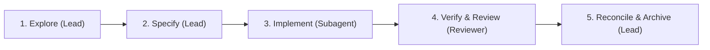

# Spec-Driven Development Guidelines

Spec-driven development (SDD) decouples ephemeral task execution from durable domain knowledge.

## Core philosophy

- **Dual-spec architecture**:
  - **Living specs** (`specs/living-specs/<domain>/`): Permanent single source of truth for runtime behavior, compiler invariants, and capabilities.
  - **Draft specs** (`specs/drafts/`): Ephemeral execution plans defining proposals, technical trade-offs, acceptance criteria, and task checklists.
- **Autonomous increments**: One draft spec represents one independently verifiable increment. Decompose multi-phase initiatives or multi-pass compiler changes into sequential draft specs.
- **Tri-agent division of labor**: Clear separation between orchestration, implementation, and adversarial review.
- **Truth custody**: Permanent living specs and spec archives are exclusively owned and reconciled by the Lead Orchestrator. Implementer and Reviewer subagents never edit living specs directly.
- **Verification as proof**: Acceptance criteria map 1:1 to executable tests, compiler checks, and static analysis.
- **Zero silent workarounds**: Toolchain or compiler friction must be surfaced and resolved at root cause, never patched around silently.

## Workflow

### 1. Explore & discover (Lead Orchestrator)

- **Inspect reality**: Ground designs in existing modules, AST/IR models, and living specs under `specs/living-specs/<domain>/`. Ban unverified assumptions.
- **Evaluate trade-offs**: Surface 2–3 candidate implementation tiers (e.g. AST vs IR vs Lowering vs Python DSL) with explicit pros/cons and complexity analysis before choosing an approach.
- **Decompose milestones**: Split multi-pass compiler changes or cross-crate features into sequential, self-contained draft specs.
- **Align intent**: Align design, invariants, and scope with the user before committing to implementation.

### 2. Specify & design (Lead Orchestrator)

- **Instantiate template**: Create `specs/drafts/YYYY-MM-DD-<feature-name>.md` from `specs/templates/draft-spec.md`.
- **Target destination**: Set `target-living-spec` frontmatter pointing to corresponding `specs/living-specs/<domain>/` file(s).
- **Compact contracts**: Define data structures, AST enums, trait signatures, and error types via markdown tables or type signatures. Ban speculative code dumps.
- **Durable references**: Cite source paths and modules via backtick code spans (e.g. `crates/f8-core/src/compiler/mod.rs`). Reserve relative links exclusively for living specs and stable docs.
- **Invariants & non-goals**: Explicitly define compiler invariants preserved and design non-goals.
- **Acceptance criteria**: Enforce testable behavior using `Given / When / Then` scenarios covering both nominal and error/boundary cases.
- **Actionable checklist**: Break work into ordered, independently testable tasks.

### 3. Implement (Implementer Subagent)

- **Subagent dispatch**: Lead Orchestrator dispatches an isolated Implementer Subagent via `invoke_subagent` (`TypeName: 'self'`, `Workspace: inherit`) using `.agents/prompts/prompt-implementer.md`.
- **Contract adherence**: Build strictly to draft spec contracts. Zero scope creep or unrequested features.
- **Progressive checklist tracking**: Update task checklist in draft spec (`specs/drafts/*.md`) progressively (`[ ]` to `[x]`).
- **Verification gate adherence**: Implementer must verify a 100% clean pass across the full verification suite defined in `AGENTS.md` (Rust suite always; Python suite when touching `crates/f8-python` or `python/`).
- **Completion receipt**: Implementer returns a structured **Implementation Receipt** (checklist progress, modified files, verification gate pass, diff summary) upon completion.

### 4. Verify & Review (Reviewer Subagent)

- **Reviewer dispatch**: Lead Orchestrator dispatches an adversarial Reviewer Subagent in a fresh context via `invoke_subagent` (`TypeName: 'self'`, `Workspace: inherit`) using `.agents/prompts/prompt-reviewer.md`.
- **Report-only invariant**: Reviewer executes `review-implementation` skill in report-only mode. Zero edits to tracked files, living specs, draft specs, or git state.
- **Adversarial probing**: Run edge-case probes in isolated scratchpad outside working tree (zero/empty matrices, topological cycles, type boundaries).
- **Checklist audit**: Verify changes against `.agents/skills/review-implementation/references/checklist.md`.
- **Verdict triage**:
  - `Changes required`: Any `Blocker` or `Major` finding. Lead Orchestrator re-dispatches Implementer Subagent with findings table and coordinates. Loop repeats until clean.
  - `Approve with flags`: Blocker- and Major-free; one or more architectural `Flag` items surfaced for user alignment.
  - `Approve`: Clean review. Proceed to Reconcile & Archive.

### 5. Reconcile & archive (Lead Orchestrator)

- **Update living specs**: Lead Orchestrator reconciles permanent system behavior and compiler invariants in `specs/living-specs/<domain>/`.
- **Archive draft**: Update draft spec `status: completed` and move file from `specs/drafts/` to `specs/history/`.
